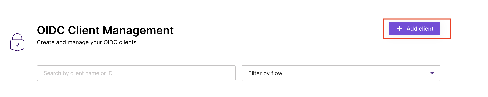
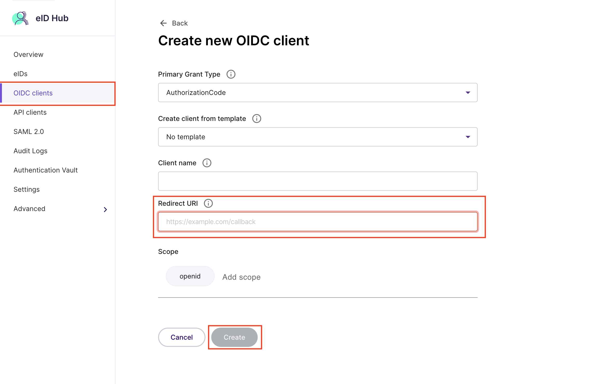
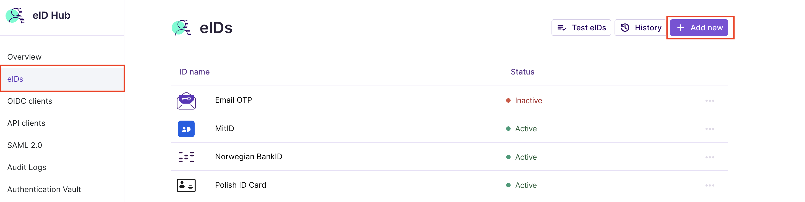
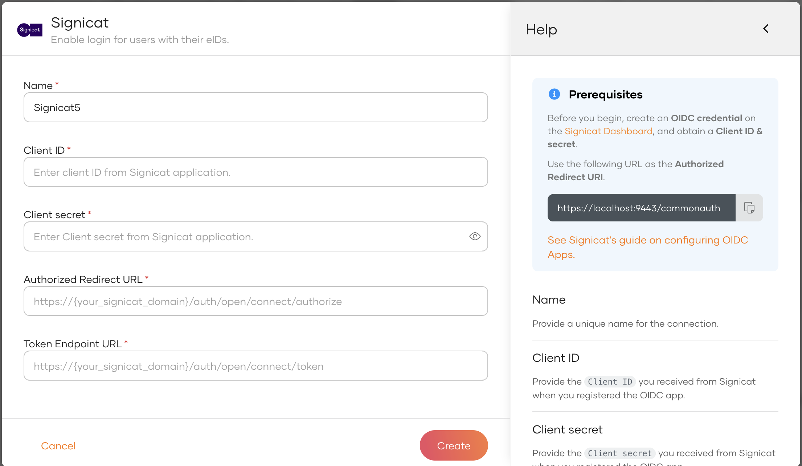
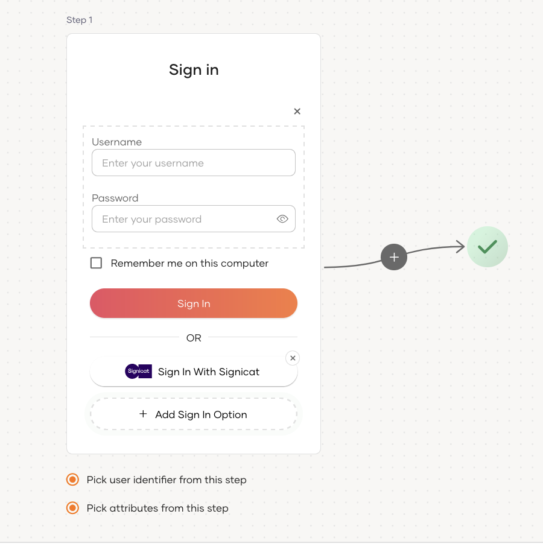
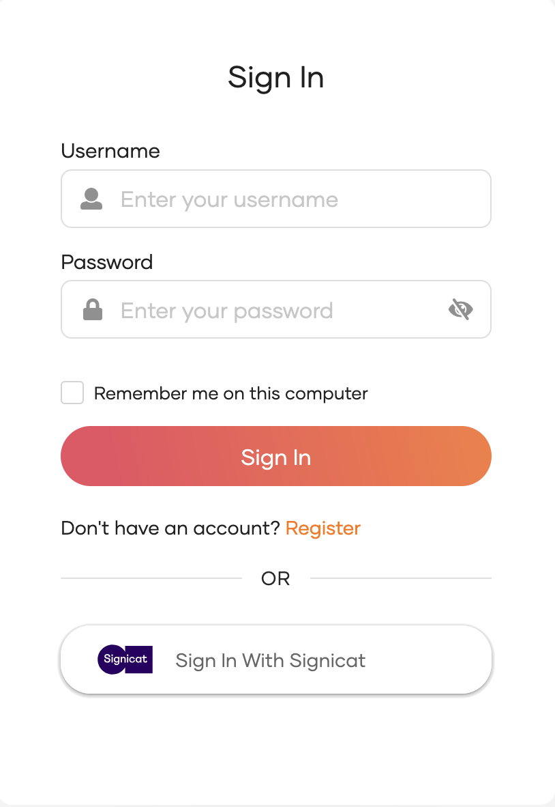

# Add Signicat login

[Signicat’s](https://www.signicat.com/) eID Hub simplifies digital identity verification and authentication by connecting your platform to more than 30 electronic identities (eIDs) from across Europe, all through one streamlined integration.

By integrating Signicat, you can authenticate users and prove their identity easily using trusted eIDs, whether for onboarding, access control, or compliance needs.

You can add Signicat login to your applications using WSO2 Identity Server and enable users to log in with their eIDs.

Follow this guide for instructions.

<Prerequisites>

## Prerequisites
- A Signicat account. If you don't have one, you can [sign up for free](https://developer.signicat.com/docs/).

</Prerequisites>

## Register WSO2 Identity Server on Signicat

You need to register WSO2 Identity Server as an OIDC app on Signicat.

:::note

You can follow the [Signicat documentation](https://developer.signicat.com/docs/) for detailed instructions.

:::

1. Log in to [Signicat Dashboard](https://dashboard.signicat.com), and click .
2. On the left panel, Click **Products** and select **eID Hub**.
3. Under **eID Hub**, click **OIDC Clients**.

    

4. Give the application a name and the following URLs:

    - **Authorization callback URL**
        ```bash
        https://localhost:9443/commonauth
        ```

    

5. Click **Create**.
6. Click **Add Secret** and Generate a new client secret.
7. Take note of the **Client ID** and **Client secret**.
8. To add required eIDs, Click **eIDs** in the left panel (under **eID Hub**), and click **Add new**.
   

9. Select the eIDs you want to add and click **Add**.

## Register the Signicat Connection

Now, let's register the Signicat IdP in WSO2 Identity Server.

1. On the WSO2 Identity Server Console, go to **Connections**.
2. Click **New Connections** and select **Signicat**.
3. Enter the following details and click **Finish**:

    

    <table><tbody><tr><th>{"Parameter"}</th><th>{"Description"}</th></tr><tr><td>{"Name"}</td><td>{"A unique name for this Signicat identity provider."}</td></tr><tr><td>{"Client ID"}</td><td>{"The client ID obtained from Signicat."}</td></tr><tr><td>{"Client secret"}</td><td>{"The client secret obtained from Signicat."}</td></tr><tr><td>{"Authorised redirect URL"}</td><td>{"Provide the Authorised redirect URL of your Signicat organization. For example https://{your_signicat_domain}/auth/open/connect/authorize.."}</td></tr><tr><td>{"Token Endpoint URL"}</td><td>{"Provide the Token endpoint URL of your Signicat organization. For example https://{your_signicat_domain}/auth/open/connect/token."}</td></tr></tbody></table>

## Enable Signicat login

<Prerequisites title="Before you begin">

You need to [register an application with WSO2 Identity Server](../../applications/index.mdx). You can register your own application or use one of the [sample applications](../../../get-started/try-samples/index.mdx) provided.

</Prerequisites>

1. On the WSO2 Identity Server Console, go to **Applications**.
2. Select your application, go to the **Login Flow** tab and add Signicat login from your preferred editor:

    
    1. Click **Add Sign In Option** to add a new authenticator to the first step.

    2. Select the Signicat connection.

    3. Click **Confirm** to add login with Signicat to the sign-in flow.

         

    

    :::note[Recommendations]


    :::
    It is recommended to add your social and enterprise connections to the first authentication step as they are used for identifying the user.


3. Click **Update** to save your changes.


## Try it out

Follow the steps given below.

1. Access the application URL.

2. Click **Login** to open the WSO2 Identity Server login page.

3. On the WSO2 Identity Server login page, **Sign in with Signicat**.

    

4. Log in to the eIDs configured in Signicat.

## Configure connection

To learn more about other configurations available for the connection, refer to the [add federated login](../federated-login/index.mdx) documentation.
