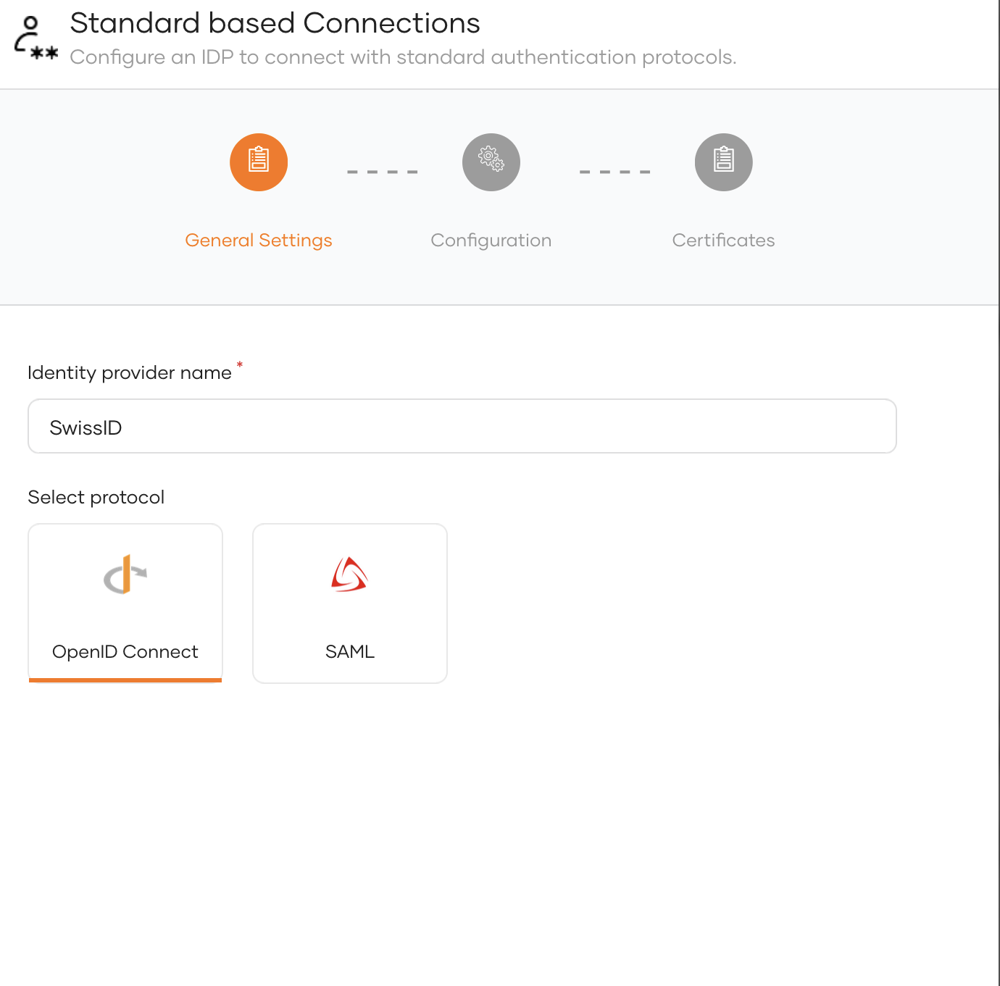
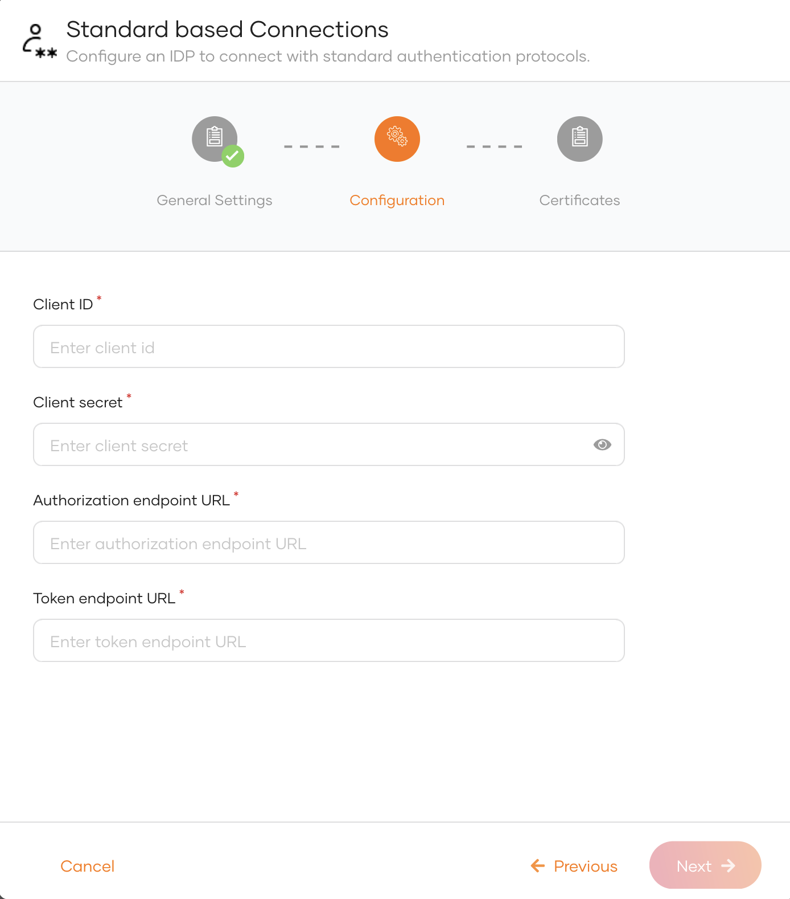
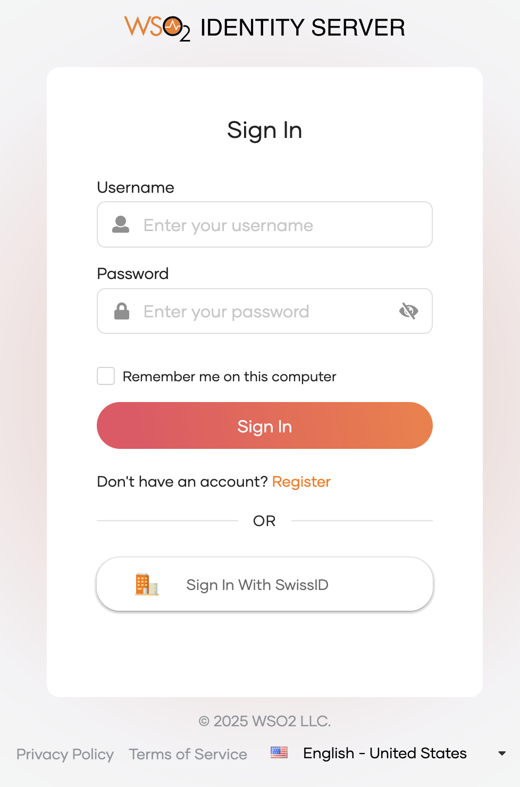

# Add SwissID login

[SwissID](https://www.swissid.ch/) is a secure digital identity solution developed in Switzerland, enabling users to access various online services through a single login. It is provided by SwissSign AG, a subsidiary of Swiss Post, and is recognized by the Swiss federal government as a trust service provider

## Register WSO2 Identity Server on SwissID

1. [Contact SwissID](https://www.swissid.ch/en/b2b-kontakt.html) in order to become a partner.
2. Once that process is done, you need to provide following as redirection URI.
    - **Authorization callback URL**
       ```bash
       https://localhost:9443/commonauth
       ```
   
3. You will get the Client ID and Client Secret from the SwissID application.
4. Take note of the **Client ID** and **Client secret**.

## Register the SwissID
Now, let's register the SwissID IdP in WSO2 Identity Server.

1. On the WSO2 Identity Server Console, go to **Connections**.
2. Click **New Connections** and select **Standard-based Idp**.
3. Click **Create**.
4. Enter a  unique name for your SwissID connection.
   
5. Enter the following details and click **Finish**:

       <table><tbody><tr><th>{"Parameter"}</th><th>{"Description"}</th></tr><tr><td>{"Client ID"}</td><td>{"The client ID obtained from SwissID."}</td></tr><tr><td>{"Client secret"}</td><td>{"The client secret obtained from SwissID."}</td></tr><tr><td>{"Authorised redirect URL"}</td><td>{"Provide the Authorised redirect URL of SwissID connection. For example `https://"}{"<swissid_env>"}{"/idp/oauth2/authorize`."}</td></tr><tr><td>{"Token Endpoint URL"}</td><td>{"Provide the Token endpoint URL of SwissID. For example `https://"}{"<swissid_env>"}{"/api/v1/token`."}</td></tr></tbody></table>
   <br />
       
6. Click **Next**<br />
7. You can enter *JWKS endpoint URL*  of SwissID or upload the public certificate. This step is not mandatory while creating the connection.
      <table><tbody><tr><td>{"JWKS endpoint URL"}</td><td>{"Provide the JWKS endpoint URL of your SwissID organization. For example `https://"}{"<swissid_env>"}{"/idp/oauth2/connect/jwk_uri`."}</td></tr></tbody></table>
8. Click **Finish**.

## Enable SwissID login

<Prerequisites title="Before you begin">

You need to [register an application with WSO2 Identity Server](../../applications/index.mdx). You can register your own application or use one of the [sample applications](../../../get-started/try-samples/index.mdx) provided.

</Prerequisites>

1. On the WSO2 Identity Server Console, go to **Applications**.
2. Select your application, go to the **Login Flow** tab and add SwissID login from your preferred editor:

    1. Click **Add Sign In Option** to add a new authenticator to the first step.

    2. Select the SwissID connection.

    3. Click **Confirm** to add login with SwissID to the sign-in flow.

       


3. Click **Update** to save your changes.


## Try it out

Follow the steps given below.

1. Access the application URL.

2. Click **Login** to open the WSO2 Identity Server login page.

3. On the WSO2 Identity Server login page, **Sign in with SwissID**.

    

4. Log in to SwissID with an existing eID.

## Configure connection

To learn more about other configurations available for the connection, refer to the [add federated login](../federated-login/index.mdx) documentation.
