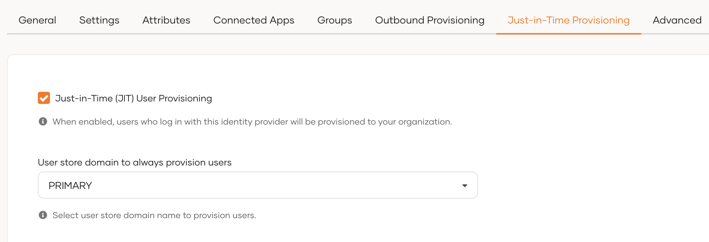
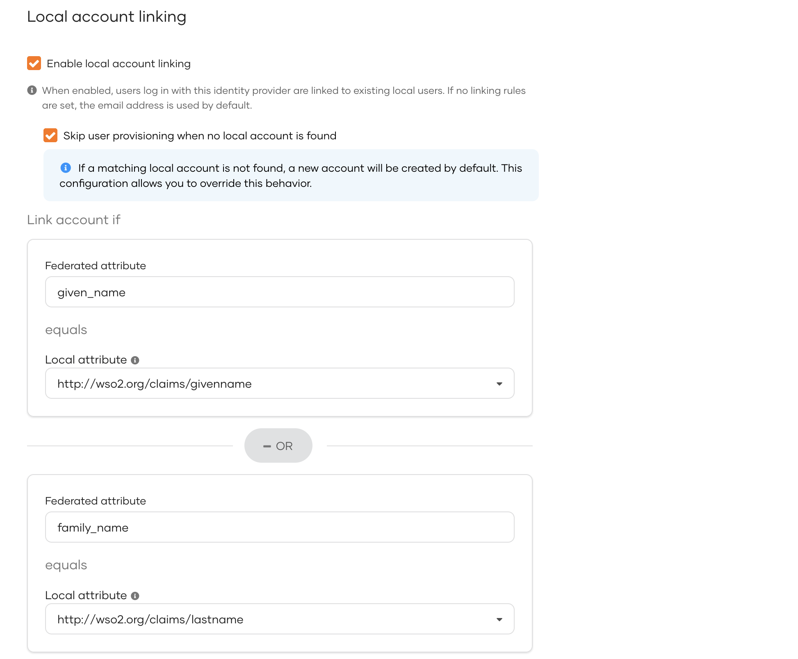

# Configure Just-in-Time user provisioning

This guide explains the concept of Just-In-Time (JIT) user provisioning, why and when to use it, and also the instructions for configuring it.

## Overview

Just-in-Time (JIT) user provisioning allows WSO2 Identity Server to automatically create a user account in its internal user store when a user successfully logs in using an external Identity Provider (IdP) for the first time.

This eliminates the need for manual user account creation in WSO2 Identity Server before users can log in using external IdPs.

JIT user provisioning works follows:

1. When an application initiates an authentication request, the user gets redirected to WSO2 Identity Server.

2. If the user selects an external IdP for authentication, WSO2 Identity Server redirects the user to the relevant IdP.

3. If WSO2 Identity Server receives a positive authentication response from the external IdP, JIT provisioning is triggered.

4. WSO2 Identity Server creates a user account in its internal user store along with the user attributes obtained from the authentication response.


With this process, new user accounts are automatically provisioned to WSO2 Identity Server when users log in with external IdPs.

## Enable JIT user provisioning

:::note


[Register the external IdP](federated-login/index.md) as a connection in WSO2 Identity Server.

:::

To enable JIT user provisioning for an external Identity provider:

1. On the WSO2 Identity Server Console, click **Connections** and select the relevant connection.

2. Go to the **Just-in-Time Provisioning** tab of the selected connection.

3. Check the **Just-in-Time (JIT) User Provisioning** checkbox to enable it. Uncheck to disable it.

    

4. Click **Update** to save.

:::warning


When JIT user provisioning is disabled, the following restrictions apply:

- Since WSO2 Identity Server does not create local user accounts for federated users, those users' attributes will not be stored in WSO2 Identity Server. Instead, attributes from the external IdP are passed directly to the application.

- If you have configured multi-factor authentication (MFA) that rely on a local user account, disabling JIT user provisioning breaks the application login flow for JIT provisioned users. Learn more about [troubleshooting sign-in flow errors with JIT](#troubleshoot-sign-in-flow-errors).

:::


## Configure JIT user provisioning settings

When JIT user provisioning is enabled, you can configure the following settings to customize how WSO2 Identity Server provisions users.


### JIT provisioning scheme

This setting determines whether WSO2 Identity Server prompts users for credentials and consent when provisioning accounts through JIT. By default, WSO2 Identity Server provisions users silently without prompting for either consent or credentials.


- **Prompt for username, password, and consent** - Prompts the user for a username, password, and consent before account creation.

- **Prompt for password and consent** - Prompts the user to provide both a password and consent. The username is automatically derived from the federated identity.

- **Prompt for consent** - Prompts the user for consent before provisioning.

- **Provision silently**: Provisions the user automatically without prompting for either credentials or consent. This is the default behavior.


### Attribute synchronization methods

This setting determines how WSO2 Identity Server synchronizes user attributes between the user's account in the external IdP and the corresponding local user account.


- **Override All** - Overrides all attributes of the local user account with the attributes received from the external identity provider each time the user logs in.

- **None** - No attributes are synchronized. The local user account retains its attributes.

- **Preserve local** - Overrides only the attributes that are received from the identity provider. Any additional attributes that exist in the local user account but are not provided by the identity provider are preserved.

### Local account linking

This setting allows you to link federated users to existing local user accounts based on configurable rules. The rules define how WSO2 Identity Server identifies a match between a federated user and a local user.



- **Enable local account linking** - Enables account linking. When enabled,
    - WSO2 Identity Server evaluates the defined account linking rules to determine whether the federated user matches an existing local user.
    - If a match is found, the federated user is automatically linked to the corresponding local account.
    - If no rules are defined, WSO2 Identity Server defaults to matching the email address.

- **Skip user provisioning when no local account is found** - By default, WSO2 Identity Server creates a new local user account for the federated user if no account linking rule matches are found. This setting prevents WSO2 Identity Server from creating a new local user account.

- **Link account if** - Configure the account linking rules. You can define a first match rule and a fallback match rule.
    - Each rule maps a federated attribute to its corresponding local attribute.
    - WSO2 Identity Server evaluates the first match rule and if no match is found, applies the fallback match rule.
    - If none of the rules match, WSO2 Identity Server creates a new local user account (unless the **Skip user provisioning when no local account is found** setting is enabled).

    :::tip


    Ensure you select a local user attribute that is unique for each user to guarantee accurate and consistent user matching. Learn more about [configuring unique attributes](../users/attributes/configure-unique-attributes.md).

    :::


## Troubleshoot sign-in flow errors

If you have disabled JIT provisioning for an IdP, applications that use [multi-factor authentication](mfa/index.md) may break as certain MFA mechanisms (such as TOTP and Email OTP) require users to have local accounts in WSO2 Identity Server.

When configuring an application's sign-in flow involving JIT-disabled IdPs and such MFA options, WSO2 Identity Server displays the following warning:


To avoid unexpected errors, you can use the following conditional authentication script to skip the MFA step when using JIT-disabled connectors.

```js
var localAuthenticator = 'LOCAL';
var onLoginRequest = function (context) {
    executeStep(1, {
        onSuccess: function (context) {
            var step = context.steps[1];
            if (step.idp == localAuthenticator) {
                executeStep(2); // MFA Step
            }
        }
    });
};
```

:::note

For more information on this script, refer to the [sign-in option-based conditional authentication script](conditional-auth/sign-in-option-based-template.md#how-it-works).

:::
