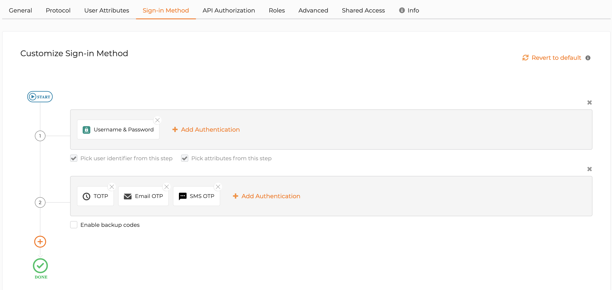

# Add user-preferred MFA login

WSO2 Identity Server users have the option to select their preferred MFA option. Once chosen, Asgardo remembers the choice and prompts the chosen MFA option as a second factor when users log into applications.

:::note

Currently, you can only configure user-preferred MFA login by using the SCIM2/Me API of WSO2 Identity Server.

:::

<Prerequisites>

## Prerequisites
To get started, you need to [register an application with WSO2 Identity Server](../../applications/index.mdx). You can register your own application or use one of the [sample applications](../../../get-started/try-samples/index.mdx) provided.

</Prerequisites>

## Configure application login for user-preferred MFA

Follow the steps given below to configure the application login to prompt the user with the preferred MFA option.

1. On the WSO2 Identity Server console, click **Applications**.
2. Select your application and go to the **Login Flow** tab.
3. Click **Start with default configuration** to define the login flow starting with `username and password`.
4. Add a second authentication step with the following authenticators.

    - **TOTP**
    - **Email OTP**
    

    

5. Turn on **Conditional Authentication** by switching the toggle.
    
    You can now define your conditional authentication script.

    !!! warning Important
            As a security measure, WSO2 Identity Server does not allow the usage of two consecutive periods (`..`) in authentication scripts.

6. Add the following adaptive authentication script.
    ```js
    var onLoginRequest = function(context) {
        executeStep(1, {
            onSuccess: function (context) {
                var preferredClaimURI = 'http://wso2.org/claims/identity/preferredMFAOption';
                var user = context.steps[1].subject;
                var preferredClaim = user.localClaims[preferredClaimURI];
    
                if(preferredClaim != null) {  
                    var jsonObj = JSON.parse(preferredClaim);
                    var authenticationOption = jsonObj.authenticationOption;
                    Log.info("preferredClaim authenticationOption " + authenticationOption); 
                    executeStep(2, {authenticationOptions: [{authenticator: authenticationOption}]}, {});
                } else {
                    executeStep(2);
                }
            }
        });  
    };
    ```

7. Click **Update** to save the configurations.

## Set preferred MFA options for users

To set preferred MFA options for users:

1. Collect information from your application users on their preferred MFA option.

    :::note[Available authenticators]

    The following authentication options are available for users:
    <table>
        <tr>
            <th>Connection Name</th>
            <th>Authenticator</th>
        </tr>
        <tr>
            <td>TOTP</td>
            <td><code>totp</code></td>
        </tr>
        <tr>
            <td>Email OTP</td>
            <td><code>email-otp-authenticator</code></td>
        </tr>
        
    </table>

    :::

2. Set the preferred MFA option for each user using a [SCIM2/Me patch API](../../../apis/scim2-me-rest-apis.mdx#tag/Me-Endpoint/operation/patchUserMe) call.

    :::note

    Update the `preferredMFAOption.authenticationOption` value for each user according to their choice in step 1.

    :::


    <details>
    <summary>Sample API call to add the user's preferred MFA option</summary>

    ```curl
    curl -v -k --header
    'Authorization: Bearer <access_token>'
    --data '
        {"Operations":[
            {
                "op": "replace",
                "value": {
                    "name": {
                        "givenName":"liya"
                    }
                }
            },
            {
                "op": "replace",
                "value": {
                    "name": {
                        "familyName":"shaggy"
                    }
                }
            },
            {
                "op": "replace",
                "value": {
                    "phoneNumbers":[]
                }
            },
            {
                "op": "replace",
                "value": {
                    "urn:scim:wso2:schema": {
                        "preferredMFAOption": "{\"authenticationOption\":\"email-otp-authenticator\"}"
                    }
                }
            }
        ],
        "schemas":[
            "urn:ietf:params:scim:api:messages:2.0:PatchOp"
        ]
    }'
    --header "Content-Type:application/json" https://localhost:9443/t/{tenant-domain}/scim2/Me
    ```

    </details>
