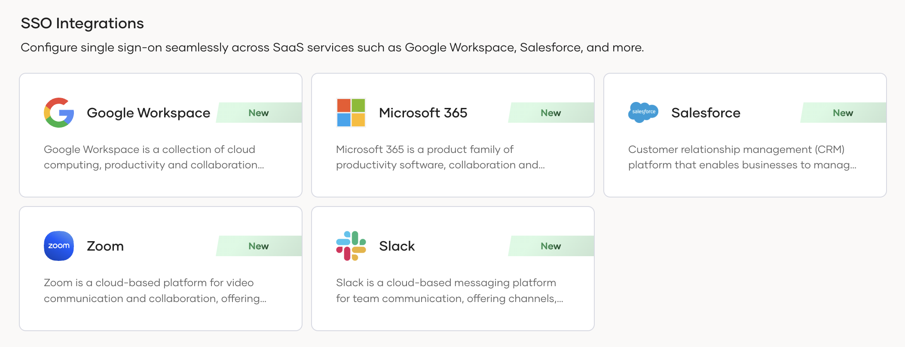
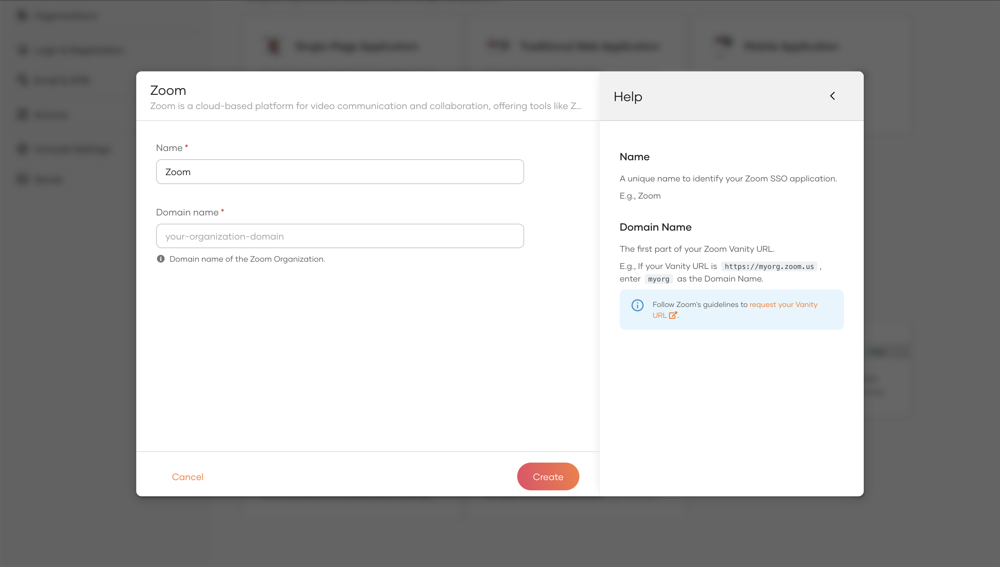
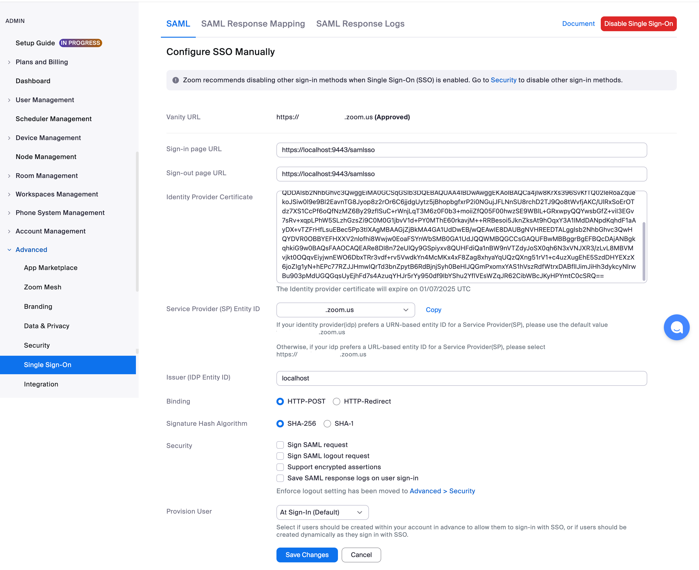

# Log in to Zoom using WSO2 Identity Server

This page guides you through integrating WSO2 Identity Server for Single Sign-On (SSO) with Zoom.

:::note[Before you begin]

You need to have a Zoom account that supports SSO. Refer to the [Zoom documentation](https://support.zoom.com/hc/en/article?id=zm_kb&sysparm_article=KB0060673) for more details.

:::

## Create the Zoom application

Follow the steps given below to register the Zoom application in WSO2 Identity Server.

1. On the WSO2 Identity Server Console, go to **Applications**.

2. Click **New Application** and under **SSO Integrations**, select **Zoom**..

    

3. Provide the Zoom domain name and a name for the application.

    :::info[Domain Name]

    Zoom domain name is the first part of your Zoom vanity URL. If your vanity URL is `https://myorg.zoom.us`, enter `myorg` as the Domain Name. Follow Zoom's guidelines to [request your vanity URL](https://support.zoom.com/hc/en/article?id=zm_kb&sysparm_article=KB0061540)

    :::

    

4. Click **Create** to complete the registration.

-----

## Configure Zoom

Follow the steps below to configure Zoom for SSO with WSO2 Identity Server.

1. Log in to [Zoom](https://zoom.us/signin#/login).

2. Use the following values and configure SSO settings for Zoom. Refer to [Zoom documentation](https://support.zoom.com/hc/en/article?id=zm_kb&sysparm_article=KB0060673#h_01EYXTRKFKDGMV8H0T6HHQFJWA) for more information.

    - **Sign-in page URL** - `https://localhost:9443/samlsso`

    - **Sign-out page URL** - `https://localhost:9443/samlsso`

    - **Identity Provider Certificate** - Obtain the certificate from the `Guide` tab of the configured Zoom application in WSO2 Identity Server.

    - **Service Provider (SP) Entity ID** - WSO2 Identity Server supports a URN-based Entity ID for service providers. Therefore, retain the default URN-based value selected for this which takes the form `<domain-name>.zoom.us`
       
    - **Issuer (IDP Entity ID)** - `localhost`

    

## Try it out

Now that you have integrated WSO2 Identity Server with Zoom, follow the steps below to test it.

1. Create a user in WSO2 Identity Server and ensure the same user exists in your Zoom organization with the same email address.

2. Navigate to the [Zoom SSO sign-in page](https://zoom.us/web/sso/login?en=signin#/sso) and enter the company domain. You will then be redirected to the WSO2 Identity Server login screen.

3. Enter the username and password of the user and complete the login process.

---

## Troubleshooting guidelines

To troubleshoot SSO failures on the Zoom side, refer to the SAML response logs. Follow [Zoom documentation](https://support.zoom.com/hc/en/article?id=zm_kb&sysparm_article=KB0061276) to learn more.
