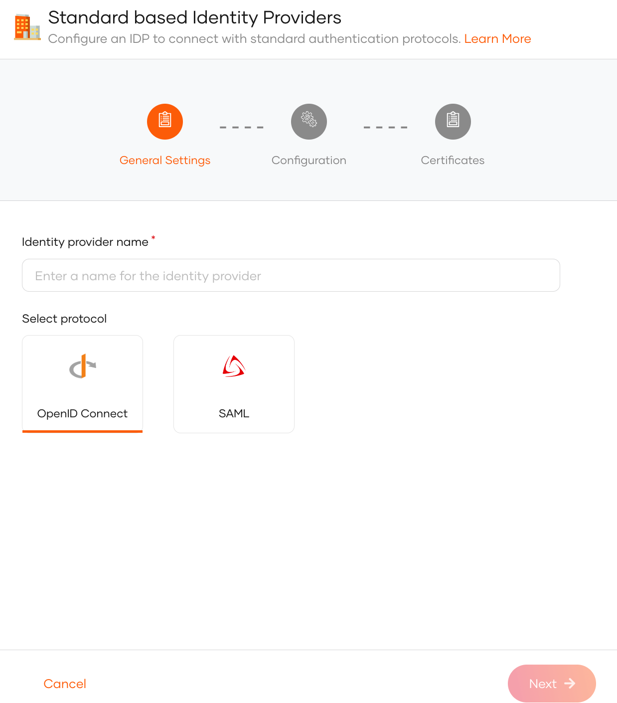
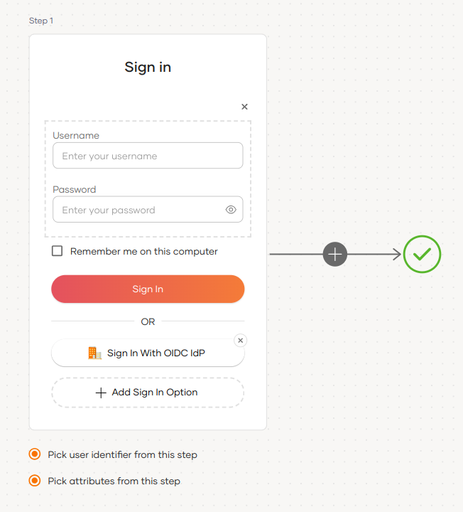
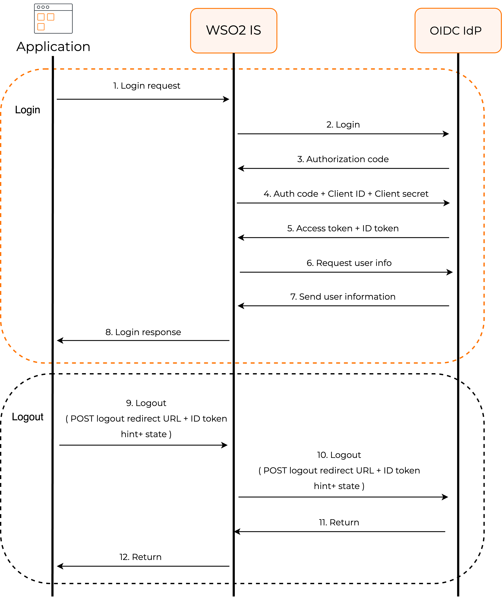

# Add login with an OpenID Connect identity provider

You can add standard OpenID Connect (OIDC) login to your applications using an external OIDC Identity Provider (IdP) and enable users to log in with their external identities.

Follow this guide to register an OIDC IdP in WSO2 Identity Server and add it to the login flow of your application.

## Register WSO2 Identity Server in the IdP

You need to register an OpenID Connect application with the external identity provider. Follow the identity provider's documentation to know how to register an OIDC application.

You can use the following URL as the **callbackURL** of the application.

```bash
https://localhost:9443/commonauth
```
Once you register an application, you will receive the following:

- **client_id** (also known as `app_id` or `application_id`)
- **client_secret** (also known as `app_secret`)

Check the documentation of the OIDC identity provider and get the following endpoints:

- Authorization Endpoint URL
- Token Endpoint URL
- User Info endpoint (optional)
- Logout endpoint (optional)

## Register the OIDC IdP

Now, let's register the OIDC IdP in WSO2 Identity Server.

1. On the WSO2 Identity Server Console, click **Connections**.
2. Click **Create Connection** and select **Standard-Based IdP**.
3. Provide a unique **identity provider name**, select **OpenID Connect**, and click **Next**.

    

4. Enter the following details of the external OIDC identity provider and click **Next**:

    <table>
        <tr>
            <th>Parameter</th>
            <th>Description</th>
        </tr>
        <tr>
            <td>Client ID</td>
            <td>The client ID obtained from the external identity provider.</td>
        </tr>
        <tr>
            <td>Client secret</td>
            <td>The client secret obtained from the external identity provider.</td>
        </tr>
        <tr>
            <td>Authorization endpoint URL</td>
            <td>The authorization endpoint of the external identity provider.</td>
        </tr>
        <tr>
            <td>Token endpoint URL</td>
            <td>The token endpoint of the external identity provider.</td>
        </tr>
    </table>

5. (Optional) Provide the mode of certificate configuration.

    :::note

    You can either configure a JWKS endpoint or upload a certificate of the external party. This helps to validate the signature of the assertions sent by the external identity provider.

    :::

    - **JWKS endpoint**: The JWKS endpoint of the external identity provider.
    - **Use PEM certificate**: Upload or paste the public certificate of the external identity provider. The certificate should be in PEM format.

        ??? note "If you have a certificate in other formats such as `.crt`, `.cer` or `.der`, expand here to see how you can convert them to PEM format using [OpenSSL](https://www.openssl.org/)"
            **Convert CRT to PEM**
            ```bash
            openssl x509 -in cert.crt -out cert.pem

            ```
            **Convert CER to PEM:**
            ```bash
            openssl x509 -in cert.cer -out cert.pem
            ```  

            **Convert DER to PEM:**
            ```bash
            openssl x509 -in cert.der -out cert.pem
            ```

6. Click **Finish** to complete the registration.

:::note

Once the OIDC identity provider is created, you can configure [additional OIDC settings](../../../references/idp-settings/oidc-settings-for-idp.mdx#additional-settings) from the **Settings** tab.

:::

WSO2 Identity Server requests for the **openid** scope from the external identity provider. If you need more attributes from the external identity provider, you can configure scopes from the **Settings** tab.

## Enable the OIDC IdP for login

<Prerequisites title="Before you begin">

You need to [register an application with WSO2 Identity Server](../../applications/index.mdx). You can register your own application or use one of the [sample applications](../../../get-started/try-samples/index.mdx) provided.

</Prerequisites>

1. On the WSO2 Identity Server Console, go to **Applications**.

2. Select your application, go to the **Login Flow** tab and add OIDC identity provider from your preferred editor:

    
    1. Click **Add Sign In Option** to add a new authenticator to the first step.

    2. Select the OIDC IdP connection.

    3. Click **Confirm** to add login with an OIDC IdP to the sign-in flow.

        
    

    :::note[Recommendations]


    :::
    It is recommended to add your social and enterprise connections to the first authentication step as they are used for identifying the user.


3. Click **Update** to save your changes.


## How it works

To provide this login capability, WSO2 Identity Server uses the standard OpenID Connect with authorization code flow  underneath. For an application, this flow works as follows:



## Configure connection

- To learn more about other configurations available for the connection, refer to the [add federated login](../federated-login/index.mdx) documentation.

- To learn more about OIDC settings available for the IdP, refer to the [OIDC settings](../../../references/idp-settings/oidc-settings-for-idp.mdx) documentation.
