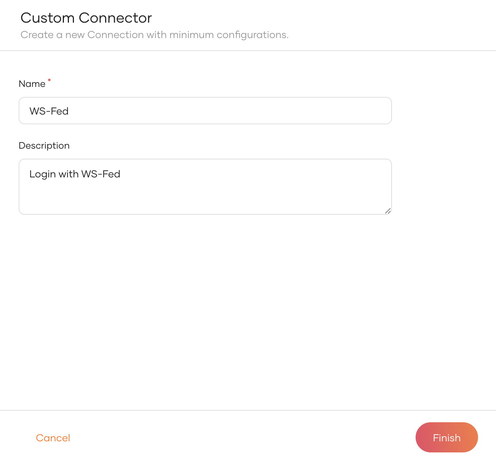
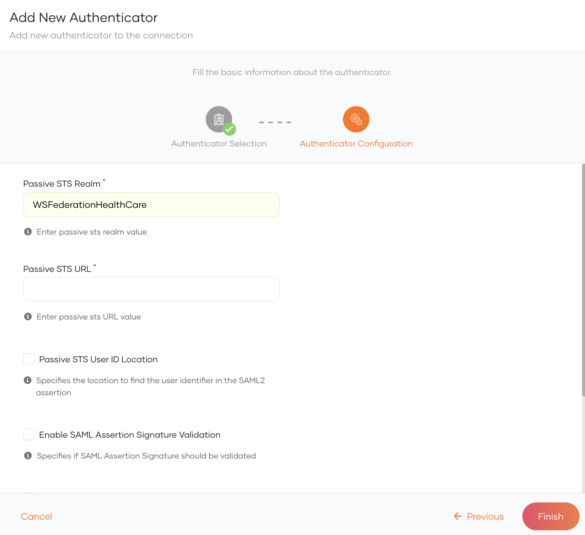
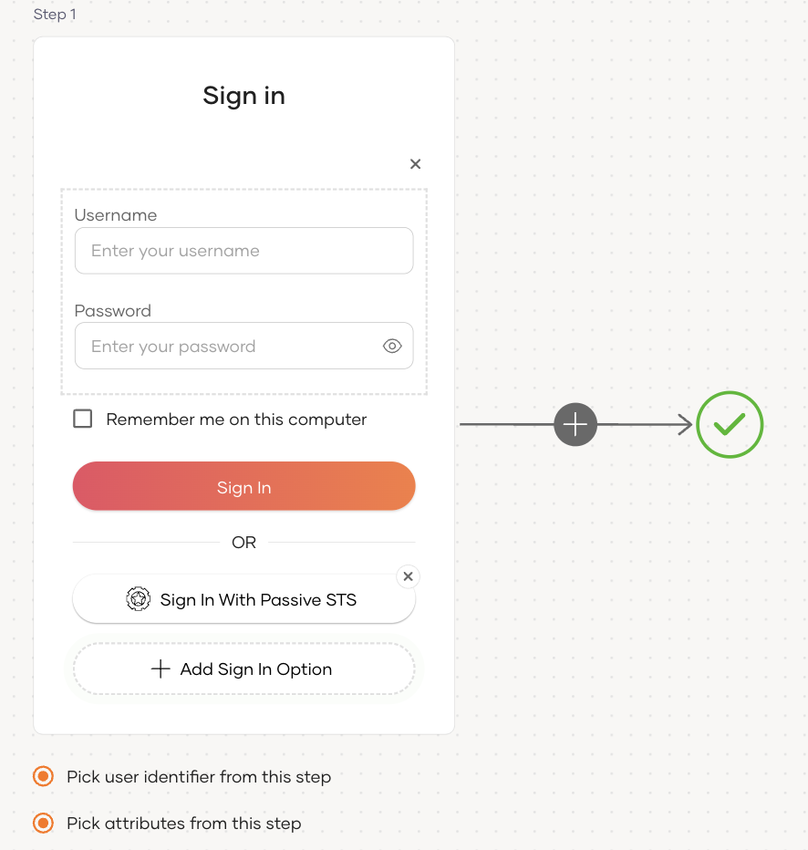

# Add login with WS-Federation

You can add login with WS-Federation to your applications and enable users to log in with their external identities.
Follow this guide to register a WS-Federation connection and add it to the login flow of your application.

## Register the WS-Fedration IdP

Let's register the WS-Fed IdP in WSO2 Identity Server.

1. On the WSO2 Identity Server Console, go to **Connections**.

2. Click **Create Connection** and select **Custom Connector**.

3. Provide a name and a description for the connector and click **Finish**.

      

4. On the created custom connector, go to the **Settings** tab.

5. Click **New Authenticator**, select **WS-Federation** and click **Next**.

6. Enter the following details and click **Finish**.

    

    <table><tbody><tr><th>{"Parameter"}</th><th>{"Description"}</th></tr><tr><td>{"Passive STS Realm"}</td><td>{"Value of your choice that serves as the unique identifier for the realm."} {" e.g."}<code>{"WSFederationHealthCare"}</code></td></tr><tr><td>{"Passive STS URL"}</td><td>
{"Passive STS endpoint of the IdP."} {" e.g. for WSO2 Identity Server, it is "}<code>{"https://localhost:9443/passivests"}</code>
{"."}</td></tr><tr><td>{"Passive STS User ID Location"}</td><td>{"Select whether the User ID is found in the "}<code>{"Name Identifier"}</code>{" as part of the authentication request or found among the claims."}</td></tr><tr><td>{"Enable SAML Assertion Signature Validation"}</td><td>{"Select to enable validation for the signature sent over the SAML assertion."}</td></tr><tr><td>{"Enable SAML Assertion Audience Validation"}</td><td>{"Select to enable validation for the audience attribute sent in the SAML assertion."}</td></tr><tr><td>{"Additional Query Parameters"}</td><td>{"Include any other parameters that are required by the external IdP."}</td></tr></tbody></table>

## Enable WS-Fed for login

:::note[Before you begin]

You need to [register an application with WSO2 Identity Server](../../applications/index.md). You can register your own application or use one of the [sample applications](../../../get-started/try-samples/index.md) provided.

:::

1. On the WSO2 Identity Server Console, go to **Applications**.

2. Select your application, go to the **Login Flow** tab and add WS-Federation from your preferred editor:

    
    1. Click **Add Sign In Option** to add a new authenticator to the first step.

    2. Select the WS-Federation connection.

    3. Click **Confirm** to add login with WS-Federation to the sign-in flow.

        
    

    :::note[Recommendations]

    :::
    It is recommended to add your social and enterprise connections to the first authentication step as they are used for identifying the user.

3. Click **Update** to save your changes.

## Configure user attributes

Configuring attributes for an Identity Provider (IdP) involves mapping the attributes available in the external IdP to local attributes. This is done so that WSO2 Identity Server can identify the user attributes in the response sent from the external IdP.

To do so,

1. On the WSO2 Identity Server Console, click **Connections**.

2. Select the relevant IdP connection from the list and click **Set up**.

3. Go to the **Attributes** tab and under **Identity Provider Attribute Mappings**,  click **Add Attribute Mapping**.

    

4. Enter the external attribute, select the corresponding local attribute to which it maps and click **Add Attribute Mapping**.

    

5. Click **Save** to save the entries.

6. Under **Subject**, select a **Subject Attribute** that will be used to uniquely identify the user.

7. Under **Provisioning Attributes Selection**, select the required attributes that needs to be sent in the response to provision the user in WSO2 Identity Server.

8. Click **Update** to save the changes.
