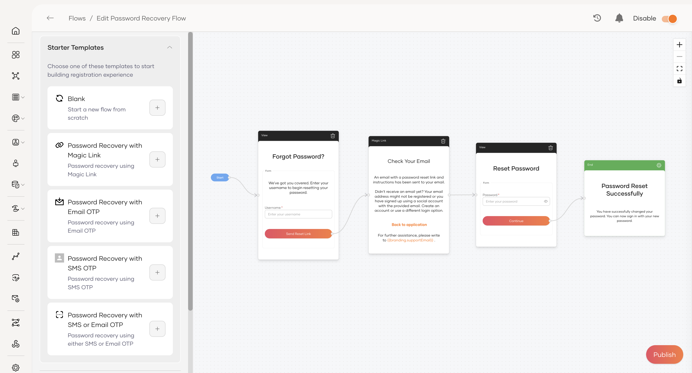
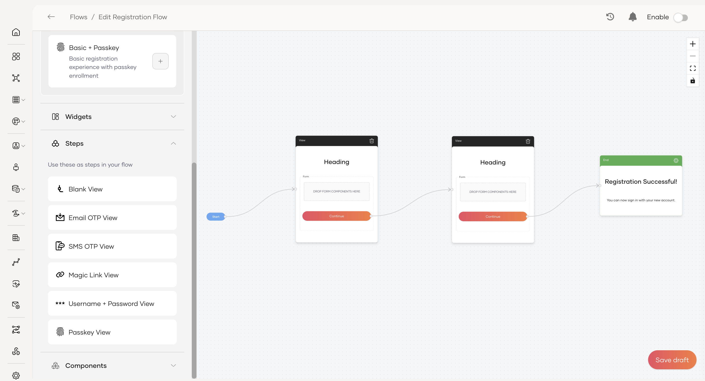
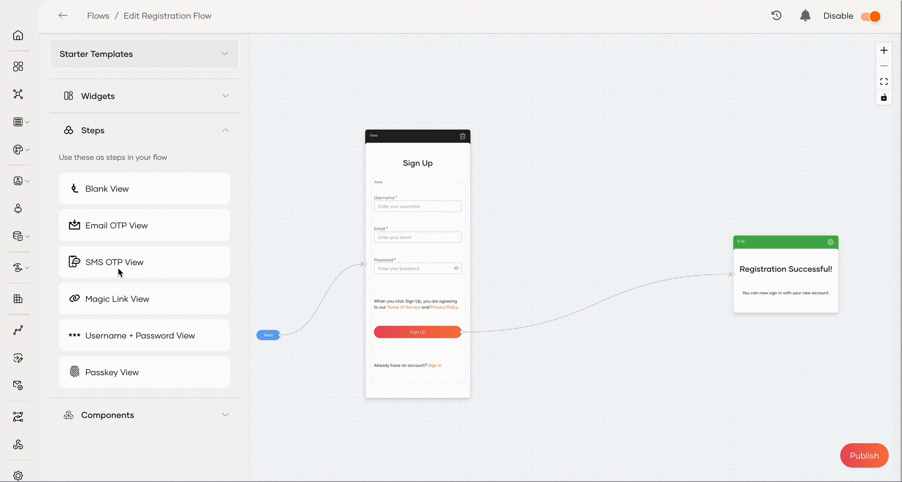
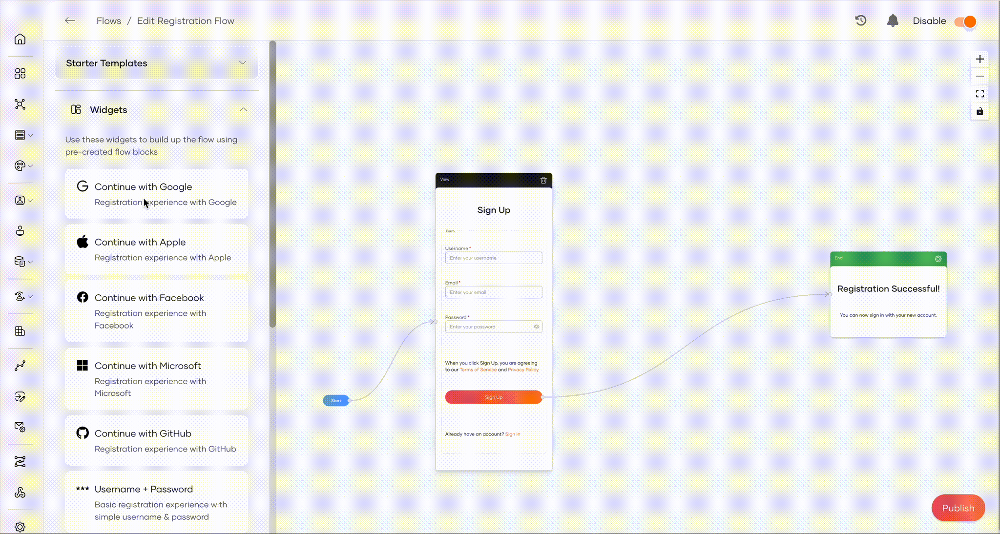
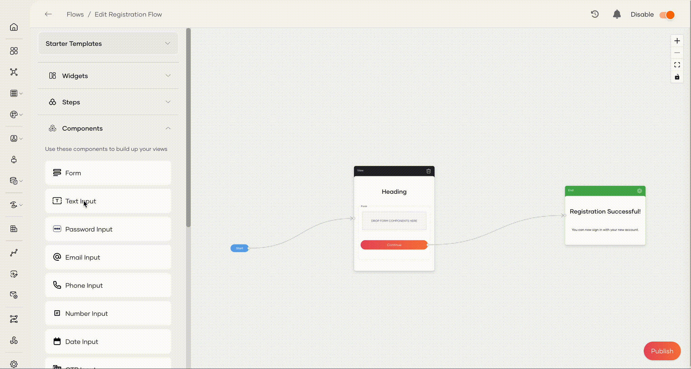
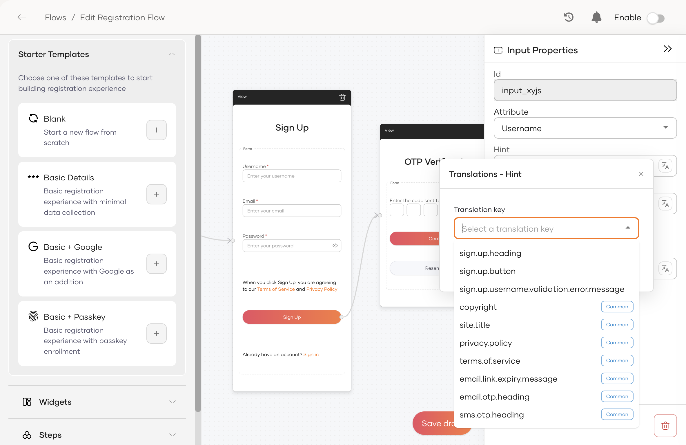
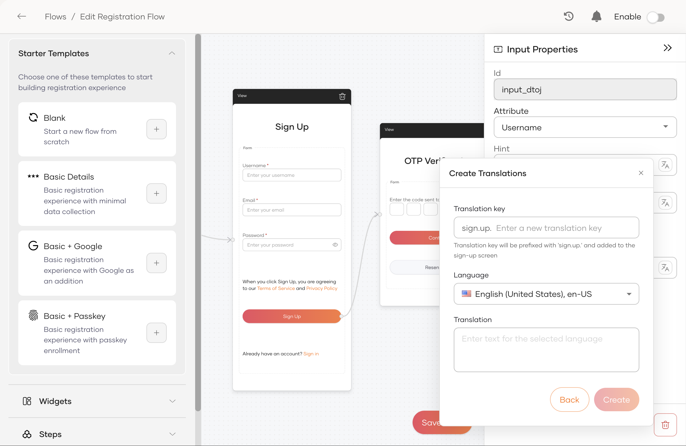
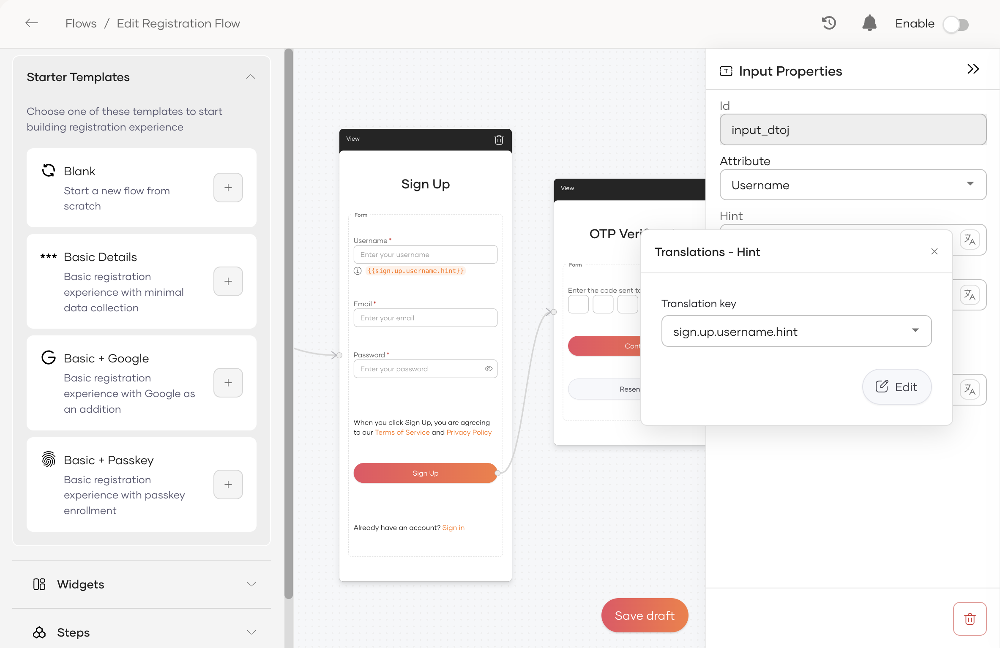
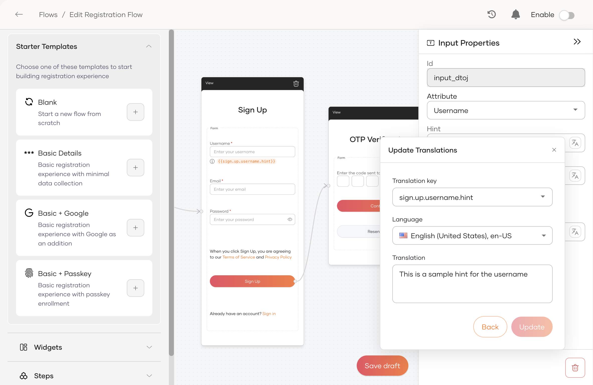

# Get started with flows

A **flow** defines the step-by-step journey a user takes during a specific interaction with your application, like signing up or resetting a password. This guide introduces the **Flow Builder**. It is a visual canvas where you can design and customize these journeys to meet your security and user experience goals without writing complex code.

The Flow Builder allows full customization of the following user journeys. Click on a flow to view a sample scenario built using the flow builder.

- [Self registration](self-registration.mdx)
- [Password recovery](password-recovery.mdx)
- [Invited user registration](invited-user-registration.mdx)

## Create and enable a flow

The following sections outline the process for creating and publishing a custom flow.

<Steps>

### Access the flow builder {/* #step-1-access-the-flow-builder */}

To access the flow builder:

1. On the WSO2 Identity Server Console, go to **Flows**.

2. Click on the corresponding flow you want to build. This opens the Flow Builder canvas for that specific flow.

### Build the flow {/* #step-2-build-the-flow */}

The **Flow builder** provides all the building blocks you need to create user journeys. To start building, you can choose one of the following methods and use [flow elements](#flow-elements) to customize it.

- **Use a starter template**

    Select from a list of pre-built templates for common use cases to avoid starting from scratch. Click the `+` icon next to a template to add it to the canvas.

    

- **Build from scratch**

    For complete control, start with a blank canvas and build the flow by dragging and dropping the required [flow elements](#flow-elements).

    

### Enable the flow {/* #step-3-enable-the-flow */}

You can enable a flow using the toggle on the top right corner of the Flow Builder. Your flows behave as follows based on their state:

- If disabled,

  - You can build your flow and save it as a draft. The flow won't be active for users until you enable it.
  - This is the default state for any new flow.

- If enabled,

  - The flow becomes immediately available for users.
  - You can continue to make changes and improvements to the flow even after enabling it. Until you publish those changes, users will continue to experience the last published version.
  - You can disable the flow at any time to remove it from user access temporarily.

</Steps>

## Flow elements

The Flow Builder provides a library of reusable, no-code elements to create user journeys. The following sections describe the key flow elements.

### Steps

Steps function as the core building block and represent a distinct part of the flow. A flow can contain one or more steps.

### Widgets

Pre-built identity verification components that you can drag and drop into a step.

### Components

Components are the individual UI elements placed inside a step, such as input fields, buttons, and paragraphs.

:::note

Field components such as **Text Input** and **Email Input** etc. have the following constraints:

   - Only a **Form** component can contain them.
   
   - Must map to a user attribute. To do so,
    
     - Click the pencil icon on the element action panel.

     - From the **Attribute** dropdown, select the relevant attribute. Only attributes **displayed in user profiles** are available for mapping. Learn how to [display attributes in user profiles](/identity/7.2.0/guides/users/attributes/manage-attributes/#configure-attributes).

:::

## Customize flow text

Every editable label, hint, heading, and button on a flow screen can be swapped for a translation key, so the same flow can render in different languages and use organization-specific wording.

<Prerequisites>

### Prerequisites

Branding must be enabled for the organization before flow translations take effect. In the WSO2 Identity Server Console, go to **Branding** and click **Save & Publish** once to activate the default configuration.

For related configuration, see [Configure UI branding](../branding/configure-ui-branding.mdx) and [Localization support](../branding/localization.mdx).

</Prerequisites>

### Open the Translations panel

On any flow screen (for example, Sign Up, Email OTP, or Password Reset), select the element you want to change and click the translate icon next to the attribute in the properties panel on the right (for example, the **Hint** attribute of an Input).

### Assign an existing translation key

1. Open the Translations panel on the target attribute.
2. From the **Translation key** dropdown, select a key. Keys are grouped into two categories:
    - **Flow-specific keys** – Prefixed by the current flow (for example, `sign.up.heading`, `sign.up.button`, `sign.up.username.validation.error.message`).
    - **Common keys** – Shared across every flow, including `site.title`, `copyright`, `privacy.policy`, `terms.of.service`, `email.link.expiry.message`, `email.otp.heading`, and `sms.otp.heading`.

### Create a new translation key

1. In the Translations panel, select **+ New**.
2. Enter the key suffix. The key is auto-prefixed by the current flow (for example, `sign.up.` for the Sign Up flow), so entering `username.hint` produces `sign.up.username.hint`.
3. Select the **Language**.
4. Enter the **Translation** text and click **Create**.

### Edit an assigned key

Once a key is assigned to an attribute, the Translations panel shows it with an **Edit** action.

Click **Edit** to open **Update Translations**, select the **Language** you want to change, adjust the text, and click **Update**.

### Publish the changes

Click **Save Draft** and then toggle **Enable** at the top-right of the Flow Builder to publish the updated flow. Users see the localized text on their next visit, resolved against the user's preferred locale.

## Manage flow context data

Flow context records are stored in the `IDN_FLOW_CONTEXT_STORE` database table and accumulate over time. To prevent this from affecting server performance, periodically clean up the table using the provided stored procedure scripts. See [Clean up flow context](../../deploy/flow-context-cleanup.mdx) for instructions.
