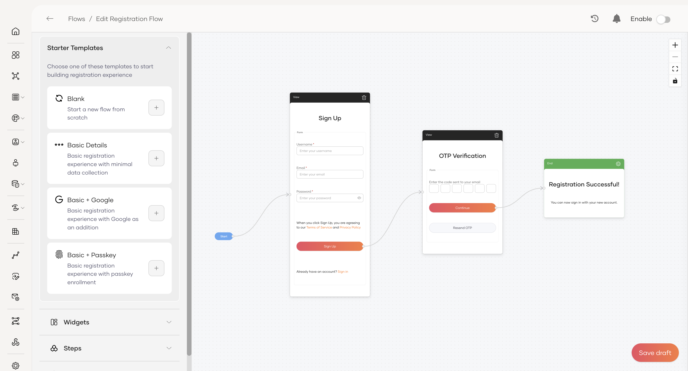

# Flows

Design and customize key user journeys in your application with Flows. A flow defines the step-by-step journey a user takes during a specific interaction, such as registering for your service or recovering a password.

WSO2 Identity Server lets you build fully customizable flows for the following user interactions.

- **Self registration** - Create seamless registration experiences for new users, with support for multi-step forms, data validation, and identity verification checks. Users can also sign up through a supported connection such as Google, Apple, Facebook, Microsoft, or GitHub.

- **Password recovery** - Build secure recovery processes to help users regain access, using steps such as email verification or one-time passwords (OTP).

- **Invited user registration** - Let new users complete creating their accounts when administrators invite them. Design secure flows to verify their identities and set their passwords.

Use starter templates, widgets, and other components to control how users interact with your application. No complex coding required.

## Start building flows

For specific examples of building flows, refer to [Self-registration](self-registration.md), [Password recovery](password-recovery.md), and [Invited user registration](invited-user-registration.md).
To execute the flows from a custom client application, see [Use the Flow Execution API](flow-execution-api.md) and explore the view schema in [Understand Flow Execution Components](flow-execution-components.md).

- To learn the fundamentals of building a flow, refer to the [get started](build-a-flow.md) guide.
- For detailed examples of specific use cases, see the guides on [Self registration](self-registration.md), [Password recovery](password-recovery.md) and [Invited user registration](invited-user-registration.md).

