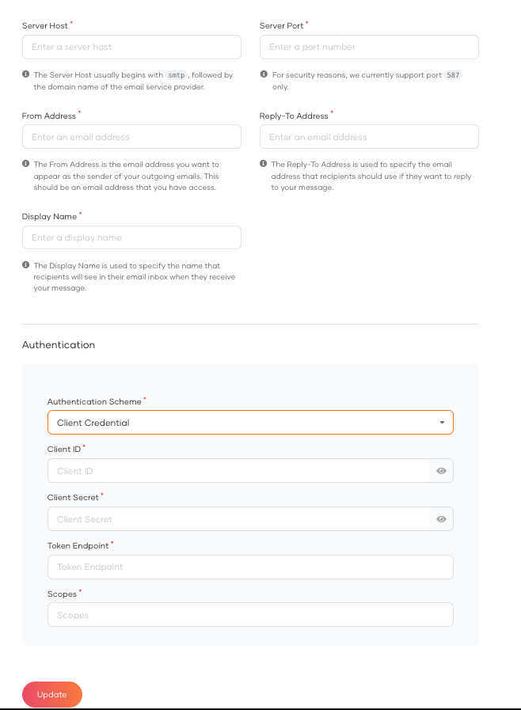

# Configure Email Provider

This document explains the steps to configure WSO2 Identity Server to send emails during multiple email-related customer identity and access management tasks such as [email OTP](../authentication/mfa/add-emailotp-login.md), email notifications, and account recovery.


WSO2 Identity Server supports SMTP-based email providers. To learn how to configure the email provider please see the relevant section.


## Global Configurations of Email Provider

Follow the steps given below to enable the email sender globally for all tenants in WSO2 Identity Server.

### Configure SMTP based email provider globally

1. Shut down the server if it is running.
2. Add the following properties to the `deployment.toml` file in the `<IS_HOME>/repository/conf` folder to configure the email provider.

    ```toml
    [output_adapter.email]
    from_address= "wso2iamtest@gmail.com"
    auth_type= "BASIC"
    username= "wso2iamtest"
    password= "Wso2@iam70"
    hostname= "smtp.gmail.com"
    port= 587
    enable_start_tls= true
    enable_authentication= true
    signature = "ABC.com"
    ```

    <table><tbody><tr><th>{"Property"}</th><th>{"Description"}</th></tr><tr><td><code>{"from_address"}</code></td><td>{"This is the mail address from where you want to send the notification. It can be any working mail address."}</td></tr><tr><td><code>{"auth_type"}</code></td><td>{"Authentication type to use when sending the email. WSO2 Identity Server supports "}<code>{"BASIC"}</code>{" and "}<code>{"CLIENT_CREDENTIAL"}</code>{" authentication types. "}<br />{" For "}<code>{"BASIC"}</code>{" you need to configure "}<code>{"username"}</code>{" and "}<code>{"password"}</code>{". "}<br />{" For "}<code>{"CLIENT_CREDENTIAL"}</code>{" you need to configure "}<code>{"client_id"}</code>{", "}<code>{"client_secret"}</code>{", "}<code>{"token_endpoint"}</code>{" and "}<code>{"scopes"}</code>{". Support for the "}<code>{"CLIENT_CREDENTIAL"}</code>{" authentication type is available for Microsoft 365 Exchange Online."}</td></tr><tr><td><code>{"username"}</code></td><td>{"Provide the username of the SMTP account. "}<br />{" Username of the mail you have provided in "}<strong>{"from_address"}</strong>{"."}</td></tr><tr><td><code>{"password"}</code></td><td>{"Provide the password of the SMTP account. "}<br />{" Password of the mail you have provided in "}<strong>{"from_address"}</strong>{"."}</td></tr><tr><td><code>{"client_id"}</code></td><td>{"Provide the password of the SMTP account. "}<br />{" Password of the mail you have provided in "}<strong>{"from_address"}</strong>{"."}</td></tr><tr><td><code>{"host"}</code></td><td>{"The SMTP server to connect to."}</td></tr><tr><td><code>{"port"}</code></td><td>{"This is the SMTP server port to connect to if the connect() method does not explicitly specify one. Defaults to 25."}</td></tr><tr><td><code>{"enable_start_tls"}</code></td><td>{"If true, this enables using the "}<code>{"STARTTLS"}</code>{" command (if enabled before issuing any login commands. Note that an appropriate trust store must be configured so that the client will trust the server's certificate. Defaults to "}<code>{"true"}</code>{"."}</td></tr><tr><td><code>{"enable_authentication"}</code></td><td>{"If true, attempt to authenticate the user using the AUTH command. Defaults to "}<code>{"true"}</code>{"."}</td></tr><tr><td><code>{"signature"}</code></td><td>{"Specifies the display name for the \"From\" email address. For example, \"ABC Company\" results in `\"ABC Company\" "}{"<mail@address.tld>"}{"`. "}<br /><br />{"If you don't set this property, the display name becomes "}<code>{"null"}</code>{" and the system falls back to your SMTP server settings. For example, some servers use the "}<code>{"username"}</code>{" as the display name."}<br /><br />{"To send an email with no display name and show only the email address, set this value to an empty string: "}<code>{"signature = \"\""}</code></td></tr></tbody></table>

    :::tip

    For information about the SMTP, see the [JavaMail SMTP documentation](https://javaee.github.io/javamail/docs/api/com/sun/mail/smtp/package-summary.html).

    :::

    :::info

    - If you use a Gmail account as the **from_address**, you must create an [App Password](https://support.google.com/accounts/answer/185833?visit_id=637943607149528455-3801902236&p=InvalidSecondFactor&rd=1).
     After you get an **App Password** from Google, update the `password`.
    - If your password contains special characters (example: `<`, `>`, `&`), you will run into errors when running the server. To avoid errors, update the `password` parameter as follows:
    ```toml
    password= "<![CDATA[xxxx]]>"
    ```

    :::

3. Save the configurations and start the server.


## Tenant Specific Configurations of Email Provider

:::info

- Super tenant email provider cannot be configured via the WSO2 Identity Server console. You need to configure the email provider in the `deployment.toml` file as mentioned above.

:::

Follow the steps given below to enable the email sender per tenant.

### Configure SMTP based email provider per tenant


1. On the WSO2 Identity Server Console, go to **Notification Channels** > **Email Provider**.
2. Provide the required details.

   

3. Click **Update**.
4. Since these configurations apply during the tenant loading process, [configure tenant loading and unloading for your tenant](../multitenancy/configure-the-tenant-loading-policy.md).


## Supported SMTP based email providers

<details>
<summary>Configuring Gmail as the email provider</summary>

If you use a Gmail account as the **from_address**, you must create an [App Password](https://support.google.com/accounts/answer/185833?visit_id=637943607149528455-3801902236&p=InvalidSecondFactor&rd=1).
  After you get an **App Password** from Google, update the `password`.

If your password contains special characters (example: `<`, `>`, `&`), you will run into errors when running the server. To avoid errors, update the `password` parameter as follows:
```toml
password= "<![CDATA[xxxx]]>"
```

</details>

<details>
<summary>Configuring Microsoft 365 Exchange Online as the email provider</summary>


## Before you start

- You must have a [Microsoft 365](https://www.microsoft.com/en-us/microsoft-365) account with an active subscription.
- Ensure your Microsoft 365 subscription is licensed to send emails through Exchange Online.
   - You need at a minimum a paid subscription to Microsoft Business Basic plan to use the SMTP Auth for Exchange Online. 
- Emails will be sent from WSO2 Identity Server to your SMTP provider. Your ports should be open and allow inbound 
  connections from specific WSO2 Identity Server IP addresses.

## Configure Microsoft 365

### Application Configuration and Permissions

  1. Register a client application in Microsoft Entra ID if you currently do not have one.
  2. Navigate to your registered Application resource. 
  3. Select Services > App registrations, and then select the application you will be using to send emails.
  4. Configure the required application permissions by navigating to Manage > API permissions.
     Please refer [Application permissions for SMTP](https://learn.microsoft.com/en-us/exchange/client-developer/legacy-protocols/how-to-authenticate-an-imap-pop-smtp-application-by-using-oauth#add-the-pop-imap-or-smtp-permissions-to-your-microsoft-entra-application)

     

### Register service principals in Exchange

- Please refer [Register service principals in Exchange](https://learn.microsoft.com/en-us/exchange/client-developer/legacy-protocols/how-to-authenticate-an-imap-pop-smtp-application-by-using-oauth#register-service-principals-in-exchange).

### Enable SMTP AUTH for specific mailboxes

- Please refer [Enable SMTP AUTH for specific mailboxes](https://learn.microsoft.com/en-us/exchange/clients-and-mobile-in-exchange-online/authenticated-client-smtp-submission#use-the-microsoft-365-admin-center-to-enable-or-disable-smtp-auth-on-specific-mailboxes).

### Retrieve required email provider configurations

- Navigate to the **Application Overview** of your Azure Active Directory Application and retrieve the [Application (client) ID](https://learn.microsoft.com/en-us/azure/healthcare-apis/register-application#application-id-client-id).
- Navigate to Manage > Certificates & secrets and collect the Value to create an [application secret](https://learn.microsoft.com/en-us/azure/healthcare-apis/register-application#certificates--secrets).
- Navigate to Overview > Endpoints and copy the **OAuth 2.0 token endpoint (v2)** URL.

### Configure SMTP settings in WSO2 Identity Server

- Go to **Notification Channels** > **Email Provider**.
- Provide the From email address and other relevant details. Click on **Client Credentials** from the Authentication type dropdown.
- Provide the required details retrieved from the previous step.

   NOTE: The scope required for Microsoft 365 Exchange Online is `https://outlook.office365.com/.default` and the token endpoint URL should be in the format of `https://login.microsoftonline.com/{tenant_id}/oauth2/v2.0/token`.

   

- Click **Update** to save the configurations.

</details>
