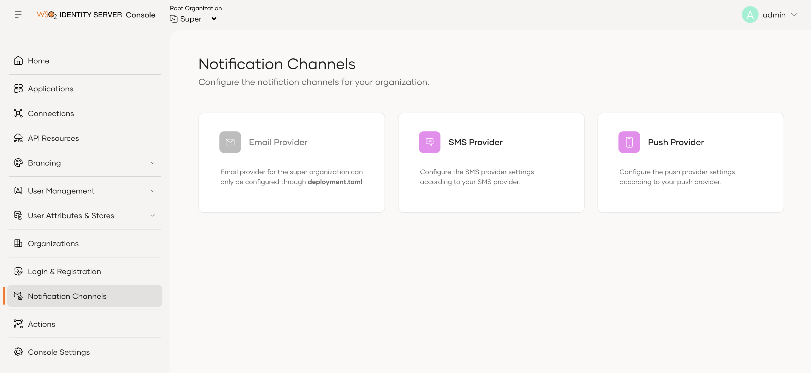

# Configure push provider

To use push notification-based authentication, you need to configure at least one push notification provider in WSO2 Identity Server. WSO2 Identity Server supports **Firebase Cloud Messaging (FCM)** as a push notification provider.

## Configure the push provider

1. On the WSO2 Identity Server Console, go to **Notification Channels** and select **Push Providers**.

      

2. Select the tab for the provider you want to configure and follow the steps in the relevant section below.

### Configure Firebase Cloud Messaging (FCM)

1. Select the **Firebase** tab.

2. Upload the `service-account.json` file that you downloaded from Firebase when you created your Firebase project.

      

3. Click **Update** to save your changes.

      

:::note

Firebase Cloud Messaging can send push notifications to iOS devices through Apple Push Notification Service (APNs). However, you need to configure APNs separately to send push notifications to iOS devices. For more information, [refer to the Firebase documentation](https://firebase.google.com/docs/cloud-messaging/ios/client).

:::
