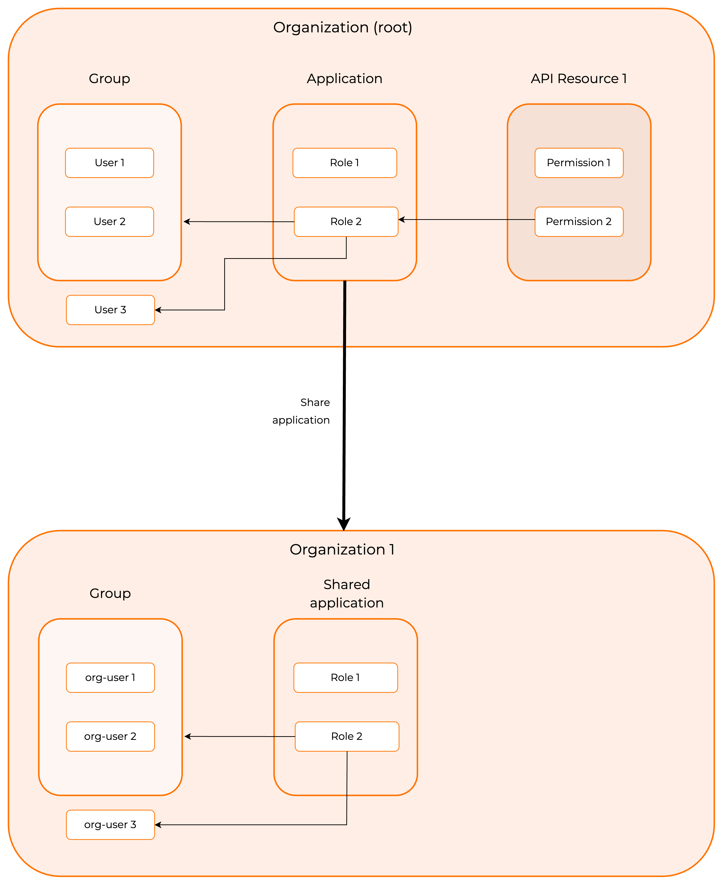

# API authorization for organizations

WSO2 Identity Server allows organizations to authorize user access to an application's API resources based on the API permissions, roles, and groups assigned to the users. See [API authorization](/identity/7.2.0/guides/api-authorization/) for more information.

API resources are created and authorized for applications on the organization (root). If the application consuming the API resources is shared with the organization, all application-specific configurations of API resources are inherited by the organization.

## Prerequisites

You need to configure your API resources on the organization (root):

1. [Register an API resource](/identity/7.2.0/guides/api-authorization/#register-an-api-resource)
2. [Authorize the API resource to an app](/identity/7.2.0/guides/api-authorization/#authorize-the-api-resources-for-an-app)
3. [Create roles and associate to application](/identity/7.2.0/guides/api-authorization/#associate-roles-to-the-application)
