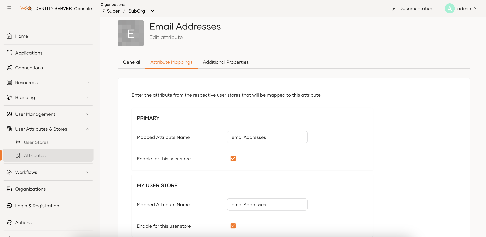

# User attribute inheritance

In WSO2 Identity Server, child organizations inherit user attributes, user store mappings, and dialects from the root organization, ensuring consistency across the organization hierarchy.

## How it works

This section explains the inheritance mechanism for attributes, user store mappings, and dialects across organizations.

### User attributes

- Child organizations inherit both the system-defined and custom attributes from the root organization.

- Only the root organization can create custom attributes.

Organization administrators can access inherited user attributes from the WSO2 Identity Server Console under **User Attributes & Stores** > **User Attributes**.

### User store mappings

Each user store in an organization maintains mappings for user attributes. Inheritance of user store mappings works in the following way.

- **Primary user store**

    - Only the root organization can edit the user store mappings for the primary user store.

    - Child organizations inherit primary user store mappings from the root organization.

- **Secondary user stores**

    - Child organizations can onboard their own secondary user stores.

    - Child organizations have full control over user store mappings for secondary user stores, including:

        - Editing mappings for user attributes inherited by the root organization.

        - Whether to enable multi-valued user attributes (e.g. emailAddresses) for the secondary user stores. This option is only available for supported attributes.

    Organization administrators can access user store mappings from the WSO2 Identity Server Console by selecting an attribute from **User Attributes & Stores** > **User Attributes** and going to its **Attribute Mappings** tab.

    The following diagram illustrates the attribute mapping section for the multi-valued `emailAddresses` attribute.

    

    - Organizations can't edit the attribute mapping or disable it for the primary user store (**PRIMARY**).

    - Child organizations can edit attribute mappings for secondary user stores (**MY USER STORE**).

### Attribute dialects

Attribute dialects define the naming and format of user attributes when exchanging data with external systems.

- Child organizations inherit all external attribute dialects defined in the root organization, such as:

    - SCIM 2.0

    - OpenID Connect (OIDC)

    

    - Any custom dialects created at the root organization level

    

- Attribute dialects are read-only for child organizations. They can't create new dialects or modify inherited ones.

Organization administrators can view user attribute dialects from the WSO2 Identity Server Console by going to **User Attributes & Stores** > **User Attributes** and selecting the relevant dialect under **Manage Attribute Mappings**.

## Configure user attributes at the root organization

Root organization administrators can create user attributes, user store mappings and dialects at the root organization. Follow the [Manage attributes and mappings](../../users/attributes/index.md) guide to learn more.
