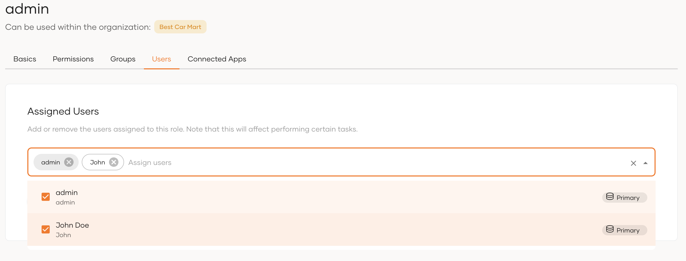

# Sales-led approach

In this approach, an admin of the parent organization creates the child organization and adds an admin to the created organization. This method is typically used when the child organizations should be created under the supervision of the parent organization.

Follow the steps below to onboard an admin to an organization in the sales-led approach.

## Prerequisites

Perform the following steps to create admin roles authorized for [organization APIs](../../../apis/organization-apis/index.md)  and share with the organization.

- [Create an organization](../manage-organizations.md#create-an-organization) for the partner/supplier.

- [Register your application](../../applications/index.md) in the root organization.

- Authorize the application to consume [organization APIs](../../../apis/organization-apis/index.md). Learn more about [API authorization](../../authorization/api-authorization/api-authorization.md).

- Create an admin role and associate it with the application. Learn about roles in [mange roles](../../users/manage-roles.md).

- [Share the application](../share-applications.md) with the organization.

## Step 1: Create an organization user

To create a new organization user:

1. [Switch to the organization Console](../manage-organizations.md#switch-to-an-organization).

2. On the organization Console, go to **User Management** > **Users** and click **Add User**.

3. Enter the following details: 
    <table>
        <tr>
            <th>Username</th>
            <td>A unique identifier to identify the user.</td>
        </tr>
        <tr>
            <th>First Name</th>
            <td>First name of the user. You can change this later.</td>
        </tr>
        <tr>
            <th>Last Name</th>
            <td>Last name of the user. You can change this later.</td>
        </tr>
        <tr>
            <th>Email Address</th>
            <td>An email address of the user. You can change this later</td>
        </tr>
    </table>

4. You can either set a password on the user's behalf or request the user to set the password.

    - **Set a temporary password for the user**: If this option is selected, the administrator can set a temporary password for the user.

    - **Invite user to set their own password**: If this option is selected, an email with a confirmation link will be sent to the provided email address for the user to set their own password.

5. Click **Finish** to add the new user.

## Step 2: Assign user to an admin role

When an application is shared with an organization, the roles associated with the application are made available to the organization. Assigning users to such a role grants them access to the [organization APIs](../../../apis/organization-apis/index.md) associated with the role. The users can then use these APIs to manage the organization, ideally through a dedicated administration portal.

To assign the created user to an admin role of the application:

1. [Switch to the organization Console](../manage-organizations.md#switch-to-an-organization).

2. On the organization Console, go to **User Management** > **Roles**.

3. Select the relevant role and go to its **Users** tab.

4. Select the user from the drop-down.

    

5. Click **Update**.

:::note

If you wish to grant organization Console access to the user, proceed to step 3 below.

:::

## Step 3 (optional): Grant user access to the organization Console

Step 2 above ensures that users receive the necessary permissions to access all or selected [organization APIs](../../../apis/organization-apis/index.md). This is sufficient if the organization admins manage organizations through a separate administration portal. However, it does not grant them access to the organization Console.

:::note[Roles for the Console]

The WSO2 Identity Server Console acts as an application and is, by default, shared with all organizations. As opposed to roles that control access to organization APIs, roles associated with the Console, govern access to features available in the Console interface. Any Console role created in the root organization will immediately be available in child organizations. Hence, organization admins may use these roles to provide users limited access to the organization Console interface.

:::
    
    

If you wish to grant the user Console access, follow the steps below.

1. [Switch to the organization Console](../manage-organizations.md#switch-to-an-organization).

2. On the organization Console, go to **Console Settings**.

3. Go to its **Roles** tab and select the **Administrator** role.

    :::tip

    The Administrator role is a default Console role that provides access to all features of the Console. Create a different role in the root organization and assign it to the user if you wish to grant limited Console access.

    :::

4. Go to its **Users** tab and from the dropdown, select the user from the dropdown.

5. Click **Update** to save the changes.

:::note[Access the Console]

Learn how privileged organization users may access the Console in [Administration of organizations](../manage-b2b-administration.md#use-the-console-as-the-administration-portal).

:::
