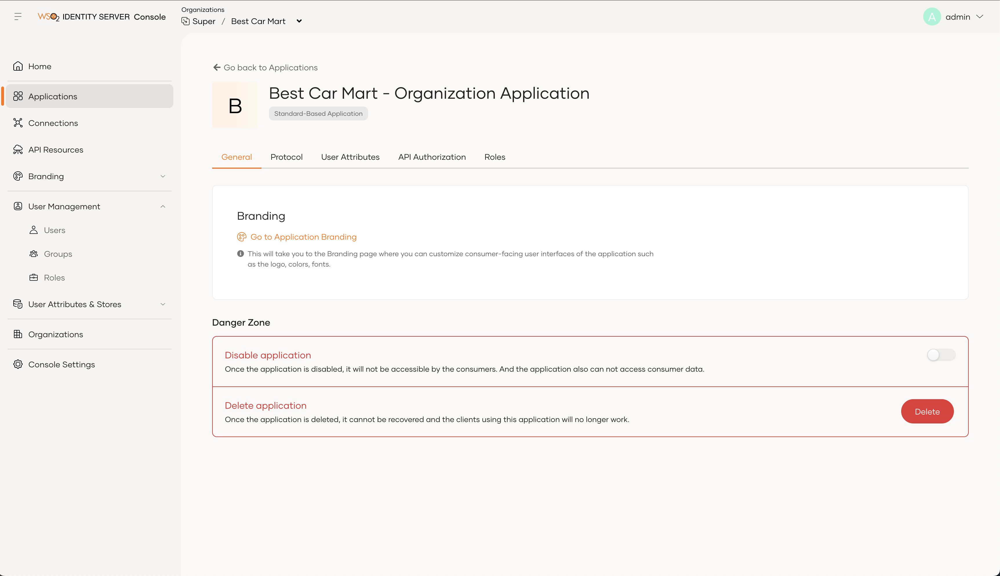

# Create an application in an organization

Organization administrators can create and mange applications directly within their organizations. These applications can access and consume the organization’s API resources. To create an application, it must meet the following conditions:

- Use OAuth2.

- Use only the following grant types: client credentials, password and refresh token.

To create an application,

1. Get a bearer token with the `internal_org_application_mgt_create` scope. Learn more about [accessing organization APIs](../../apis/organization-apis/authentication.md).

2. Use the [Application management REST API](../../apis/organization-apis/organization-application-mgt.md#tag/Applications/operation/createApplication) to create an application in an organization.

## Edit an application

You can find the created applications in the **Application** section of your organization's Console. You can use the Console to make the following changes to these applications.

- Protocol level configurations
- User attributes related configurations
- API Authorization for organization application
- Role management for organization application

