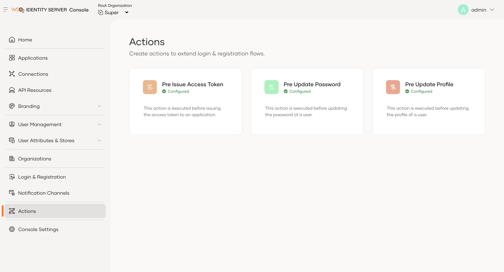
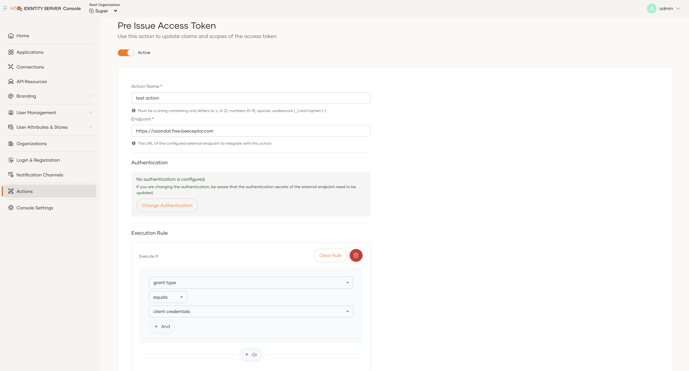

# Setting up actions

This guide provides a step-by-step approach to setting up actions in WSO2 Identity Server to customize its behavior at specific extension points.

<Prerequisites>

## Prerequisites

Ensure that you have:

- Access to the WSO2 Identity Server console.
- Facility to develop a web service or endpoint accessible to WSO2 Identity Server.

</Prerequisites>

## Create the external service

Your external web service should have the following to successfully execute an action.

1. Expose an endpoint that accepts HTTP POST requests with JSON payloads. This endpoint should deploy in a server accessible to WSO2 Identity Server.

2. Ensure your service adheres to the REST API contract specified for the action type you plan to use. This includes handling request and response formats.

3. Use one of the following methods to secure the communication between your external service and WSO2 Identity Server.

    - Basic Authentication: Use HTTP Basic authentication to secure the endpoint.
    - OAuth 2.0 Bearer Tokens: Integrate OAuth 2.0 for token-based authentication.
    - API Key Header: Secure the endpoint using an API key sent in the request header.
    

    :::tip

    During the development phase, you may choose to invoke your external service without security for testing purposes. Add security before deploying the service in a production environment.

    :::

## Configure an action in WSO2 Identity Server

Follow the steps below to configure an action.

1. On the WSO2 Identity Server Console, go to **Actions**.

2. Click on the preferred action type.

    

3. Provide the following information

    - **Action Name**: Provide a name for the action.
    - **Endpoint**: Enter the URL of the web service endpoint you created.
    - **Authentication**: Select the authentication scheme required to invoke your endpoint and configure the related properties.

        :::note

        You can view authentication secret values only at the time of adding them. Reset the secrets if you need to update them.

        :::

        - Basic - Provide a username and password.
        - Bearer - Provide a bearer token.
        - API Key - Provide the header name and the value.
        
        - No Authentication - No authentication (recommended only for testing purposes).


    - **Allowed headers**: Add the request headers you want to send to your external service.
    - **Allowed Parameters**: Add the request parameters you want to send to your external service.
  
        :::note

        Currently, you can add allowed headers and parameters only in the Pre-Issue Access Token action.

        :::


    Note that you may see extra properties depending on the action type.

4. Click **Create** to create the action.

### Action versioning

Actions use versioning to ensure your external service continues to operate without disruption as the action feature evolves. Each action has a major and minor version:

- Major version – Indicates breaking changes, such as removed fields or incompatible response changes.
- Minor version – Indicates backward-compatible improvements, such as new optional fields or minor enhancements.

How versions work

- When you create a new action, WSO2 Identity Server automatically uses the latest available version.
- If a newer version releases later, you can upgrade your action to use it.
- WSO2 Identity Server always uses the latest minor version within the configured major version when invoking an action. Existing service extensions continue to work without changes.
- To take advantage of improvements in a new minor version, you must explicitly upgrade your external service accordingly.

:::warning

Once an action is updated to a major version, it cannot revert to an older major version.
Before upgrading, ensure your external service implements the request and response format of the new version.

:::

## Invoke actions conditionally

You can trigger actions conditionally by configuring rules. The following action types support rule-based invocation:

- [Pre-Issue Access Token](pre-issue-access-token-action.mdx#conditional-invocation-of-pre-issue-access-token-action)
- [Pre-Issue ID Token](/identity/7.2.0/guides/service-extensions/pre-flow-extensions/pre-issue-id-token-action/#conditional-invocation-of-pre-issue-id-token-action)
- [Pre-Update Password](pre-update-password-action.mdx#conditional-invocation-of-pre-update-password-action)

- [Pre-Update Profile](pre-update-profile-action.mdx#conditional-invocation-of-pre-update-profile-action)


### Rule structure

A rule contains one or more expressions and logical operators (AND/OR) combine these expressions. The structure of a rule includes:

- **Field**: The data attribute evaluated in the rule. Available fields vary depending on the action type. For example, you can use grant type in pre-issue access token action but not in other flows.
- **Operator**: Defines how the rule evaluates the field against the value. Supported operators (such as equals, not equals) may vary based on the selected field.
- **Value**: The specific data compared against the field using the chosen operator. The available values depend on the selected field. For example, if you select application as the field,  use the name of a created application as the value.
- **Expression**: Compares a field and a value using an operator. This forms the smallest unit in a rule.
- **Operators (AND/OR)**: You can group expressions using logical operators to form complex rule conditions.

### Configuring a rule

To configure a rule:

- Select the action flow.
- Choose a field relevant to that flow.
- Apply a suitable operator (equals, not equals).
- Provide a value corresponding to the field.
- Combine expressions using AND/OR to define the full rule logic.

This rule configuration mechanism allows you to precisely control when WSO2 Identity Server should invoke an action, ensuring flexibility and flow-specific customization.
The following example illustrates a rule configuration in pre-issue access token action. In this example, set the field to grant type, the operator to equals, and the value to client credentials.



## Test your action

Follow the steps below to try out the created action.

1. Trigger an action by initiating the specified flow (For example login and get an access token, update a password).

2. Ensure that the external service receives a request with a JSON payload from WSO2 Identity Server. Payload differs based on the action type you have implemented.

3. Verify that your service correctly processes the request and the response as intended by WSO2 Identity Server.

## Troubleshoot issues

Try these troubleshooting steps to resolve issues.

1. Check that your external service runs without errors and responds to requests from WSO2 Identity Server.

2. Confirm that the request and response payloads conform to the expected formats as defined by the REST API contract.


3. If your external service uses a self-signed certificate, ensure the certificate is imported into the WSO2 Carbon truststore. By default, WSO2 Identity Server uses the WSO2 Carbon truststore at `<IS_HOME>/repository/resources/security/client-truststore.jks`.

    
    Add the following configuration to the `deployment.toml` file and restart the server:

    ```toml
    [actions.http_client]
    use_carbon_truststore = true
    ```

    
    :::note

    This configuration is available from the update level: **`7.2.0.19`**.

    :::
