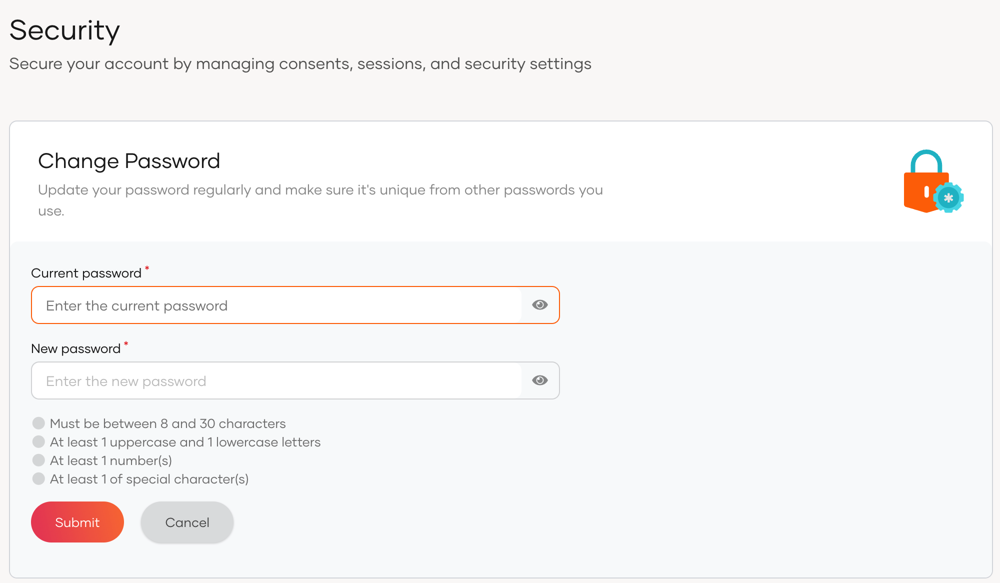

# Change password

Users can use the My Account portal to change the password by following the steps below.

1. Sign in to the My Account portal.

2. Click **Security** and go to **Change Password**.

3. Click **Change your password**.

      

4. Enter the **Current password** and the **New password**.

5. Click **Submit**.

:::note

- Alternatively, users can [reset a forgotten password from the login page of an application](user-password-recovery.mdx). 
- Users onboarded from a read-only remote user store do not have the capability of changing their password through the My Account portal.

:::
