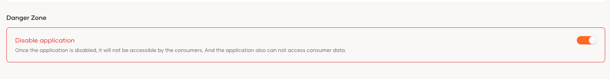
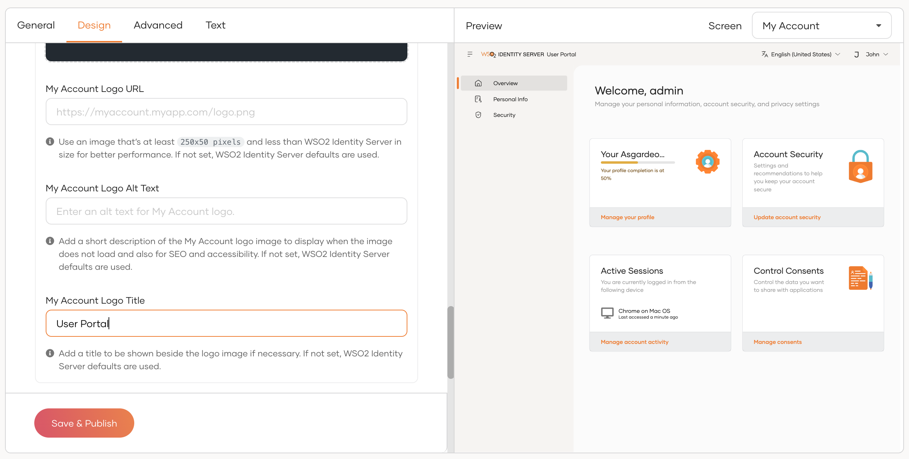

# Configure the My Account portal

This section explains configurations available for the **My Account portal**, a self-service portal offered by WSO2 Identity Server that allows users and administrators to manage their accounts and information.


## Enable/Disable the My Account portal

Follow the steps given below to manage access to the My Account portal for users in your organization.

1. On the WSO2 Identity Server Console, go to **Applications** and locate the My Account application at the top.

2. Click the settings icon to enter the **My Account** configuration page.

3. In the **Danger Zone**, under **Disable application**, switch the toggle on to disable the My Account portal or off to enable it for users.

    


## Configure the login flow

Just like any other application registered in WSO2 Identity Server, you can customize the login flow of the My Account portal. To do so,

1. On the WSO2 Identity Server Console, go to **Applications** and locate the My Account application at the top.

2. Click the settings icon to enter the **My Account** configuration page.

3. Go to the **Login Flow** tab and customize the login flow.

    :::note

    Explore the authentication options offered by WSO2 Identity Server in the [Authentication](../authentication/index.md) section.

    :::

4. Click **Update** to save the changes.

## Customize appearance

You can customize the appearance of the **My Account** application to align with your organization's branding. This includes modifying elements such as logos, color schemes, and fonts to ensure a consistent user experience.

Refer to the [Branding Preferences](../branding/configure-ui-branding.md) to learn more.



## Enable/Disable self-service features

As an administrator, you can enable or disable specific self-service features in the **My Account** portal based on your organization's requirements. This allows you to tailor the portal's functionality to better suit your users' needs.

All the features in the **My Account** portal use the following configuration structure and can be configured in the `<IS_HOME>/repository/conf/deployment.toml` file.

```toml
[myaccount]
<feature>.enabled = true
<feature>.disabled_features = []
<feature>.scopes.create = []
<feature>.scopes.read = []
<feature>.scopes.update = []
<feature>.scopes.delete = []
```

- The `<feature>.enabled` parameter can be used to toggle a feature as a whole. For instance, by setting the `<feature>.enabled` parameter of the *overview* feature, you can disable the *overview* feature as a whole.
-	The `<feature>.disabled_features` parameter can be used to disable specific sub-features of a feature. For instance, by adding `overview.accountActivity` to the `overview.disabled_features` array, you can disable the `accountActivity` widget in the `overview` feature.

-	The `<feature>.scopes` parameter can be used to specify the scopes the user should have in order to access a feature. The `<feature>.scopes` parameter has the following sub-attributes and each sub-attribute takes an array of scopes.

    ```toml
    <feature>.scopes.create = []
    <feature>.scopes.read = []
    <feature>.scopes.update = []
    <feature>.scopes.delete = []
    ```

    For instance, if you want the user to have a certain scope to create an application, then you can specify that scope within the `applications.scopes.create` array of the applications feature.

The following section explains all the features available in the **My Account** portal and how to configure them.

<Tabs>
<TabItem value="tab-0" label="Overview">


The `Overview` section provides a summary of your account. It displays the completion status of your profile and offers quick access to update personal details. Additionally, it highlights important account security settings, allowing you to review and manage the measures that help keep your account safe. It can be configured as follows:

```toml
[myaccount]
overview.enabled = true
overview.disabled_features = []
overview.scopes.create = []
overview.scopes.read = []
overview.scopes.update = []
overview.scopes.delete = []
```

The `overview` feature has the following sub-features that can be disabled using the `overview. disabled_features` parameter:

|Sub-feature| Description|
|--|--|
|`overview.accountStatus`|The widget that shows the account status in the overview page.|
|`overview.accountActivity`|The widget that shows the account activity in the overview page.|
|`overview.accountSecurity`|The widget that shows the account security information in the overview page.|
|`overview.consents`|The widget that shows the consent information in the overview page.|

</TabItem>
<TabItem value="tab-1" label="Personal Info">


The `Personal Info` section allows you to view and manage your personal profile details. You can update information such as your name, mobile number, and birth date. Additionally, you can manage and review linked social accounts that are connected to your account. It can be configured as follows:

```toml
[myaccount]
personal_info.enabled = true
personal_info.disabled_features = ["profileInfo.mobileVerification"]
personal_info.scopes.create = []
personal_info.scopes.read = []
personal_info.scopes.update = []
personal_info.scopes.delete = []
```

The `personal info` feature has the following sub-features that can be disabled using the `personal_info.disabled_features` parameter:

|Sub-feature| Description|
|--|--|
|`profileInfo.linkedAccounts`|The Linked Accounts section in the Personal Info page.|
|`profileInfo.externalLogins`|The External Logins section in the Personal Info page.|
|`profileInfo.exportProfile`|The Export Profile section in the Personal Info page.|
|`profileInfo.mobileVerification`|The Mobile number verification feature in the Personal Info page.|

</TabItem>
<TabItem value="tab-2" label="Security">


The `Security` section helps you safeguard your account by managing authentication methods, recovery options, and active sessions. From here, you can update your password, configure account recovery methods, and enable additional authentication options such as TOTP, push authentication, and backup codes. You can also monitor and manage your active sessions to maintain account security. It can be configured as follows:

```toml
[myaccount]
security.enabled = true
security.disabled_features = []
security.scopes.create = []
security.scopes.read = []
security.scopes.update = []
security.scopes.delete = []
```

The `security` feature has the following sub-features that can be disabled using the `security. disabled_features` parameter:

|Sub-feature| Description|
|--|--|
|`security.changePassword`| The Change Password section of the Security page.|
|`security.accountRecovery`| The Account Recovery section of the Security page.|
|`security.accountRecovery.challengeQuestions`| The Challenge Questions section under the Account Recovery section of the Security page.|
|`security.accountRecovery.emailRecovery`| The Email Recovery Section under the Account Recovery section of the Security page.|
|`security.mfa`| The Multi-factor Authentication section of the Security page.|
|`security.mfa.sms`| The SMS feature of the Multi-factor Authentication section of the Security page.|
|`security.mfa.fido`| The Device feature of the Multi-factor  Authentication section of the Security page.|
|`security.mfa.totp`| The Authenticator App feature of the Multi-factor  Authentication section of the  Security page.|
|`security.activeSessions`| The Active IDP Sessions section of the Security page.|
|`security.manageConsents`| The Manage Consents section of the Security page.|

</TabItem>
<TabItem value="tab-3" label="Applications">


The `Applications` section allows you to discover and access applications available within your organization. It can be configured as follows:

```toml
[myaccount]
applications.enabled = true
applications.disabled_features = []
applications.scopes.create = []
applications.scopes.read = []
applications.scopes.update = []
applications.scopes.delete = []
```

The applications feature has no sub-features.

</TabItem>
</Tabs>


<Tabs>
<TabItem value="tab-0" label="Approvals">


The Approvals section enables users to review and act on operational tasks that require their attention. From here, users can view pending approval requests, such as user creation, role creation, or user removal requests, and take the necessary actions. It can be configured as follows:

```toml
[myaccount]
approvals.enabled = true
approvals.disabled_features = []
approvals.scopes.create = []
approvals.scopes.read = ["internal_approval_task_view"]
approvals.scopes.update = ["internal_approval_task_update"]
approvals.scopes.delete = []
```

The approvals feature has no sub-features.

</TabItem>
</Tabs>


## Configure My Account sessions

You can configure session management for the My Account portal by updating the following parameters in the `<IS_HOME>/repository/conf/deployment.toml` file.

```toml
[myaccount]
session.params.userIdleTimeOut = 600
session.params.userIdleWarningTimeOut = 580
session.params.sessionRefreshTimeOut = 300
session.params.checkSessionInterval = 3
```

|Parameter|Description|Default Value|
|--|--|--|
| `session.params.userIdleTimeOut`|Automatically logs out the user when the user idles for the specified number of seconds. | 600|
|`session.params.userIdleWarningTimeOut`| Display a warning when the user idles for the specified number of seconds.| 580|
|`session.params.sessionRefreshTimeOut`| The session refreshes after the specified number of seconds. | 300|
|`session.params.checkSessionInterval` | Checks the session state at the specified interval.|3|
