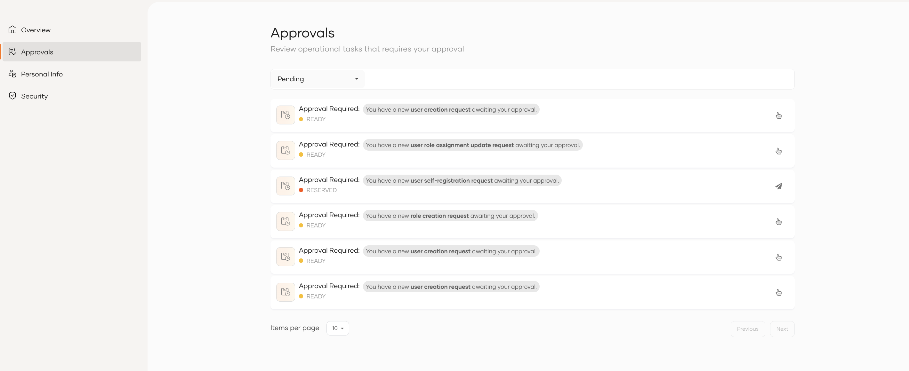
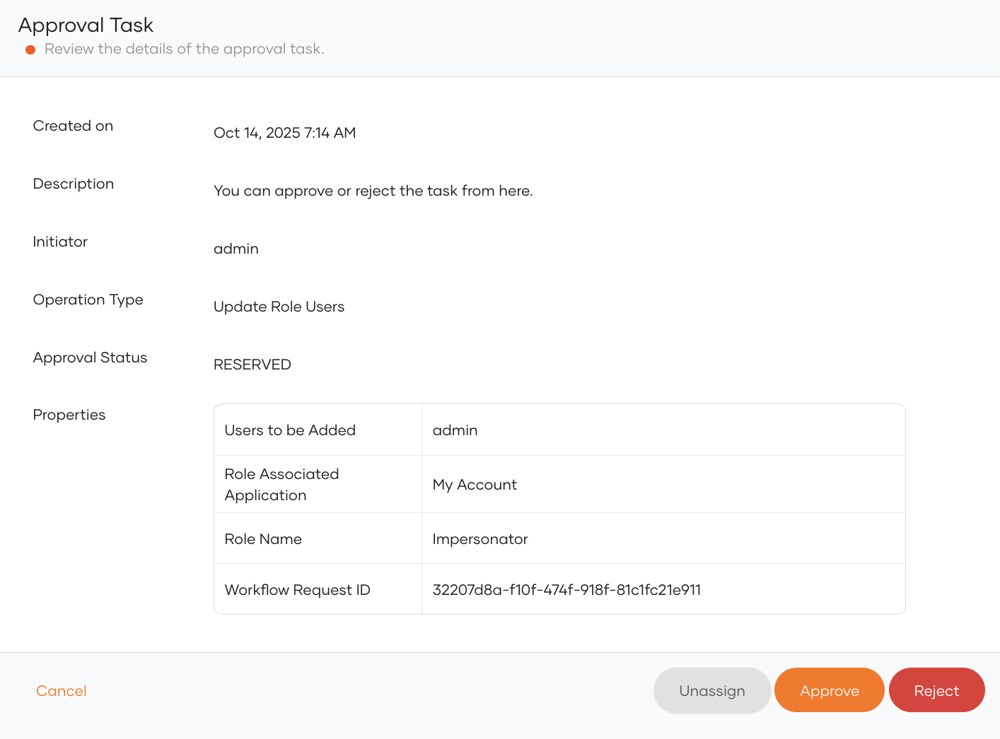
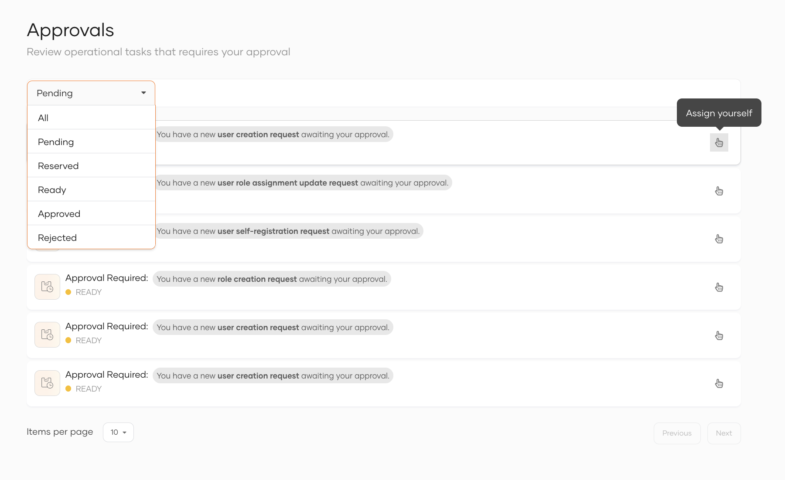
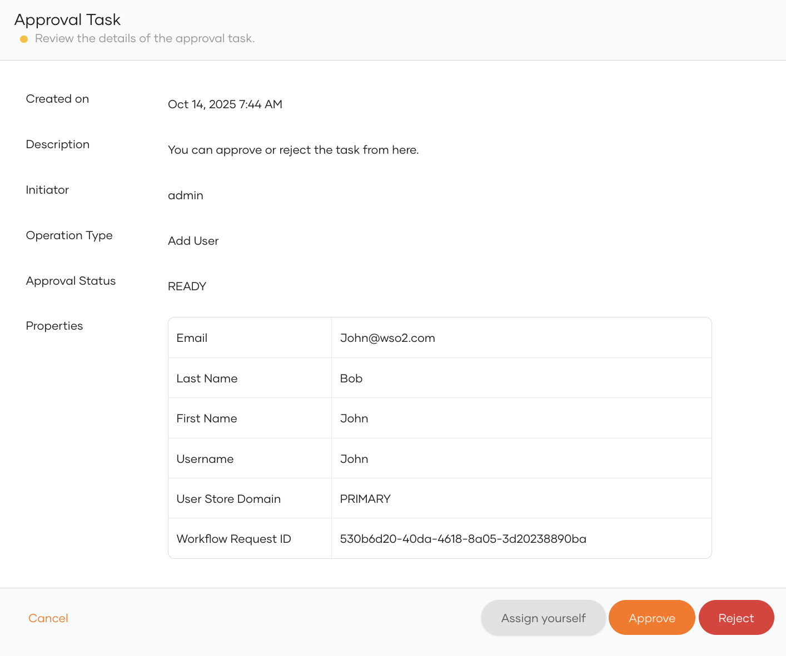

To view the approvals, you can navigate to the **Approvals** section from the My Account Portal side menu.

This page displays all approval requests that you are eligible to act on.

### Approval states

Each approval request can be in one of the following states:

- **Ready**: The approval request is available for assignment. You can either approve it immediately or reserve it for review later.
- **Reserved**: You have assigned yourself this approval for review. Other approvers can't act on it until you unassign it.
- **Blocked**: Another approver has already reserved this request, so you can't act on it.
- **Approved**: You have approved the request.
- **Rejected**: You have rejected the request.

:::note

Once you reserve (assign yourself) an approval, no one else can approve it. However, you can unassign a reserved approval back to the shared pool at any time, allowing other eligible approvers to act on it.

:::

You can filter approval requests based on their state, as shown below.

### View approval details

To view more information about a specific approval, click on the approval entry in the list.
This opens the Approval Details page, which displays all relevant information about the associated operation.

