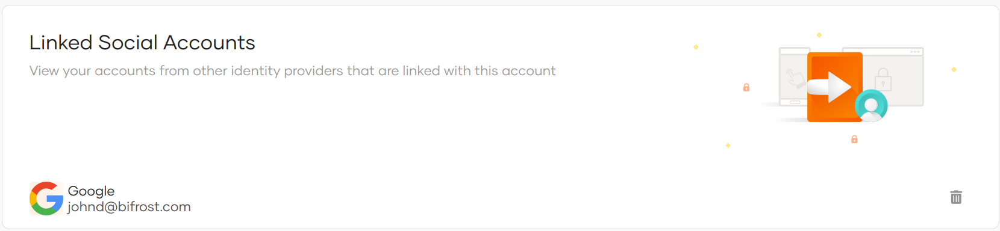

# Manage linked social accounts

Users can use the My Account portal to change the password by following the steps below.

Given below are the steps to follow.

1. Sign in to the My Account portal.

2. Click **Personal Info** > **External Logins**.

3. To remove any of the linked accounts, click **Remove**.

    
