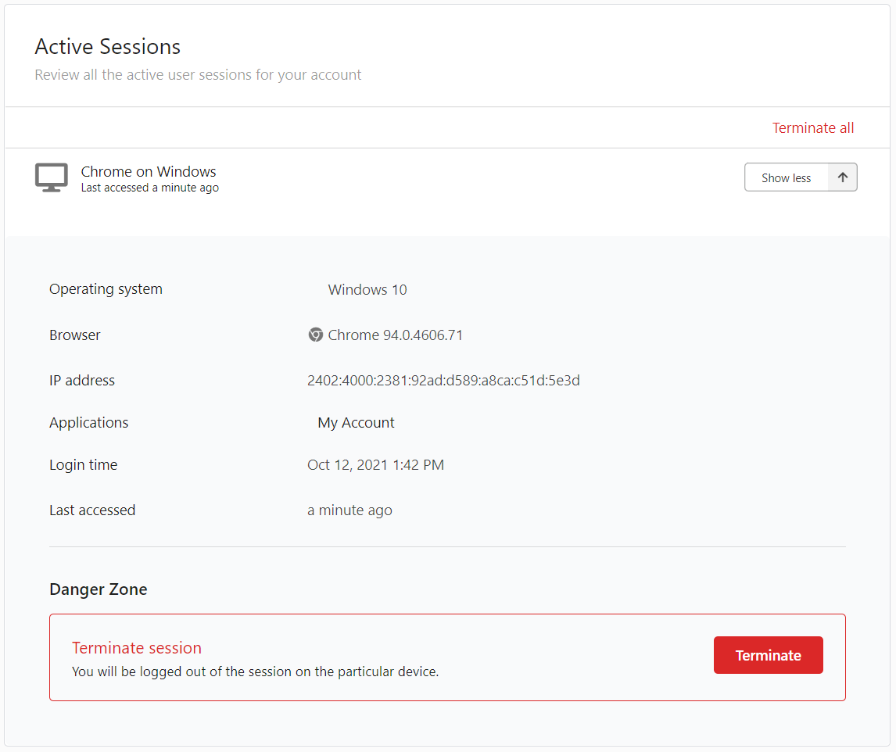

# Manage login sessions

Users can manage their own sessions via My Account by following the steps below:

1. Sign in to the My Account portal.

2. Go to **Security** and go to **Active Sessions**. This section lists all the active login sessions of the user.

3. Click **Show more** on an individual session to get more details on it.

    

4. To terminate sessions, users can do one of the following:

    - Click **Terminate** on a selected session to terminate only that session.

    - Click **Terminate all** on the upper-right corner to terminate all active sessions.
