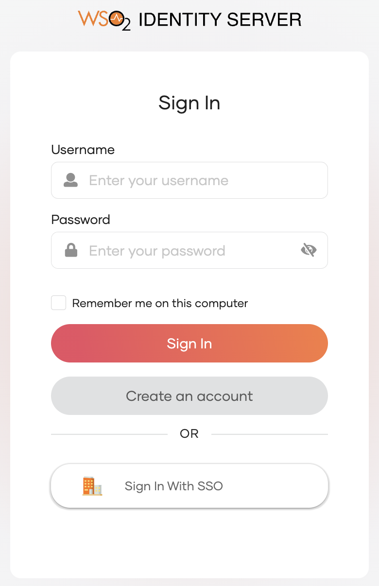
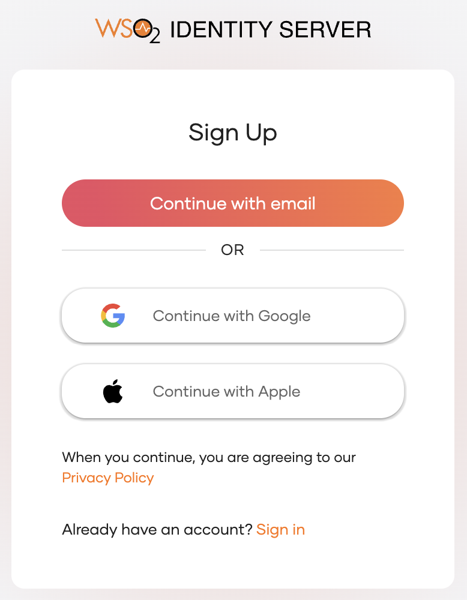
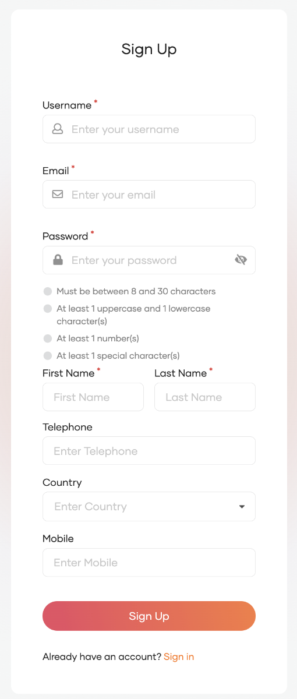
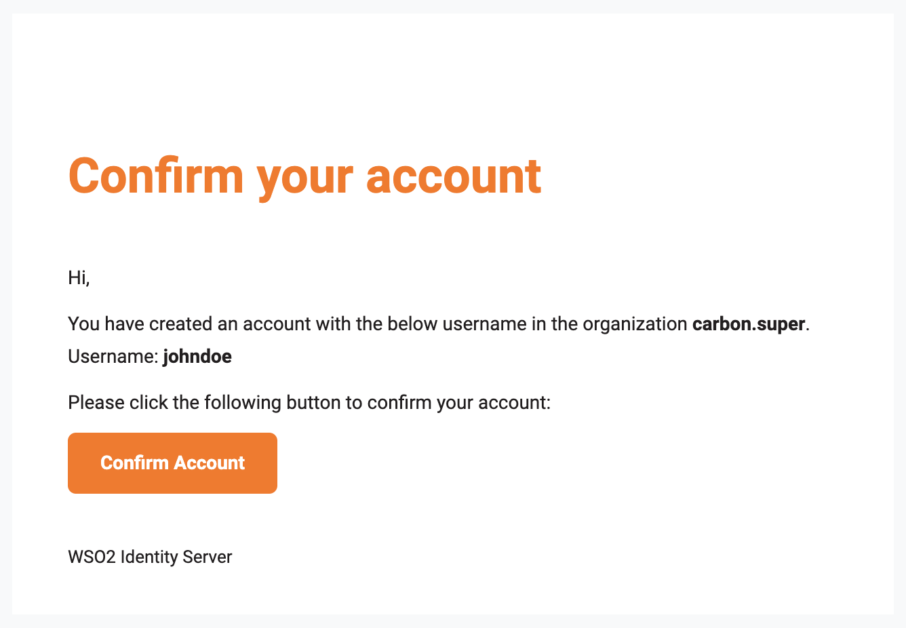
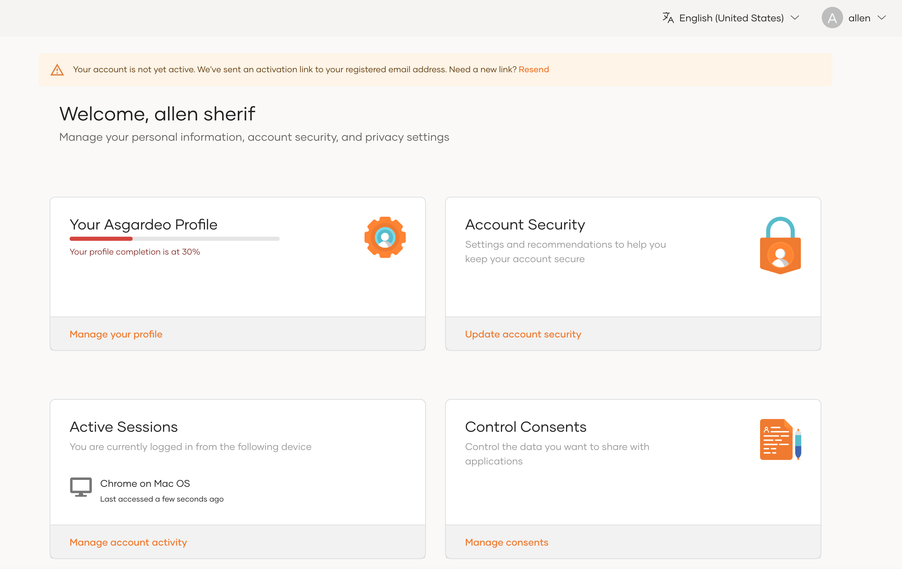
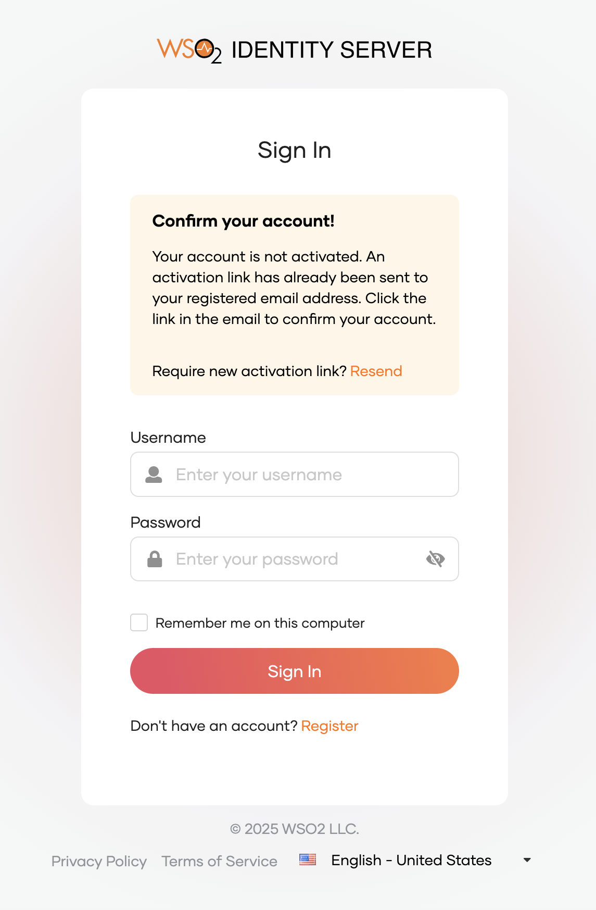

# Self-register as a user

If an administrator has enabled self-registration for an organization, users can sign up and create their own accounts without the involvement of an administrator.

:::note

Learn how administrators can [enable self-registration](../flows/self-registration.md) in an organization.

:::

## Self-registration methods

There are two ways that a user can self-register to an organization in WSO2 Identity Server.

### via My Account

To self-register from the My Account portal, the user should follow these steps.

1. Go to the My Account Portal.

    

2. Click **Register**.

3. Follow the steps to [sign-up using an email](#sign-up-using-an-email).

### via an application

To self-register from an application, users should follow these steps.

1. Access the application URL.
2. Click **Register**
3. Select one of the following options to sign up:

    - Click **Continue with email** and follow the steps to [sign up using an email](#sign-up-using-an-email).
    - Sign-up using any of the other authenticators as shown below.

      

## Sign up using an email

A user can sign-up to an organization in WSO2 Identity Server using an email, [via My Account portal](#via-my-account) or [via an application](#via-an-application).

The user can follow the steps below to sign up using an email.

1. Click **Continue with email** on the sign-up screen.

2. Enter the email address, password, and any other information that the application requests.

    

    :::note

    - Administrators can change which attributes users need to enter during the sign up process. Learn how to [update user attributes](/identity/7.2.0/guides/users/attributes/manage-attributes/#update-attributes) so that they are displayed in the user profile.

    :::
        

3. Click **Sign Up** to create the account.

4. If **Account Verification** enabled, the user can confirm the account from the email.

    

5. If **Account Verification** enabled, users can resend the account verification email if needed.
    - If **Activate Account Immediately** enabled, after successfully logging into My Account, a warning message with a resend link will appear. Click this link to resend the account verification email.

        

    - If **Activate Account Immediately** disabled, attempting to log in to **My Account**, will display a warning message indicating the account lacks activation, along with a resend link. Click this link to resend the account verification email.

        
