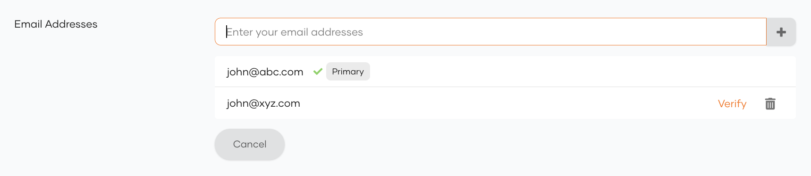

# Try out email address update verification

Email address verification ensures that when a user updates their primary email address, a verification request is triggered to the new email address. The primary email address will not change until the new email address is verified. If you have enabled [multiple email addresses per user](/identity/7.2.0/guides/users/attributes/manage-attributes/#assign-multiple-email-addresses-and-mobile-numbers-to-a-user), users can maintain several verified email addresses and designate one as the primary email address.

:::note

- This feature can be invoked via a PUT/PATCH request to the SCIM 2.0 /Users endpoint or /Me endpoint.
- The verification on update capability is **only** supported for the `Email` (`http://wso2.org/claims/emailaddress`) 
and `Verified Email Addresses` (`http://wso2.org/claims/verifiedEmailAddresses`) claims.
- Verification is not triggered if the email address to be updated is the same as a previously verified email address of the user.

:::

<Prerequisites>

## Prerequisites


- [Configure the email sending module](../../../deploy/configure/email-sending-module.mdx) of the WSO2 Identity Server.


- If required, enable [support for multiple email addresses](/identity/7.2.0/guides/users/attributes/manage-attributes/#assign-multiple-email-addresses-and-mobile-numbers-to-a-user) for users.

- Update [email verification settings](user-attribute-change-verification.mdx).

</Prerequisites>

## Try it out

Follow the guides below to try out different email update scenarios.

### Update the primary email address

If you only support a single email address and wish to update the email address of a user,

1. On the WSO2 Identity Server Console, go to **User Management** > **Users**.

2. Select a user account and go to its **Profile** tab.

3. Under **Email**, update the user's email address.

4. Click **Update** to save the changes. An email will be sent to the specified address for verification. The user needs to click the link provided in the email to verify the email address.

Alternatively, you may update the email address via a PATCH operation to the [SCIM 2.0 Me endpoint](../../../apis/scim2-me-rest-apis.mdx) as shown below.

:::note


<Tabs>
<TabItem value="tab-0" label="Request format">

```
curl -v -k -X PATCH
https://localhost:9443/scim2/Me \
-d '{
    "schemas":["urn:ietf:params:scim:api:messages:2.0:PatchOp"], 
    "Operations":[{
        "op":<operation>, 
        "value":
            { "emails":[{"primary":true, "value":<new_email>}]}
        }]
    }' \
--header "Content-Type:application/json" 
--header "Authorization: Bearer <access_token>"
```

</TabItem>
<TabItem value="tab-1" label="Sample request">


```curl
curl -X PATCH
https://localhost:9443/scim2/Me \
-d '{
    "schemas":["urn:ietf:params:scim:api:messages:2.0:PatchOp"],
    "Operations":[{
        "op":"replace",
        "value":
            { "emails":[{"primary":true,"value":"kim.jackson.new@gmail.com"}]}
        }]
    }' \
--header "Content-Type:application/json"
--header "Authorization: Bearer <access_token>"
```

</TabItem>
</Tabs>
---
**Sample Response**

```
{
    "emails":[
        "kimjack@gmail.com"
    ],
    "meta":{
        "created":"2020-01-07T09:32:18",
        "location":"https://localhost:9443/scim2/Users/1e624046-520c-4628-a245-091e04b03f21",
        "lastModified":"2020-01-07T14:18:49",
        "resourceType":"User"
    },
    "schemas":[
        "urn:ietf:params:scim:schemas:core:2.0:User",
        "urn:ietf:params:scim:schemas:extension:enterprise:2.0:User",
        "urn:scim:wso2:schema"
    ],
    "urn:scim:wso2:schema": {
        "emailAddresses": "kimjack@gmail.com",
        "verifiedEmailAddresses": "kimjack@gmail.com",
    },
    "urn:ietf:params:scim:schemas:extension:enterprise:2.0:User":{
        "pendingEmails":[
            {
                "value":"kim.jackson.new@gmail.com"
            }
        ]
    },
    "roles":[
        {
            "type":"default",
            "value":"Internal/everyone"
        }
    ],
    "name":{
        "givenName":"kim",
        "familyName":"jackson"
    },
    "id":"1e624046-520c-4628-a245-091e04b03f21",
    "userName":"kim"
}
```

:::
Upon receiving the response outlined above, the user will receive an email notification prompting them to verify their 
updated email address. Once verified, the `Email` claim (`http://wso2.org/claims/emailaddress`) will be updated to 
reflect the new email address.

:::note

If you update the primary `Email` claim directly, the change will not be reflected in the  `Verified Email Addresses` 
(`http://wso2.org/claims/verifiedEmailAddresses`) claim after verification.

:::

### Update the verified email addresses list

If you have enabled support for multiple email addresses and mobile numbers, a user can have several verified email addresses and a single primary email address.

To verify an email address, 

1. On the WSO2 Identity Server Console, go to **User Management** > **Users**.

2. Select a user account and go to its **Profile** tab.

3. Under **Email Addresses**, click the verify icon on an unverified email address of the user.

    

    An email will be sent to the specified address for verification. The user needs to click the link provided in the email to verify the email address.

Alternatively, you may update the email addresses via a PATCH operation to the [SCIM 2.0 Me endpoint](../../../apis/scim2-me-rest-apis.mdx) as shown below.

:::note


<Tabs>
<TabItem value="tab-0" label="Request format">


```curl
curl -X PATCH
https://localhost:9443/scim2/Me \
-d '{
    "schemas":["urn:ietf:params:scim:api:messages:2.0:PatchOp"],
    "Operations":[{
        "op":<operation>,
        "value":{"urn:scim:wso2:schema": {"verifiedEmailAddresses": <list_of_email_addresses>}}
        }]
    }' 
--header "Content-Type:application/json"
--header "Authorization: Bearer <access_token>"
```

</TabItem>
<TabItem value="tab-1" label="Sample request">


```curl
curl -X PATCH
https://localhost:9443/scim2/Me \
-d '{
    "schemas":["urn:ietf:params:scim:api:messages:2.0:PatchOp"],
    "Operations":[{
        "op":"replace",
        "value":{"urn:scim:wso2:schema": {"verifiedEmailAddresses": "kimjackson@gmail.com,kim.jackson.new@gmail.com"}}
        }]
    }' 
--header "Content-Type:application/json"
--header "Authorization: Bearer <access_token>"
```

</TabItem>
</Tabs>
---

**Sample Response**
```
{
    "emails":[
        "kimjack@gmail.com"
    ],
    "meta":{
        "created":"2020-01-07T09:32:18",
        "location":"https://localhost:9443/scim2/Users/1e624046-520c-4628-a245-091e04b03f21",
        "lastModified":"2020-01-07T14:18:49",
        "resourceType":"User"
    },
    "schemas":[
        "urn:ietf:params:scim:schemas:core:2.0:User",
        "urn:ietf:params:scim:schemas:extension:enterprise:2.0:User",
        urn:scim:wso2:schema
    ],
    "urn:scim:wso2:schema": {
        "emailAddresses": "kimjack@gmail.com",
        "verifiedEmailAddresses": "kimjack@gmail.com",
    },
    "urn:ietf:params:scim:schemas:extension:enterprise:2.0:User":{
        "pendingEmails":[
            {
                "value":"kim.jackson.new@gmail.com"
            }
        ]
    },
    "roles":[
        {
            "type":"default",
            "value":"Internal/everyone"
        }
    ],
    "name":{
        "givenName":"kim",
        "familyName":"jackson"
    },
    "id":"1e624046-520c-4628-a245-091e04b03f21",
    "userName":"kim"
}
```

:::

Upon receiving the response outlined above, the user will receive an email notification prompting them to verify their 
updated email address. Once verified, the `verifiedEmailAddresses` claim (http://wso2.org/claims/verifiedEmailAddresses) 
will be updated to reflect the new email address.  If a primary email address has not been configured, 
the verified email address will also be set as the primary email.


## Resend email verification

Run the following curl command in case you want to resend the email verification.

:::note


<Tabs>
<TabItem value="tab-0" label="Request format">


```curl
curl -X POST https://localhost:9443/api/identity/user/v1.0/resend-code
-H "Authorization: Bearer <access_token>"
-H "Content-Type: application/json" \
-d '{
    "user": {
        "username": <USERNAME>,
        "realm": <REALM>"
    },
    "properties": [{
        "key":"RecoveryScenario",
        "value": <recovery_scenario>
        }]
    }'
```

</TabItem>
<TabItem value="tab-1" label="Sample request">


```
curl -X POST https://localhost:9443/api/identity/user/v1.0/resend-code 
-H "Authorization: Bearer <access_token>"
-H "Content-Type: application/json" \
-d '{
    "user": {
        "username": "bob",
        "realm": "PRIMARY"
    },
    "properties": [{
        "key":"RecoveryScenario",
        "value":"EMAIL_VERIFICATION_ON_UPDATE"
        }]
    }'
```

</TabItem>
</Tabs>
The verification scenario should be specified in the properties parameter of the request body as follows :
```
"properties": [{"key": "RecoveryScenario", "value": "EMAIL_VERIFICATION_ON_UPDATE"}]
```
- `EMAIL_VERIFICATION_ON_UPDATE`: Used when verifying a newly updated email address for a user. 
- `EMAIL_VERIFICATION_ON_VERIFIED_LIST_UPDATE`: Used when updating the list of verified email addresses for a 
user.
---

**Response**
```curl
HTTP/1.1 201 Created
```

:::
