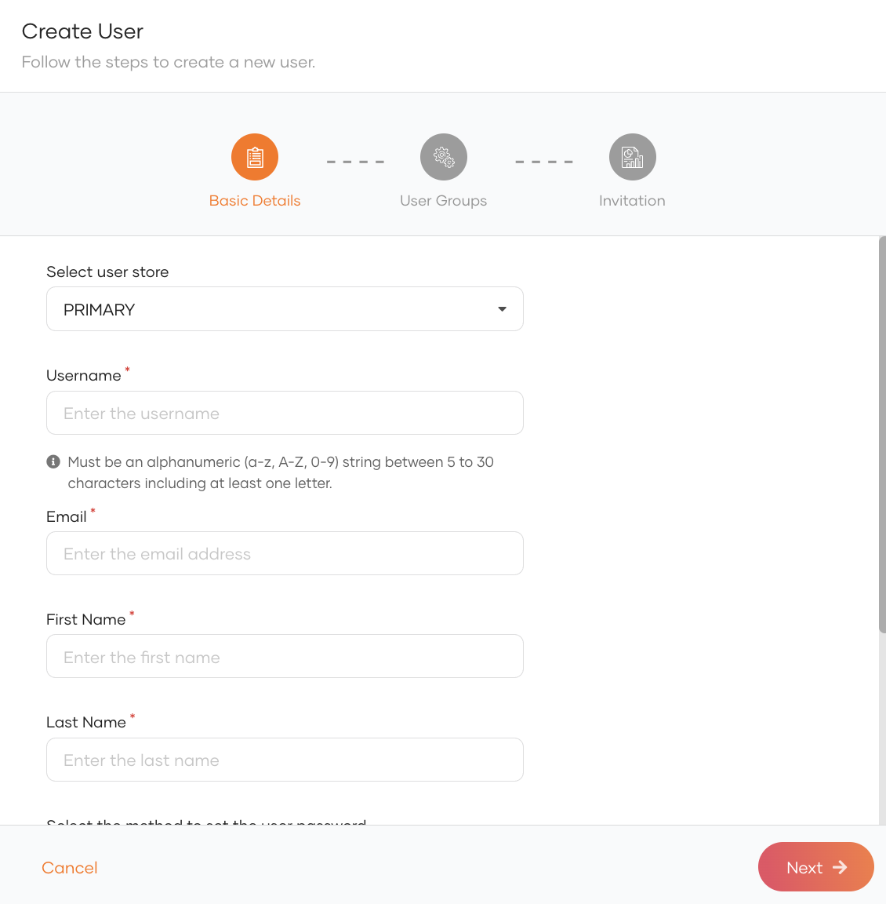
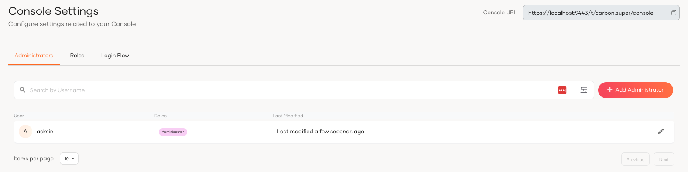

# Manage administrators

This guide walks you through the steps of managing an administrator account. If you are the owner or an existing administrator in the organization, you can add new administrators or delete existing administrator accounts.

## Add an administrator

Administrators of your organization can follow the steps below to add another administrator:

1. On the WSO2 Identity Server Console, go to **User Management** > **Users**.

2. Click **Add User** and provide the required details.

    

3. Click **Next**.

4. Review the summary and click **Finish**.

5. On the WSO2 Identity Server Console, go to **Console Settings**. 

6. Click **Add Administrator**.

7. Select the relevant user as the **username**.

8. Select the **Administrator** role.

9. Click **Add**.

:::note

The created administrator will be listed in the **Console Settings** page under the **Administrators** tab.

:::

## Delete an administrator

!!! warning Before you begin
    When you delete an administrator, you will only be revoking the administrator privileges from the user. Deleting this administrator does not delete the user account. If you want to delete the user account, see [Delete a user](manage-users.md#delete-a-user).

To delete an administrator:

1. On the WSO2 Identity Server Console, click **Console Settings**.
2. Click **Delete** for the administrator you want to remove.
3. Select the checkbox to confirm your action.
4. Click **Confirm**.
