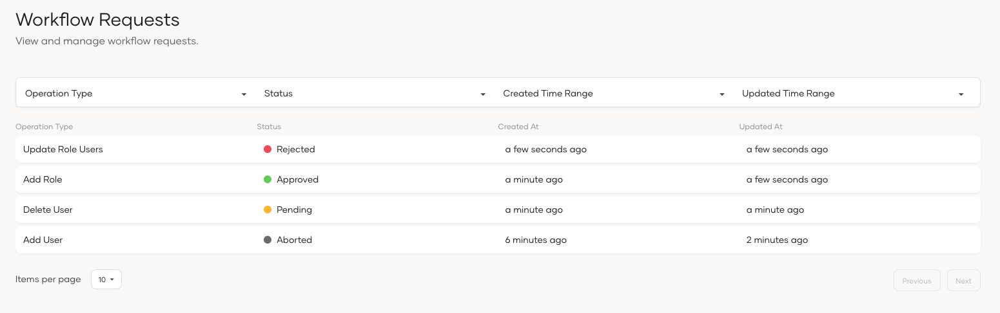
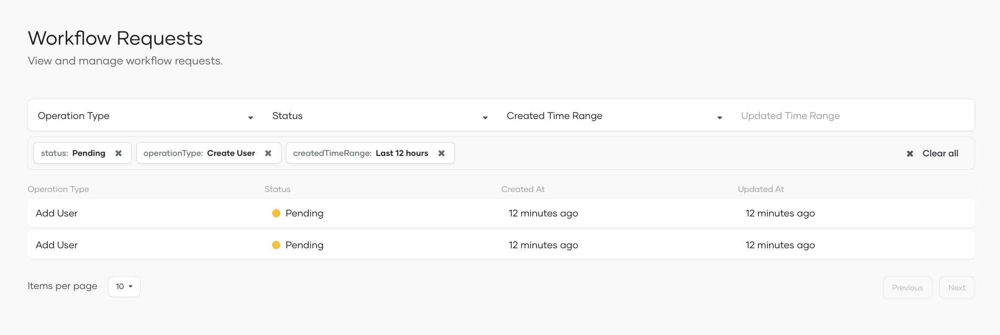
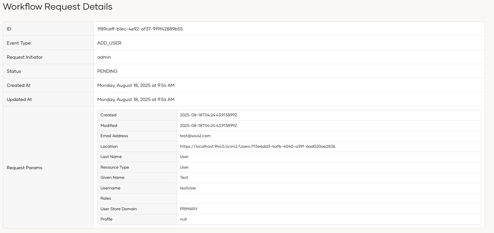
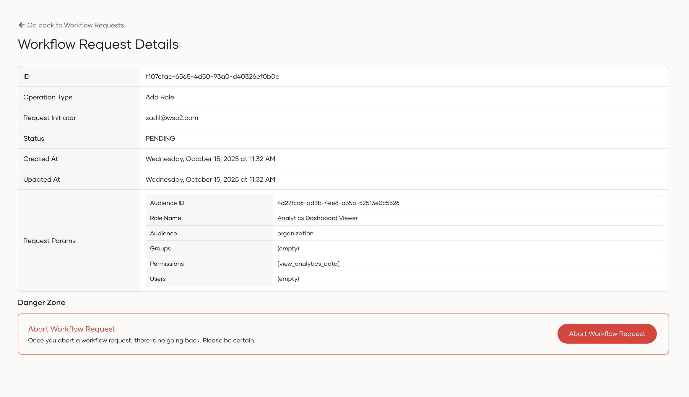

The Workflow requests page is located under the workflows section. It gives administrators full visibility into every workflow approval request.
Administrators can use it to check progress, and detect bottlenecks.

### Filter workflow requests

You can filter workflow requests by operation type, status, created time range, and updated time range.

### Status of the workflow requests

- **Pending**: The workflow request is pending and waiting for approval.
- **Approved**: The workflow request is approved by the approvers.
- **Rejected**: The workflow request is rejected by an approver.
- **Failed**: The workflow request has failed after the approval due to an error.
- **Aborted**: The workflow request has been aborted by the administrator.

### View workflow request details

To view the details of a workflow request, you can click on the request in the list.

### Abort workflow request

You can abort a workflow request that's pending approval.

### Workflow requests cleanup

You can remove completed workflow request records to improve database performance. Select and run the cleanup script for your database. The cleanup can be performed with or without a backup, and you can also schedule it to run automatically.

- [DB2](https://github.com/wso2/carbon-identity-framework/tree/master/features/identity-core/org.wso2.carbon.identity.core.server.feature/resources/dbscripts/stored-procedures/db2/workflow-cleanup)
- [MSSQL](https://github.com/wso2/carbon-identity-framework/tree/master/features/identity-core/org.wso2.carbon.identity.core.server.feature/resources/dbscripts/stored-procedures/mssql/workflow-cleanup)
- [MySQL](https://github.com/wso2/carbon-identity-framework/tree/master/features/identity-core/org.wso2.carbon.identity.core.server.feature/resources/dbscripts/stored-procedures/mysql/workflow-cleanup)
- [Oracle](https://github.com/wso2/carbon-identity-framework/tree/master/features/identity-core/org.wso2.carbon.identity.core.server.feature/resources/dbscripts/stored-procedures/oracle/workflow-cleanup)
- [PostgreSQL 9.X](https://github.com/wso2/carbon-identity-framework/tree/master/features/identity-core/org.wso2.carbon.identity.core.server.feature/resources/dbscripts/stored-procedures/postgresql/postgre-9x/workflow-cleanup)
- [PostgreSQL 11.X to 17.X](https://github.com/wso2/carbon-identity-framework/tree/master/features/identity-core/org.wso2.carbon.identity.core.server.feature/resources/dbscripts/stored-procedures/postgresql/postgre-11x/workflow-cleanup)
