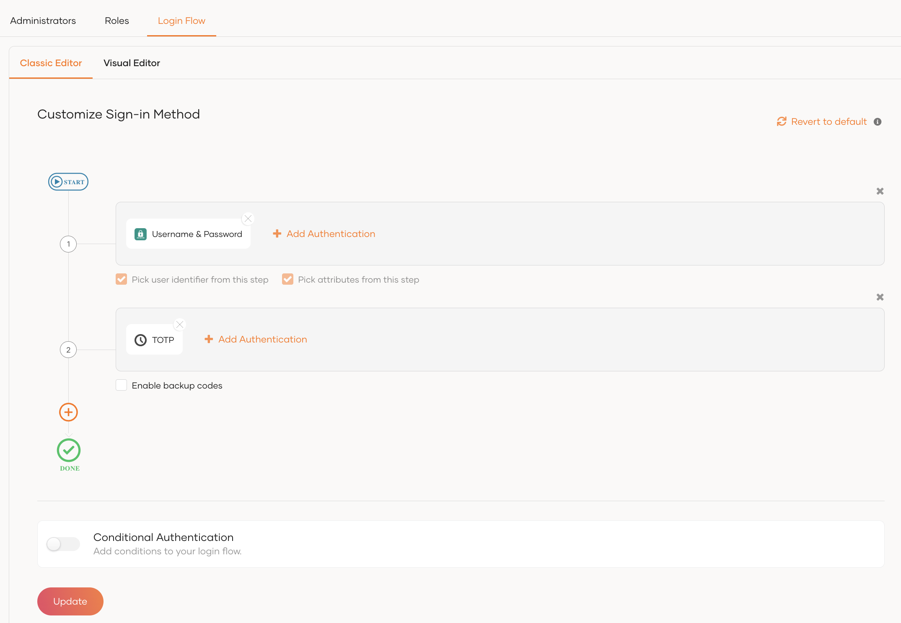
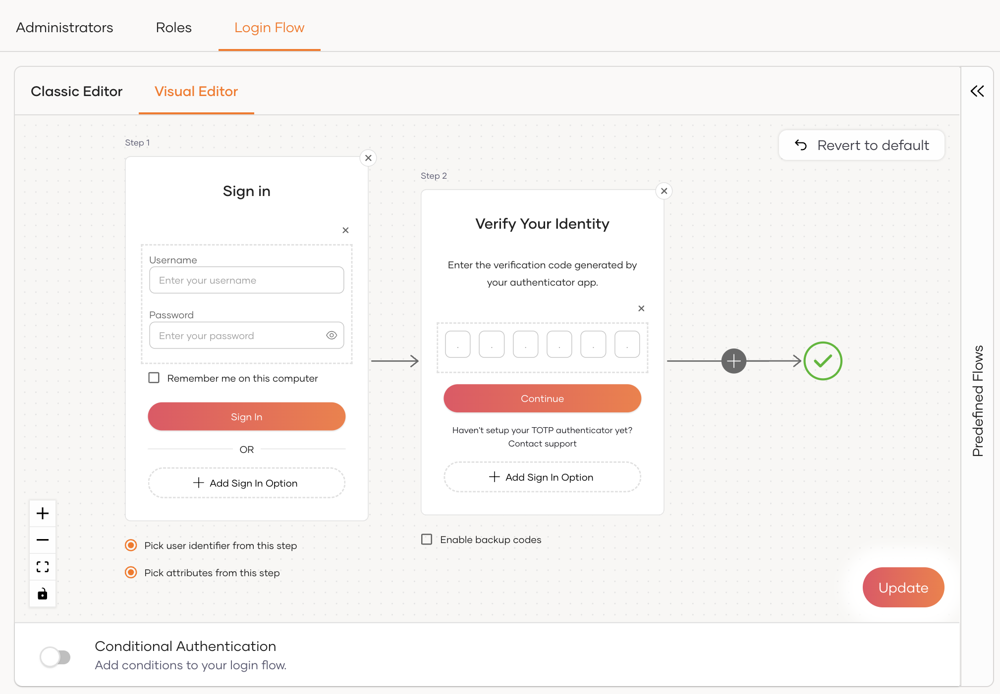
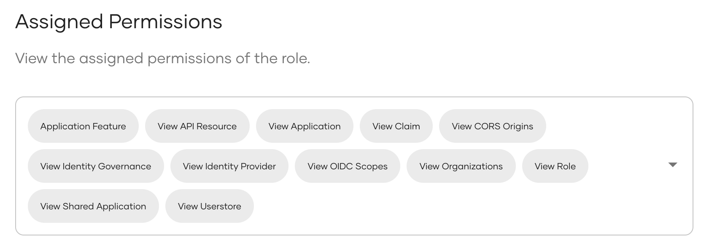
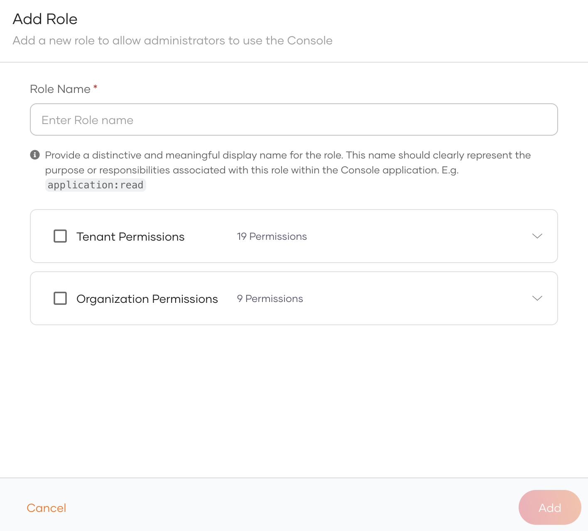
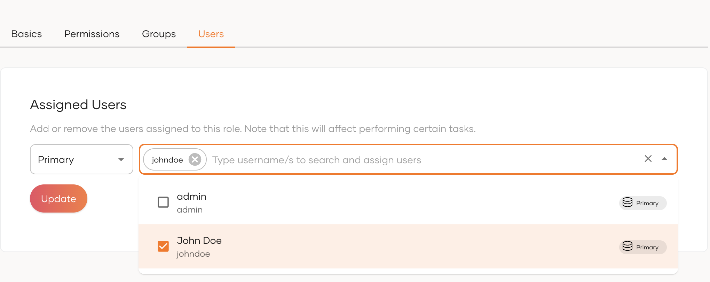
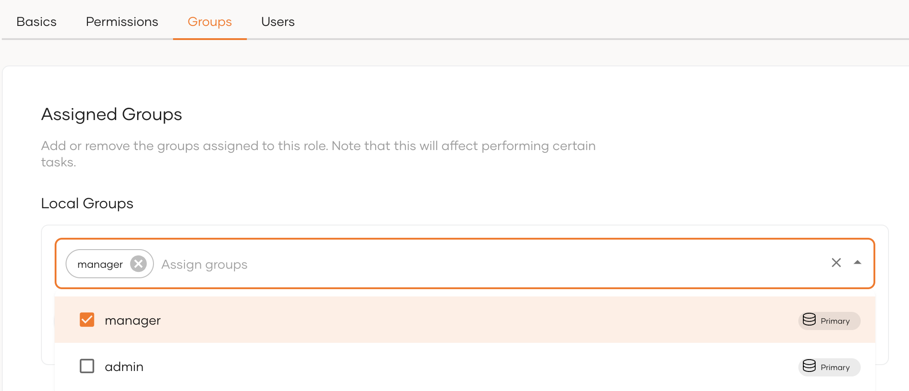

# Manage WSO2 Identity Server Console access

The WSO2 Identity Server Console is a pivotal point for managing identity and access within your organization. It provides a comprehensive interface for configuring and managing users, groups, roles, and various identity services. To ensure a secure and efficient management process, it is crucial to configure access to the console appropriately. This section outlines the steps to access the console and how to manage access based on user roles.


## Accessing the WSO2 Identity Server Console

To access the WSO2 Identity Server Console, you need to have the required permissions and the URL of the Console. This can be achieved by navigating to the console through a web browser using the following URL format:

   ```
   https://<hostname>:<port>/console
   ```

For example, if you are using the default host and port, the URL will be `https://localhost:9443/console`.

Upon navigating to this URL, you will be presented by the login screen of the WSO2 Identity Server. Use your credentials to log in to the Console.

:::note

The default credentials for an administrative user is as follows. It is crucial to change these default credentials before deploying the server in any production environment. Using default login information can pose a significant security risk, making the system vulnerable to unauthorized access. Learn more about [changing the super admin password](../../../deploy/security/maintain-logins-and-passwords/#change-the-super-admin-password)
```
Username: admin
Password: admin
```

:::


## Configure Console login

Just like any other application registered in WSO2 Identity Server, you can customize the login flow of the Console using any configured connection.

:::note

Learn about the connections supported in WSO2 Identity Server and how to configure them in the [Authentication](../authentication/index.mdx) section.

:::

To customize login for the Console,

1. Sign in to the WSO2 Identity Server Console and click **Console Settings**.

2. Go to the **Login Flow** tab and configure the login flow from your preferred editor:

    <Tabs>
    <TabItem value="tab-0" label="Classic Editor">

    - Click **Add Authentication** on a step, select a connection from the list and click **Add**. You can add multiple connections to the same step.

        \{: width:"600" style="display: block; margin: 0; border: 0.3px solid lightgrey;"\}

    - Click the **+** icon on the login flow if you wish to add an additional authentication step and repeat the above.

    - Turn on the **Conditional Authentication** toggle if you wish to customize authentication using a script.

        :::note

        Refer to [**Add conditional authentication**](../authentication/conditional-auth/index.mdx) to learn more about conditional authentication scripts.

        :::

    </TabItem>
    <TabItem value="tab-1" label="Visual Editor">


    - Switch to the **Visual Editor** tab.

    - Click **Add Sign In Option**, select a connection from the list and click **Add**. You can add multiple authentication methods to the same step. (Alternatively, go to **Predefined Flows** > **Basic Flows** to quickly add a login flow.)

        \{: width:"600" style="display: block; margin: 0; border: 0.3px solid lightgrey;"\}

    - Click the **+** icon on the login flow if you wish to add an additional authentication step and repeat the above.

    - Turn on the **Conditional Authentication** toggle if you wish to customize authentication using a script.

        :::note

        Refer to [Add conditional authentication](../authentication/conditional-auth/index.mdx) to learn more about conditional authentication scripts.

        :::

    </TabItem>
    </Tabs>

3. Click **Update** to save the changes.

## Manage Console roles

Roles are a collection of permissions. You can create roles and assign users and groups to them so that they gain limited access to Console features. Follow the sections below to learn about managing Console roles.

### Console role permissions

When you create a Console role, you grant it access to one or more **Console components** — features such as **Applications**, **Connections**, **Users**, **Groups**, and **Roles**. You assign these permissions at two levels:

<table>
    <tr>
        <td><b>Tenant Permissions</b></td>
        <td>The permissions the role has for the root organization.</td>
    </tr>
    <tr>
        <td><b>Organization Permissions</b></td>
        <td>The permissions the role has for the child organizations.</td>
    </tr>
</table>

#### Permission levels

By default, you can assign each Console component one of the following permission levels:

<table>
    <tr>
        <td><b>View</b></td>
        <td>Assigns read permissions for the component.</td>
    </tr>
    <tr>
        <td><b>Edit</b></td>
        <td>Assigns read, create, update, and delete permissions for the component.</td>
    </tr>
</table>

:::note


Selecting **View** or **Edit** for a given Console component assigns the role several scopes pertaining to it. For example, if you select **Applications** and assign the **View** permission, the role is assigned the following scopes.



:::


### Create a role

:::warning[Important]

Roles created here are roles for the Console application which are solely for the purpose of limiting features of the Console. You can define organization level roles and roles for other applications in **User Management** > **Roles**. Refer to [Manage roles](../users/manage-roles.mdx) to learn more.

:::

To create a role for the Console,

1. Sign in to the WSO2 Identity Server Console as an administrator and click **Console Settings**.

2. Select the **Roles** tab and click **New Role**.

3. Provide the following details for the role.

    

4. Click **Add** to save the role.

### Assign users/groups to a role

To assign a user or a group to a role,

1. On the WSO2 Identity Server Console, click **Console Settings**.

2. Go to the **Roles** tab and select the role you wish to assign.

3. Do one of the following:

    - To assign a user:

        - Go to the **Users** tab and click **Assign Users**

        - Choose a user store and select the relevant user.

            

        - Click **Update** to assign the user.


    - To assign a group:

        - Go to the **Groups** tab.

        - Select a relevant local group.

            

        - Click **Update** to assign the group.

### Delete a role

To delete a role:

1. On the WSO2 Identity Server Console, go to **Console Settings** > **Roles**.

2. Click the trash icon next to the role you wish to delete.

3. Select the checkbox and confirm your action.


## Manage administrators

Users who are assigned to one or more Console roles created [above](#create-a-role), are listed under the **Administrators** tab in **Console Settings**. For instructions on managing administrators, refer to [manage administrators](../users/manage-administrators.mdx).
