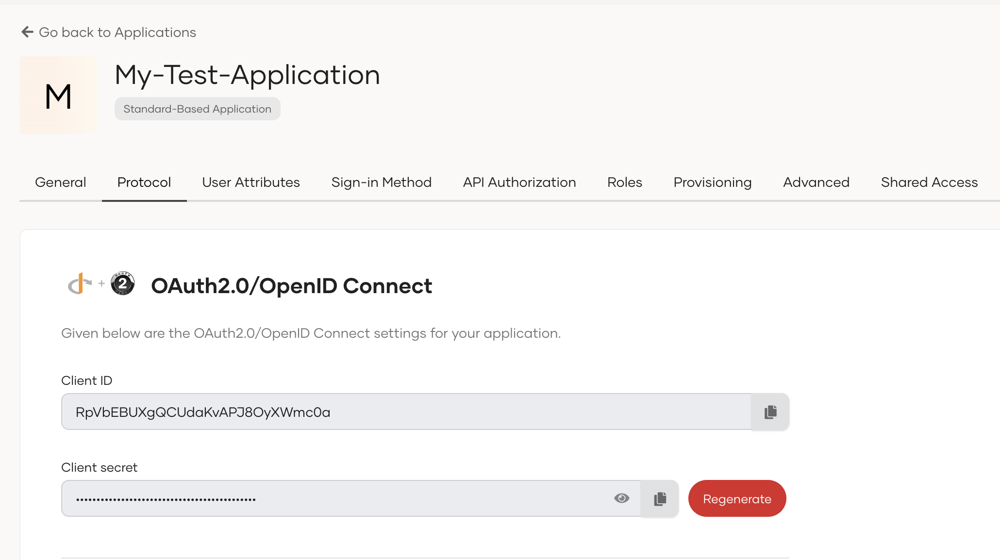
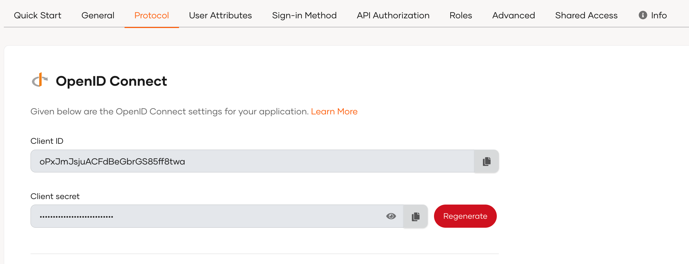
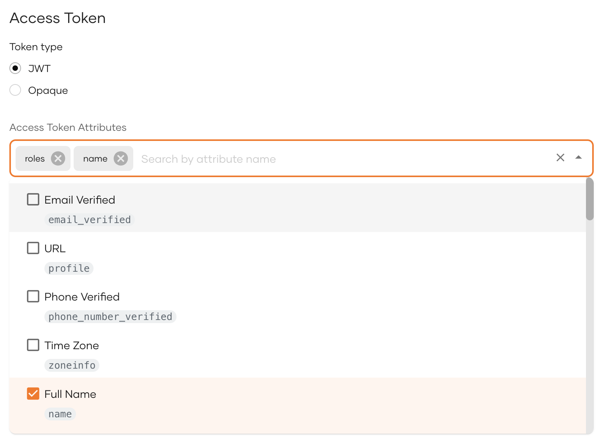

# OIDC settings for apps

OpenID Connect protocol related settings are under the **Protocol** section of the application registered in WSO2 Identity Server.

:::note

Configurations mentioned in this reference may vary based on the type of application that you register.

:::
  


## Basic settings

The following are the minimum configurations that are required for OIDC applications to run successfully.

### Client credentials


When your application is registered in WSO2 Identity Server, a client ID is generated as the identifier of the application. If your application is not a public client, a client secret is generated in addition to the client ID as shown below.





### Allowed grant types

This option determines how the application communicates with the token service. Web application template supports the following grant types:

:::note

Learn more about [OAuth2 grant types](../grant-types.mdx).

:::

<table><thead><tr><th>{"Grant type"}</th><th>{"Description"}</th></tr></thead><tbody><tr><td>{"Code"}</td><td>{"Used for executing the "}<b>{"OAuth2 Authorization Code"}</b>{" flow in client applications. Upon user authentication, the client receives an authorization code, which is then exchanged for an access token. The client can use this token to access the required resources."}</td></tr><tr><td>{"Client Credentials"}</td><td>{"Used for executing the "}<b>{"OAuth2 Client Credentials"}</b>{" flow in client applications. Users are authenticated from the user credentials and an access token is granted. The client can use this token to access the required resources."}</td></tr><tr><td>{"Refresh Token"}</td><td>{"The client can use the refresh token to get a new access token when the original access token expires, without having the user re-authenticate."}</td></tr><tr><td>{"Implicit"}</td><td>{"Used for executing the "}<b>{"OAuth2 Implicit"}</b>{" flow in client applications. Clients without a back-channel (hence cannot securely store secrets) can receive the access token directly in the URL. "}<b>{"This grant type is not recommended due to security reasons"}</b>{"."}</td></tr><tr><td>{"Password"}</td><td>{"Used for executing the "}<b>{"OAuth2 Password"}</b>{" flow in client applications. The client sends the user's credentials to get an access token. "}<b>{"This grant type is not recommended due to security reasons"}</b>{"."}</td></tr><tr><td>{"Token Exchange"}</td><td>{"This is a grant type in the OAuth 2.0 framework that enables the exchange of one type of token for another."}</td></tr><tr><td>{"Organization Switch"}</td><td>{"A custom OAuth2 grant type that allows clients to get access to organization APIs in WSO2 Identity Server. The client can exchange the access token received from the organization (root) for an access token of the organization."}</td></tr></tbody></table>

:::tip


- It is recommended to use `Code` grant for public clients.
- For single-page application templates, the `Code` grant is enabled by default.
- If `Code` grant is enabled, enable the `Refresh Token` grant to get refresh tokens.

:::

### Authorized redirect URLs

Authorized redirect URLs determine where WSO2 Identity Server redirects users after login and logout. An application can have multiple authorized redirect URLs.

The `redirect_uri` sent in the [login request](../../guides/authentication/oidc/implement-auth-code.mdx#get-authorization-code) and the `post_logout_redirect_uri` sent in the [logout request](../../guides/authentication/oidc/add-logout.mdx) should match one of the registered authorized redirect URLs.

:::note

Authorized redirect URLs are not required for `Client Credentials` and `Password` grant types.

:::

:::note

If you are planning to enable the Authorization Code grant type for standard-based applications, please note the following when adding the authorized redirect URL. The authorized redirect URL should be defined based on the type of application you are using:
    
- Web-based applications: Use exact URLs or implement logic to dynamically register specific redirect URIs as needed.
    
- Mobile apps with deep links: Wildcard support may be acceptable, but it must be implemented securely and restricted to well-defined patterns to limit its scope.

:::

### Allowed origins

Browsers restrict cross-origin HTTP requests initiated from browser scripts for security reasons. Enabling [Cross Origin Resource Sharing (CORS)](https://developer.mozilla.org/en-US/docs/Web/HTTP/CORS) allows your application to perform cross-origin HTTP requests.

You should list the set of URLs that are allowed to access WSO2 Identity Server APIs with JavaScript under **Allowed origins**. By pre-registering the application origin, applications can access:

  - the token endpoint
  - the JWKS endpoint
  - the userinfo endpoint
  - other APIs

## Advanced settings
This section elaborates on the advanced settings available for OIDC applications on WSO2 Identity Server.

### Proof Key for Code Exchange(PKCE)

When using [PKCE with authorization code flow](../../guides/authentication/oidc/implement-auth-code-with-pkce.mdx), the application sends a `code challenge` in the authorization request and subsequently, sends the corresponding `code verifier` in the token request.

PKCE ensures that the authorization code is sent to the same client making the request and no malicious application has intercepted the code during the delivery process. WSO2 Identity Server supports the following options for PKCE:

- **Mandatory**

    By enabling this option, WSO2 Identity Server makes it mandatory for an application to use PKCE with the authorization code flow grant type. Shown below is a sample request to the `/authorize` endpoint and the subsequent request to the `/token` endpoint.

    *Sample authorization request*

    ```
    https://localhost:9443/oauth2/authorize?scope=openid&response_type=code&redirect_uri=<redirect_uri>&  client_id=<client_id>&code_challenge=<code_challenge>&code_challenge_method=<code_challenge_method>
    ```

    *Sample token request*

    <Tabs>
    <TabItem value="tab-0" label="cURL">


    ```bash
    curl --location --request POST 'https://localhost:9443/oauth2/token' \
    --header 'Content-Type: application/x-www-form-urlencoded' \
    --data-urlencode 'code=60cb4ba7-b7b2-3f2f-8319-58122f1b2f5d' \
    --data-urlencode 'grant_type=authorization_code' \
    --data-urlencode 'redirect_uri=https://localhost:5000' \
    --data-urlencode    'code_verifier=WAOqjmxMpCnjME0mRpd8pDZNT8bEIpCdHgMKFqxoAVtEb4LhJ0KSg8Rl0z0O3pySx4HGp53R87bckxOxrXk2oNav0fgWzFdOy  BR rvA8ZTgCG7MlQcY9mfamCM8SWnGgO' \
    --data-urlencode 'client_id=fv_LScHaB83PN4VPX1cHufphtHQa'
    ```

    </TabItem>
    <TabItem value="tab-1" label="JavaScript - jQuery">


    ```js
    var settings = {
        "url": "https://localhost:9443/oauth2/token",
        "method": "POST",
        "timeout": 0,
        "headers": {
            "Content-Type": "application/x-www-form-urlencoded"
        },
        "data": {
            "code": "60cb4ba7-b7b2-3f2f-8319-58122f1b2f5d",
            "grant_type": "authorization_code",
            "redirect_uri": "https://localhost:5000",
            "code_verifier":    "WAOqjmxMpCnjME0mRpd8pDZNT8bEIpCdHgMKFqxoAVtEb4LhJ0KSg8Rl0z0O3pySx4HGp53R87bckxOxrXk2oNav0fgWzFdOyBRrvA8  ZT gCG7MlQcY9mfamCM8SWnGgO",
            "client_id": "fv_LScHaB83PN4VPX1cHufphtHQa"
        }
    };

    $.ajax(settings).done(function (response) {
        console.log(response);
    });
    ```

    </TabItem>
    <TabItem value="tab-2" label="Nodejs - Axios">


    ```js
    var axios = require('axios');
    var qs = require('qs');
    var data = qs.stringify({
        'code': '60cb4ba7-b7b2-3f2f-8319-58122f1b2f5d',
        'grant_type': 'authorization_code',
        'redirect_uri': 'https://localhost:5000',
        'code_verifier':    'WAOqjmxMpCnjME0mRpd8pDZNT8bEIpCdHgMKFqxoAVtEb4LhJ0KSg8Rl0z0O3pySx4HGp53R87bckxOxrXk2oNav0fgWzFdOyBRrvA8ZTgC  G7 MlQcY9mfamCM8SWnGgO',
        'client_id': 'fv_LScHaB83PN4VPX1cHufphtHQa'
    });
    var config = {
        method: 'post',
        url: 'https://localhost:9443/oauth2/token',
        headers: {
            'Content-Type': 'application/x-www-form-urlencoded'
        },
        data: data
    };

    axios(config)
        .then(function (response) {
            console.log(JSON.stringify(response.data));
        })
        .catch(function (error) {
            console.log(error);
        });
    ```

    </TabItem>
    </Tabs>

- **Support Plain Transform Algorithm**

    
    If this configuration is selected, the applications can use the `plain` algorithm. i.e,`code_challenge = code_verifier`. As the `code_verifier` is visible to a malicious party, this is not recommended for production environments.

    ```
    https://localhost:9443/oauth2/authorize?response_type=code&client_id=Wsoq8t4nHW80gSnPfyDvRbiC__Ea&    scope=openidprofile&redirect_uri=http%3A%2F%2Flocalhost%3A5000&code_challenge_method=plain&   code_challenge=nAkA5m0EKlFbHFvF_V53Icig9gSnqr-HxH44Lvkne2c
    ```

### Client authentication

For applications that rely on a client secret, client authentication method is the mechanism used to verify the identity of the client application when requesting for an access token. The following are the available client authentication methods in WSO2 Identity Server.

<table><thead><tr><th>{"Client authentication method"}</th><th>{"Description"}</th></tr></thead><tbody><tr><td>{"Client Secret Basic"}</td><td>{"Client applications use HTTP basic authentication to authenticate with the authorization server. The client secret is included in the authorization header as a base 64 encoded string as shown below."}<br />{" "}<code>{"Authorization: Basic base64(client_id:client_secret)"}</code></td></tr><tr><td>{"Client Secret Post"}</td><td>{"The client application sends the client secret in the body of the HTTP POST request when requesting an access token."}</td></tr><tr><td>{"Mutual TLS"}</td><td>{"Client authentication happens with TLS certificates. The server and the client both present their certificates to each other during the TLS handshake and establish a two-way trust relationship."}<br />{" When configuring, enter the domain name of the client certificate under "}<b>{"TLS client authentication subject domain name"}</b>{"."}</td></tr><tr><td>{"Private Key JWT"}</td><td>{"Client authentication happens with a public/private key pair. The client sends a client assertion, a client-generated JSON Web Token (JWT), signed with the private key. The authorization server will verify the assertion with the client's public key."}<br />{" When configuring, enter the required "}<b>{"signing algorithm"}</b>{"."}</td></tr></tbody></table>

:::note[Public client]

A public client is an application which cannot securely store client credentials. A public client does not need to authenticate with a `client_secret`. Thus to secure public clients, it is recommended to use `Code` grant type for public clients along with [PKCE](https://datatracker.ietf.org/doc/html/rfc7636) to mitigate code interception attacks.

:::

### Pushed Authorization Requests (PAR)

When an application initiates an authorization request with Pushed Authorization Reqeusts (PAR), it sends the payload to the `/par` endpoint from the back channel, and includes a reference to the payload in the authorization request.

Selecting the **Mandatory** option enforces the application to initiate an authorization request with PAR.

:::note

Learn more about [Pushed Authorization Requests](../pushed-authorization-requests.mdx).

:::

### Request Object

OAuth 2.0 authorization requests can either include the authorization parameters in URL query strings or in a request object. A request object is typically a JSON Web Token (JWT) which encapsulates the authorization parameters. It can be signed and encrypted to respectively ensure data integrity and data confidentiality.


- Under **Request object signing algorithm**, select a supported algorithm with which the request object will be signed.

- Under **Request object encryption algorithm**, choose a supported asymmetric encryption algorithm to perform the key exchange.

- Under **Request object encryption method**, choose a supported symmetric encryption algorithm with which the request object will be encrypted.

### Access Token
The following configurations are related to the access token.


#### Token type

Select the access token type to issue for this application. WSO2 Identity Server supports **Opaque** (reference token) and **JWT** (self-contained) token types.

:::note

Learn about [access token types and validation](../tokens/access-tokens.mdx#token-types) to understand how each type works at runtime.

:::


#### Access Token Attributes

For **JWT** access tokens, this feature enables you to specify which user attributes are included in the access token. As a result, when a user logs in to an application, only the chosen attributes are shared, providing enhanced security and flexibility.

:::note

All configured user attributes are included in the access token, regardless of the requested scopes.

:::

:::warning

For custom attributes to appear in the access token, you must explicitly add them to an OIDC scope. Without this mapping, custom attributes will not be included in the access token, even if they are configured under **Access Token Attributes**.

To map custom attributes to an OIDC scope, [configure the custom attributes for the appropriate scopes](../../guides/users/attributes/manage-scopes.mdx#edit-scopes) and ensure that your application's OIDC configuration is updated to request those scopes.

:::




#### Token binding type

Token binding securely links authentication tokens to client devices to prevent unauthorized token theft and replay attacks. It is a vital mechanism, especially when dealing with unsecured networks, as it provides an additional layer of security against unauthorized access.

:::note

Learn more about [Token Binding](../token-binding/index.mdx) in WSO2 Identity Server.

:::

WSO2 Identity Server offers the following token binding types.

<table><thead><tr><th>{"Binding Type"}</th><th>{"Description"}</th></tr></thead><tbody><tr><td>{"none"}</td><td>{"Does not establish any specific binding between the token and the client device. Suitable for scenarios where token binding is not required or implemented separately. This is the default token binding type of any application."}</td></tr><tr><td>{"cookie"}</td><td>{"Binds the token to the cookie named "}<b>{"atbv"}</b>{" with Secure and httpOnly parameters. Supported with the "}<b>{"authorization_code"}</b>{" grant type. "}<b>{"Validate Token Binding"}<b>{" can be enabled to mandate client sends both the token and the cookie for successful authorization."}</b></b></td></tr><tr><td>{"sso-session"}</td><td>{"Binds the token to the browser session. During each login, a token is generated coupled to the browser session and revoked on user logout. Supported with the "}<b>{"authorization_code"}</b>{" grant type."}</td></tr><tr><td>{"certificate"}</td><td>{"Binds the token to the hash of the TLS certificate passed in the request. Supported with "}<b>{"all"}</b>{" grant types."}</td></tr><tr><td>{"device-flow"}</td><td>{"Binds the token to the "}<b>{"device_code"}</b>{" sent in the "}<b>{"device_flow"}</b>{" grant type token call."}</td></tr><tr><td>{"client-request"}</td><td>{"Binds the token to the instance identifier as requested by the client through the "}<code>{"tokenBindingId"}</code>{" parameter with the token request as shown below. "}<br /><br /><p><code>{" curl -X POST -u \"<client_id>:<client_secret>\""}<br />{" -H \"Content-Type: application/x-www-form-urlencoded\""}<br />{" -d \"grant_type=password&username=<user_name>&password=<user_password>"}<br />{" &tokenBindingId=<your_unique_token_binding_id>\" "}<br />{" https://localhost:9443/oauth2/token "}</code></p><br />{" Generally for applications that involve multiple instances and use back-channel grant types such as "}<b>{"token exchange"}</b>{" or "}<b>{"password"}</b>{"."}</td></tr></tbody></table>

:::note


You can configure the following properties related to token binding:

- **Validate token bindings** - When enabled, WSO2 Identity Server uses the selected binding type to validate the access token based on the binding information sent in the cookie.

- **Revoke token upon user logout** - When enabled, a user logout from a session causes access tokens to be revoked provided the logout request contains either `client_id` or `id_token_hint`. Learn more about [logout requests](../../guides/authentication/oidc/add-logout.mdx).

:::

#### User access token expiry time

This option specifies the validity period of an access token issued to a user in seconds. The default expiry time is 3600 seconds.

#### Application access token expiry time

This option specifies the validity period of an access token issued to an application when using the `Client Credentials` grant type in seconds.


### ID Token
The following configurations are related to the ID token.

#### Audience

The audience specifies the recipient(s) for which the ID token is intended. By default, the client ID of the application is added as an audience. You can add multiple audiences in the ID token.

:::note

Learn about [ID token claims and the audience field](../tokens/id-tokens.mdx#id-token-claims) for more details.

:::

#### Enable encryption

Specifies whether to encrypt the ID token when it is issued. The public key of your application is used for encryption.

:::note

To enable this option, configure a certificate for your application in the <b>Certificate</b> section.

:::

#### Algorithm

Select the asymmetric algorithm used to encrypt the Content Encryption Key (CEK). The selected algorithm is included as the `alg` claim in the ID token header.

:::note

Learn about [ID token encryption mechanics](../tokens/id-tokens.mdx#id-token-encryption) for details on how the CEK and encryption algorithms work together.

:::

#### Encryption Method

Select the symmetric encryption method used to encrypt the ID token payload. The selected method is included as the `enc` claim in the ID token header.

#### ID Token expiry time

This option specifies the validity period of the ID token in seconds. The default value is 3600 seconds.


### Refresh Token

These configurations appear if the `Refresh Token` grant type is added as an allowed grant type.

:::note

Learn about [refresh token rotation and runtime behavior](../tokens/refresh-tokens.mdx).

:::

#### Renew refresh token

By default, whenever the refresh token is exchanged for a new access token, WSO2 Identity Server issues the same refresh token back, as long as it is not expired.

If you select the **Renew refresh token** option, each time the refresh token is exchanged for a new access token, WSO2 Identity Server invalidates the existing refresh token and issues a new refresh token.


#### Refresh token expiry time

This option specifies the validity period of a refresh token in seconds. The default value is 86400 seconds.


### Certificate
Certificates play a critical role in validating signatures on signed requests from the application and encrypting the ID token sent to the application when [ID token encryption](#enable-encryption) is enabled. To add a certificate, you can either upload one or provide a JWKS endpoint.

To upload a certificate, select **Provide certificate** and upload a certificate in the `.pem` format.

<details>
<summary>How to convert `.crt`, `.cer` or `.der` to the `.pem` format?</summary>

You can use [OpenSSL](https://www.openssl.org/) to convert certificates of other formats to the `.pem`format using the following commands.

**Convert CRT to PEM**
```
openssl x509 -in cert.crt -out cert.pem
```
**Convert CER to PEM:**
```
openssl x509 -in cert.cer -out cert.pem
```
**Convert DER to PEM:**
```
openssl x509 -in cert.der -out cert.pem
```

</details>
