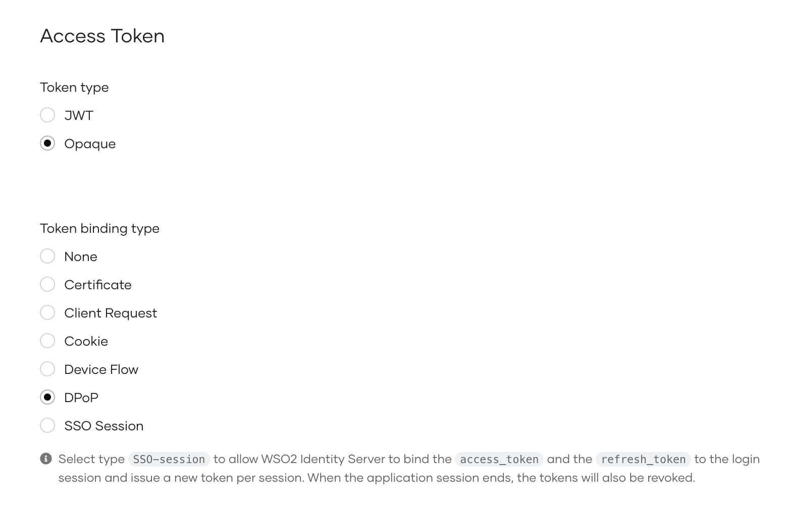

# Demonstrating Proof of Possession (DPoP)

Demonstrating Proof of Possession (DPoP) [(RFC 9449)](https://datatracker.ietf.org/doc/rfc9449/) defines a binding mechanism that ties an access token to the client’s private key. To prove possession of the key, the client includes a signed DPoP proof in the `DPoP` header of each request. This ensures that only the legitimate client holding the corresponding private key can use the access token.

DPoP enhances security by preventing token misuse and replay attacks, making it a robust solution for securing access tokens across all OAuth 2.0 grant types.

## Configure your application for DPoP

Follow these steps to enable DPoP for your application:

1. On the WSO2 Identity Server Console, [create a standard-based application](../../guides/applications/register-standard-based-app.mdx) by selecting **OAuth2.0** as the protocol.

2. Go to the application's **Protocol** tab and do the following:

    1. Under **Allowed grant types**, select **Client Credentials**.

    2. Under **Access Token**, select **DPoP** as the **Token binding type**.

        

3. Click **Update** to save your changes.

## Try it out

You can test DPoP support in WSO2 Identity Server using either the [Client Credentials](../grant-types.mdx#client-credentials-grant) or [Authorization Code grant](../grant-types.mdx#authorization-code-grant). Follow the steps below to generate a DPoP proof and use it in token requests.

### Generate a DPoP proof

Before making a token request, the client must generate a DPoP proof that proves possession of the private key. The client should include this proof in the DPoP header of the request. You can refer to the sample DPoP proof generator on [GitHub](https://github.com/wso2/samples-is/tree/master/oauth2/org.wso2.dpop.proof.generator#dpop-client-application).

### Try with the client credentials grant

Use the following command to get a token using the client credentials grant:

<Tabs>
<TabItem value="tab-0" label="Sample request (/token)">


```curl
 curl -X POST https://localhost:9443/oauth2/token \
-u "<client_id>:<client_secret>" \
-H "Content-Type: application/x-www-form-urlencoded" \
-H "DPoP: <dpop_proof>" \
-d "grant_type=client_credentials"
```

</TabItem>
<TabItem value="tab-1" label="Sample response (/token)">


```json
{
    "access_token":"a53e7ebc-8771-34eb-9351-67af7232d301",
    "token_type":"DPoP",
    "expires_in":3600
}
```

</TabItem>
</Tabs>

### Try with the authorization code grant

Follow the steps below to get a token using the authorization code grant:

1. Get an authorization code. To bind the code to the client, you can optionally include the  [thumbprint](https://datatracker.ietf.org/doc/html/rfc9449#section-10) of the client’s public key using the `dpop_jkt` parameter.

    ```curl
    https://localhost:9443/oauth2/authorize?scope={scope}&response_type=code&redirect_uri={redirect_uri}&client_id=   {client_id}&dpop_jkt={dpop_jkt}
    ```

2. Use the following command to get a token using the authorization code grant.

    <Tabs>
    <TabItem value="tab-0" label="Sample request (/oauth2/token)">


    ```curl
     curl -X POST https://localhost:9443/oauth2/token \
    -H "Content-Type: application/x-www-form-urlencoded" \
    -H "DPoP: <dpop_proof>" \
    -d "grant_type=authorization_code" \
    -d "code=<authorization_code>" \
    -d "client_id=<client_id>" \
    -d "client_secret=<client_secret>" \
    -d "redirect_uri=<redirect_uri>"
    ```

    </TabItem>
    <TabItem value="tab-1" label="Sample response (/oauth2/token)">


    ```json
    {
        "access_token":"a53e7ebc-8771-34eb-9351-67af7232d301",
        "token_type":"DPoP",
        "expires_in":3600
    }
    ```

    </TabItem>
    </Tabs>
