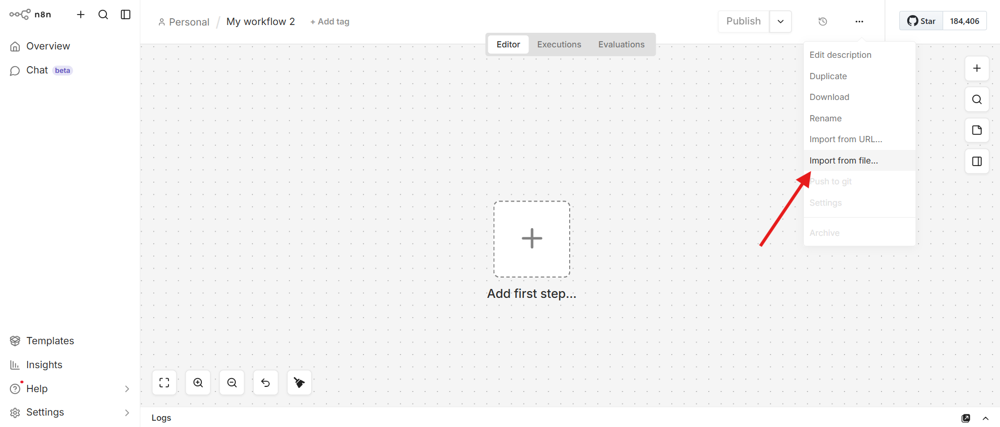
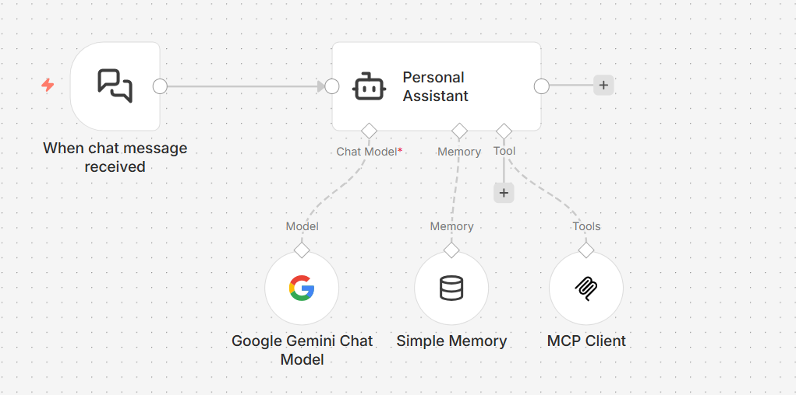
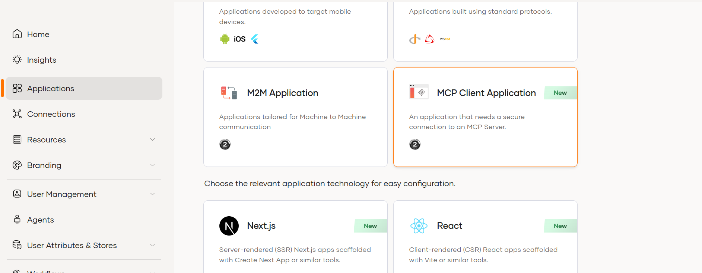
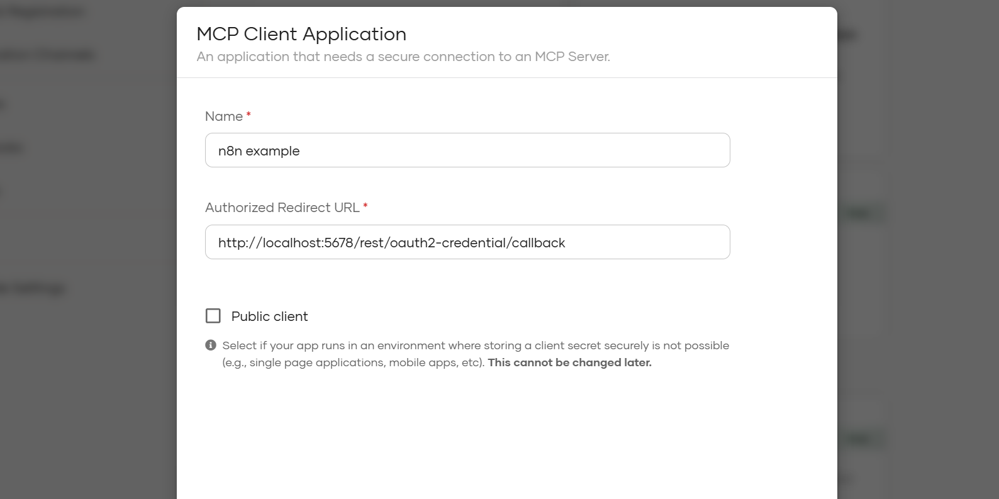
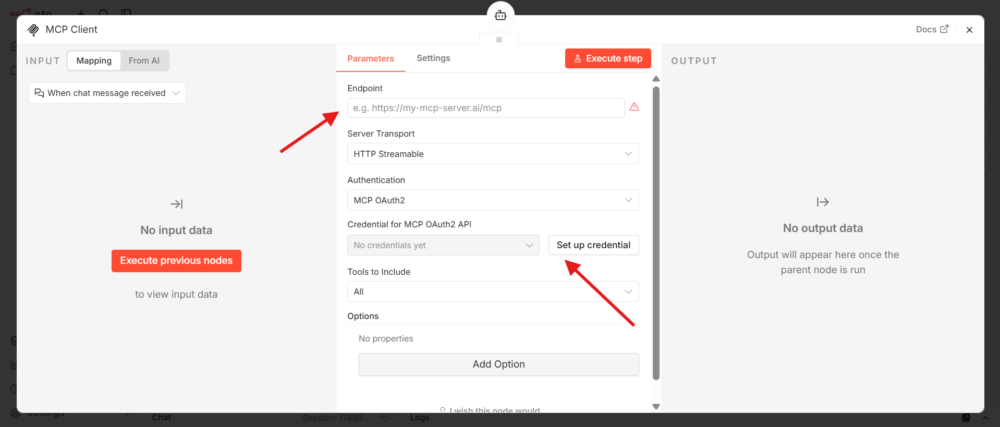
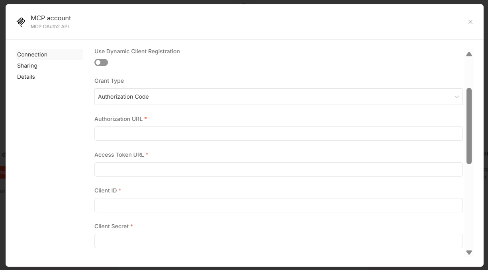
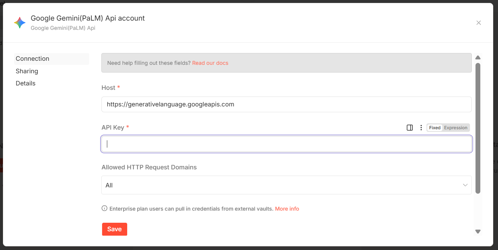
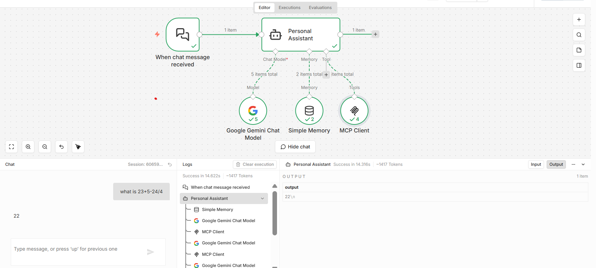

# Secure MCP servers with WSO2 Identity Server and integrate them with n8n agentic flows

The [Model Context Protocol (MCP)](https://modelcontextprotocol.io/docs/getting-started/intro) provides a standard way for AI agents and applications to discover and invoke tools. However, an MCP connection alone does not provide production-grade security. Without authentication and authorization, a client can access tools and resources without sufficient control.

At the same time, no-code and low-code platforms such as [n8n](https://n8n.io/) are rapidly increasing the number of MCP clients being built. This creates an important question: **Are these clients integrating with MCP servers using proper security standards?**

The good news is that secure MCP ecosystems can be built using [WSO2 Identity Server](https://wso2.com/products/downloads/?product=wso2is). By leveraging WSO2 Identity Server for authentication and authorization, you can protect MCP servers and ensure that only trusted clients and users are allowed to access specific tools.

By the end of this tutorial, you will be able to run n8n locally, configure its MCP client secured by WSO2 Identity Server, set up a demo MCP server, and securely interact with it using OAuth 2.0 with PKCE from the n8n chat interface.

## Getting started

First, clone this [repository](https://github.com/wso2/iam-ai-samples) and go to the `mcp-auth/integrations/mcp-auth-n8n-example` directory to access the required project files and sample workflow.

<Steps>

## Set up n8n {/* #step-1-set-up-n8n */}

Follow [n8n documentation](https://community.n8n.io/t/how-to-install-n8n-locally-docker-or-node-js-step-by-step/228296) to install and run n8n locally using either Docker or Node.js.

### Import the MCP client workflow

1. Open the n8n UI. (Usually at `http://localhost:5678`).
2. Select **Create Workflow**.
3. Select **Import from File**.

Select the `mcp-client-n8n-example.json` file from the cloned repository.

## Set up WSO2 Identity Server {/* #step-2-set-up-wso2-identity-server */}

Register an application in WSO2 Identity Server to represent the n8n MCP client.

### Create an MCP client application

1. On WSO2 Identity Server console, Go to **Applications**.
2. Click on **New Application**.
3. Select **MCP Client Application**.

Configure the application with the following values:

* **Application Name**: `n8n-example`
* **Redirect URL**: `http://localhost:5678/rest/oauth2-credential/callback`
* Disable **Public Client** option, as n8n currently only supports confidential clients and expects the client secret during configuration.

Save the application.

## Configure the MCP server {/* #step-3-configure-the-mcp-server */}

1. Go to the `mcp-server` directory in the cloned repository.
2. Create or update the `.env` file with the required values.
3. Follow the setup instructions in `mcp-server/README.md` to run the server.

## Configure the MCP client in n8n {/* #step-4-configure-the-mcp-client-in-n8n */}

After the MCP server starts, open the imported n8n MCP workflow.

### Configure the MCP Client node

Double-click the **MCP Client** node.

1. Set the MCP server endpoint:
	  * If you use Docker: `http://host.docker.internal:3000/mcp`
	  * If you do not use Docker: `http://localhost:3000/mcp`
2. Select **Set Up Credentials**.
3. Configure OAuth 2.0 settings:
	  * Disable **Use Dynamic Client Registration**.
	  * Set **Grant Type** to `PKCE`.
	  * Provide the **Authorization URL**, **Access Token URL**, **Client ID**, and **Client Secret**.

You can find these values in the **Protocol** and **Info** tabs of your WSO2 Identity Server application.

### Configure the Google Gemini chat model node

1. Open the **Google Gemini chat model** node.
2. Generate an API key from [Google AI Studio API keys](https://aistudio.google.com/api-keys).
3. Add the API key to the node configuration.

## Try the workflow {/* #step-5-try-the-workflow */}

1. Select **Open Chat** at the bottom of the n8n workflow editor.
2. Send a sample prompt from the chat interface.
3. Verify that the MCP client authenticates and invokes tools from the secured MCP server.

</Steps>

## Troubleshooting

If the OAuth callback fails, confirm that the redirect URL shown in n8n is `http://localhost:5678/rest/oauth2-credential/callback`.
If token requests fail, verify the **Authorization URL**, **Access Token URL**, **Client ID**, and **Client Secret** from the WSO2 Identity Server application.
