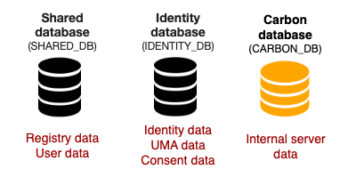

WSO2 Identity Server is shipped with an embedded H2 database for storing data. These default databases are located in the `<IS_HOME>/repository/database` directory of the product pack.

---

## Default databases

Explained below are the default databases that you will find in the `database` directory.

-   **Identity database** :The database, `WSO2IDENTITY_DB.mv.db` consists of identity related data.
-   **Shared database** :The database, `WSO2SHARED_DB.mv.db` contains the registry and user management data.
-   **Carbon database:** The database, `WSO2CARBON_DB.mv.db` has the internal data related to the product. This data is stored in the embedded H2 database.

Following image shows the default databases and the data that are stored in each database.

