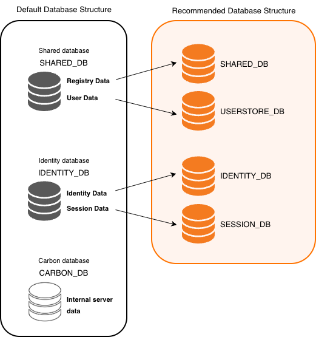

WSO2 Identity Server uses a database to store information such as user management details and identity data. By default, WSO2 Identity Server is shipped with an embedded H2 database that works for all types of data.

:::warning[Embedded H2 is NOT RECOMMENDED in production]
The embedded H2 database doesn't suit enterprise testing or production. It gives lower performance, clustering limitations, and file corruption failures. Use an industry-standard RDBMS such as Oracle, PostgreSQL, MySQL, or MS SQL.
:::

:::tip[Before you begin]
Creating separate databases as shown below isn't mandatory. You can point all the following data sources to the default data structure. This does not affect performance. For more information, see [Working with Databases](../../configure/databases/index.mdx).
:::

The following image shows the default database structure and a recommended database structure for logical separation.

**SHARED_DB**

- Shared database for config and governance registry mounts in WSO2 Identity Server's nodes. This includes data on tenants and keystores.
- For more information, see [Change the default databases](../../configure/databases/carbon-database/index.mdx).

**USERSTORE_DB**

- Mainly contains users and roles of the system.
- Contains authorization manager configurations, internal permissions, and roles.
- Userstore databases separation is required when using an external userstore such as LDAP or Active Directory.
- For more information, see [Configure Userstores](../../../guides/users/user-stores/index.mdx).

**IDENTITY_DB**

- Contains identity-related data. For example, user sessions, OAuth 2.0, SAML 2.0, etc.

**SESSION_DB**

- Stores session-related data. For example, user sessions, session contexts, etc.
- Session database separation is recommended for deployments that require higher concurrency and throughput.
- For more information, see [Change the Datasource for Session Database](../../configure/databases/carbon-database/change-datasource-session.mdx).

{/* TODO !!! note
    For more information on `SHARED_DB` and `IDENTITY_DB`, see [Working with Databases]({{base_path}}/deploy/work-with-databases/).*/}
