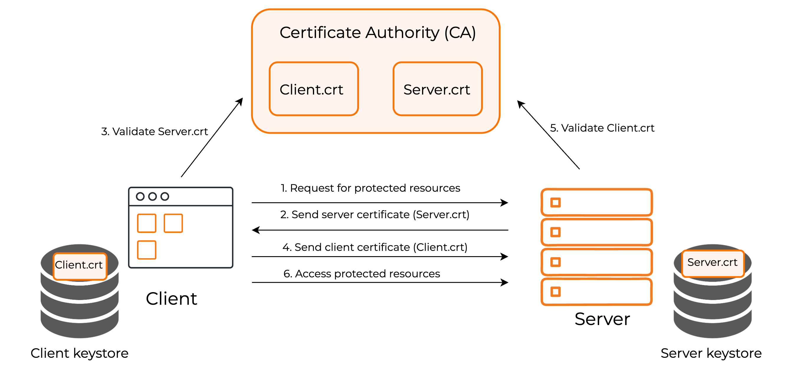

Mutual SSL is a security mechanism where both the client and server authenticate each other using digital certificates. Unlike traditional SSL, which only verifies the server’s identity, mutual SSL requires both parties to present certificates issued by a trusted Certificate Authority (CA). This ensures a highly secure connection and often eliminates the need for username/password authentication, as the client is authenticated based on its certificate.

## How it works

Let's take a look at how mutual SSL works with clients and {edition.productName}. The relevant digital certificates are stored in the following `keystores`.

-   {edition.productName} server certificates are stored in,<br />

    `<IS_HOME>/repository/resources/security/wso2carbon.p12`

-   The trusted client certificates are stored in,<br />
    `<IS_HOME>/repository/resources/security/clienttruststore.p12`

:::note
Learn more about {edition.productName}'s [keystores and truststores](./encryption/keystores/index.mdx).
:::

These certificates are signed and issued by a certificate authority that allows both the client and server to communicate freely. Now let's look at how it works:

 

1.  The client attempts to access a protected resource and the SSL/TSL
    handshake process begins.
2.  The server presents its certificate,`Server.crt`, according to the above example.
3.  The client takes this certificate and requests the CA for authenticity and validity of the certificate.
4.  If the certificate is valid, the client will provide its certificate, `Client.crt`, to the server.
5.  The Server takes this certificate and requests the CA for authenticity and validity of the certificate.
6.  If the certificate is valid, the server grants the client access to the resource.

## Enable Mutual SSL in {edition.productName}

To enable mutual SSL,

1.  Open the `<IS_HOME>/repository/conf/tomcat/catalina-server.xml` file and find the  `certificateVerification` attribute within the `SSLHostConfig` tag under the `https` connector. Make sure the value of it is set to `want`

    ```java
    certificateVerification="want"
    ```

    :::tip[Why?]
    This configuration is set to `want` in order to make certificate authentication disabled for some scenarios (such as for mobile apps), essentially making two-way SSL authentication optional. You can set the value to `require` to make it mandatory.
    :::

    Alternatively, you can add the following configuration to the `<IS_HOME>/repository/conf/deployment.toml` file.

    ```toml
    [transport.https.sslHostConfig.properties]
    certificateVerification = "want"
    ```

2.  Open the `<IS_HOME>/repository/conf/deployment.toml` file and add the following configuration to enable the mutual SSL authenticator.

    ```toml
    [admin_console.authenticator.mutual_ssl_authenticator]
    enable = true

    [admin_console.authenticator.mutual_ssl_authenticator.config]
    WhiteList = ""
    ```

3.  For mutual SSL authentication to succeed, import the public certificate of {edition.productName} to the client's truststore and import the public certificate of the client to {edition.productName}'s truststore. Consider the following example scenario.

    :::info
    If both the client and {edition.productName} use {edition.productName}'s keystore and truststore for authentication, {edition.productName}'s certificate must also be present in the truststore. This ensures that the client can verify and trust {edition.productName} during the authentication process. To do this, execute the following commands from the `<IS_HOME>/repository/resources/security` directory.

    1. Extract the public certificate of {edition.productName} using the following command.

       ```bash
       keytool -export -alias wso2carbon -file carbon_public2.crt -keystore wso2carbon.{{ default_keystore_ext }} -storetype PKCS12 -storepass wso2carbon
       ```

    2. Import the public certificate to the truststore using the following command.

       ```bash
       keytool -import -trustcacerts -alias carbon -file carbon_public2.crt -keystore  client-truststore.{{ default_keystore_ext }} -storetype PKCS12 -storepass wso2carbon
       ```
    :::
