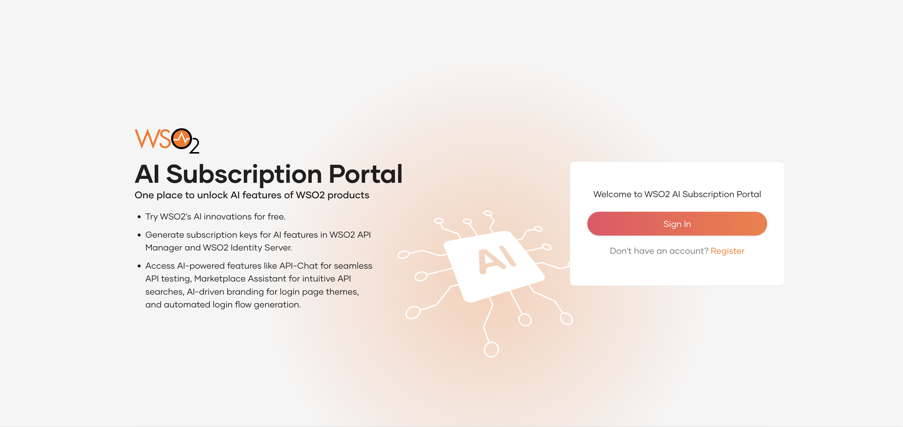

{edition.productName} brings AI-powered simplicity to your application setup, making it faster and smarter. With intuitive, text-driven intelligent features, you can streamline complex tasks effortlessly. Currently, {edition.productName} offers the following AI-driven capabilities:

- [Configure login flows using AI](../guides/authentication/login-flow-ai.mdx)
- [Create custom branding using AI](../guides/customizations/branding/branding-ai.mdx)

To enjoy access to these features, you need to create a free account in the WSO2 AI subscription portal. Follow the guide below for step-by-step instructions.

## Step 1 - Sign up for the AI Subscription portal {#step-1-sign-up-for-the-ai-subscription-portal}

1. Navigate to the AI Subscription Portal using the following URL: [https://ai-subscriptions.wso2.com](https://ai-subscriptions.wso2.com/).

      

2. Click **Register**.
3. Enter a valid email address and click **Register**. 
5. Check your email inbox and click **Complete Account Creation**. 
6. Provide an organization name and a password. Be sure to remember the organization name as it is needed to log in to the portal.
7. Once you have completed the registration, you will be directed to the AI Subscription portal. 
8. Click **Sign In** and enter your organization name. 
10. Enter your email address and password to log in.

## Step 2 - Create a subscription key {#step-2-create-a-subscription-key}

1. Once you have signed in to the subscription portal, click on the **New Subscription** button.
   
2. Enter a name for the subscription key and select **wso2is** as the product. 
3. Click **Create** to create the subscription key.
   
4. Once you create a subscription key, you can use it to enable AI features in {edition.productName}. Check step 3 below for instructions.

:::warning[Manage subscription keys]
You can revoke, regenerate and even delete subscription keys using the portal. However, performing any of these actions will invalidate the existing keys. To avoid disruptions, make sure the keys are no longer in use before proceeding.
:::

## Step 3 - Enable AI features in {edition.productName} {#step-3-enable-ai-features-in-wso2-identity-server}

1. Open the `deployment.toml` file in the `<IS_HOME>/repository/conf/` directory.
2. Add the following configuration to it.

      ```toml
      [ai_services]
      key="<YOUR_SUBSCRIPTION_KEY>"
      ```

3. Save the file and restart {edition.productName}.

:::note[Data storage information]
The data in the AI subscription portal is securely stored in the US region in compliance with industry standards.
:::

## Step 4- Start using AI-powered features {#step-4-start-using-ai-powered-features}

You can now leverage these features to simplify your application configuration. See the following guides for step by step instructions and to learn more about these capabilities.

- [Configure login flows using AI](../guides/authentication/login-flow-ai.mdx)
- [Create custom branding using AI](../guides/customizations/branding/branding-ai.mdx)
