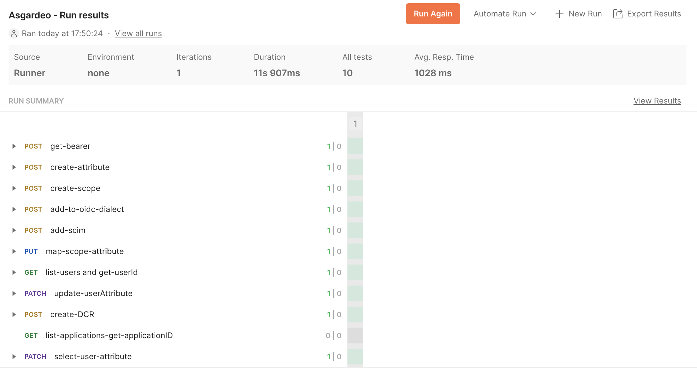

Follow the tutorial below to learn how you can leverage WSO2 Identity Platform as an identity provider, to implement a robust authentication and authorization mechanism for your healthcare applications built on SMART on FHIR.

## What is FHIR?

[FHIR](https://hl7.org/fhir/R4/index.html) (Fast Healthcare Interoperability Resources) is a standard introduced by HL7 for securely exchanging healthcare data. The standard defines a set of structured data formats for key healthcare resources such as patients, practitioners, diagnostics and medications. This ensures that regardless of how the data are stored in one system, they can be understood and processed by another system even if it is running on a different technology.

## What is SMART on FHIR?

[SMART ON FHIR](https://hl7.org/fhir/smart-app-launch/index.html) is a framework that extends FHIR and allows third-party developers to create applications that seamlessly integrate with Electronic Health Records (EHR) systems. There are two main advantages of using SMART ON FHIR for building healthcare apps:

- Interoperability - As the framework provides a standardized method to access healthcare data, developers can build applications that work across different EHR systems, irrespective of the underlying technology.

- Security - The framework uses open standards such as OAuth2 and OpenID Connect for authorization and authentication to ensure EHR systems are accessed securely and in compliance with privacy regulations such as HIPAA.

## How can WSO2 Identity Platform help?

WSO2 Identity Platform, a cloud-native Identity and Access Management (IAM) solution, is equipped with support for open standards such as OpenID Connect and Oauth 2.0 that developers can simply integrate right into their SMART on FHIR applications. This helps developers to safeguard patient information, comply with privacy regulations, and manage access to FHIR resources based on user roles.

WSO2 Identity Platform simplifies and automates identity and permission management, making it an ideal solution for integrating third-party applications securely within the healthcare ecosystem.

## How do I integrate WSO2 Identity Platform into my app?

This guide outlines how WSO2 Identity Platform can be integrated into your healthcare apps. We have created a Postman collection to automate this process so that it enhances efficiency and ensures consistency in configurations.

### Prerequisite

You need to have a WSO2 Identity Platform account. If you do not have one, create one for free in [WSO2 Identity Platform](https://asgardeo.io/signup). Follow the [documentation](../index.mdx) to learn how to get started.

### Step 1: Register an application in WSO2 Identity Platform

Follow the steps below to register an application in WSO2 Identity Platform.

1. Log in to the [WSO2 Identity Platform Console](https://console.asgardeo.io/) and go to **Applications**.

2. Click **New Application** and select **Standard-Based Application**.

3. Provide a name, select **OAuth 2.0/OpenID Connect** as the protocol and click **Create**.

4. On the **Protocol** tab of the created application, do the following:

    - Take note of the **Client ID** and **Client secret**. You will need them later.

    - Under **Allowed grant types**, ensure the **Client Credential** grant is selected.

### Step 2: Authorize application to access REST APIs

Now that you have registered an application in WSO2 Identity Platform, the next step is to provide it authorization to perform the following actions on the listed REST APIs,

<table>
  <thead>
    <tr>
      <th>API Resource</th>
      <th>Authorized Scopes</th>
    </tr>
  </thead>
  <tbody>
    <tr>
      <td>OAuth DCR API</td>
      <td>

        - Create DCR
        - Delete DCR
        - View DCR
        - Update DCR

      </td>
    </tr>
    <tr>
      <td>SCIM2 Users API</td>
      <td>

        - Create User
        - List Users
        - View User
        - Delete User
        - Update User

      </td>
    </tr>
    <tr>
      <td>SCIM2 Roles API</td>
      <td>

        - Create Role
        - Update Role
        - View Role
        - Delete Role

      </td>
    </tr>
    <tr>
      <td>SCIM2 Bulk API</td>
      <td>

        - Create Bulk Resource

      </td>
    </tr>
    <tr>
      <td>Application Management API</td>
      <td>

        - Create Application
        - Delete Application
        - Update Application
        - View Application

      </td>
    </tr>
    <tr>
      <td>Shared Application Management API</td>
      <td>

        - Create Shared Application
        - View Shared Application
        - Delete Shared Application

      </td>
    </tr>
    <tr>
      <td>OIDC Scope Management API</td>
      <td>

        - Update OIDC Scopes
        - Delete OIDC Scopes
        - Create OIDC Scopes
        - View OIDC Scopes

      </td>
    </tr>
    <tr>
      <td>Claim Management API</td>
      <td>

        - Delete Claim
        - Update Claim
        - Create Claim
        - View Claim

      </td>
    </tr>
    <tr>
      <td>API Resource Management API</td>
      <td>

        - Delete API Resource
        - Update API Resource
        - Create API Resource
        - View API Resource

      </td>
    </tr>
  </tbody>
</table>

To do so,

1. On the [WSO2 Identity Platform Console](https://console.asgardeo.io/), go to **Applications**.

2. Select the created application and go to its **API Authorization** tab.

3. Do the following for all the REST APIs listed on the above table.

    1. Click on **Authorize an API Resource** and do the following:

    2. Select the resource from the **API Resource** dropdown.

        :::note
        To authorize APIs for the current organization, be sure to select resources under **Management API**.
        :::

    3. Under **Authorized Scopes**, select the relevant scopes. Since the application requires all scopes of the API resource, click **Select All** to collectively add all scopes.

    4. Click **Finish**.

    

### Step 3: Configure the Postman collection

Now that you have registered and configured an application in WSO2 Identity Platform, you are able to use its credentials to obtain an access token and access WSO2 Identity Platform's REST APIs.

:::info
We have created a Postman collection to automate the following process:

- Get a bearer token to access WSO2 Identity Platform REST APIs.

- Create the `fhirUser` user attribute. This will be used as the identity of a user accessing FHIR resources.

- Create the `fhirUser` scope. Applications can request this scope to access the `fhirUser` attribute of a user.

- Add the relevant OIDC and SCIM dialects of the `fhirUser` user attribute.

- Provide a patient ID to a selected user by assigning the `fhirUser` attribute with a value (`Patient/1`).

- Create a custom FHIR API resource and define scopes for it.

- Create a role that permits to consume the custom API and assign users to it.

- Register your SMART on FHIR app using Dynamic Client Registration (DCR).

- Configure your SMART on FHIR application to request the `fhirUser` local attribute from users during login.
:::

Follow the steps below to download and run the Postman collection:

1. Download the Postman collection from [GitHub](https://github.com/wso2-enterprise/open-healthcare/blob/main/scripts/postman-collections/smartonfhir-asgardeo.postman_collection.json) and import it to Postman.

2. In the Postman collection named **WSO2 Identity Platform**, go to the **Authorization** tab and do the following:

    1. Under **Auth Type**, select **Basic Auth**.

    2. Enter the client ID and client secret of your application as username and password respectively.

        

3. Go to the **Variables** tab and provide the following values:

    <table>
      <tbody>
        <tr>
          <td>applicationName</td>
          <td>Provide any name and this will be the name of the DCR application that will be created through the Postman script.</td>
        </tr>
        <tr>
          <td>organization</td>
          <td>Provide your organization name. You may find it in your Console URL. For example, if the URL is \`https://console.asgardeo.io/t/healthcare36/app/getting-started\`, the organization name is \`healthcare36\`.</td>
        </tr>
        <tr>
          <td>username</td>
          <td>Provide the email address of the user whose \`fhirUSer\` attribute you want to update.</td>
        </tr>
      </tbody>
    </table>

4. Once the Postman collection is configured, you are ready to run it. To do so,

    1. Navigate to the **WSO2 Identity Platform** > **WSO2 Identity Platform-configs** folder.

    2. Click the three dots corresponding to **WSO2 Identity Platform-configs** and click **Run folder**.

    3. Ensure no errors occur and troubleshoot any errors that arise.

        

### Step 4: Verify that everything works

Now that you have created the `fhirUser` user attribute and registered your SMART on FHIR app in WSO2 Identity Platform, let's try to log into your application as the user and obtain the ID token. If everything has worked, the ID token should contain the `fhirUser` attribute.

To do so,

1. In the same Postman collection, navigate to the **WSO2 Identity Platform** > **authorization-code-grant-flow** folder.

2. Open the **get-token** request and go to its **Authorization** tab.

3. While making sure **Auth Type** is set to **OAuth 2.0**, scroll down to find the **Configure New Token** section on the right panel.

4. Keep the default settings and click **Get New Access Token**.

    

5. You will be directed to the WSO2 Identity Platform login page. Enter the user's credentials and click **Sign In**. If prompted, provide permission for the application to read the `fhirUser` attribute.

6. Once authenticated, you will be redirected back to Postman. Copy the `id_token` value and decode it to find the following data.

    ```json
    ...
    "fhirUser": "Patient/1",
    ...
    ```
