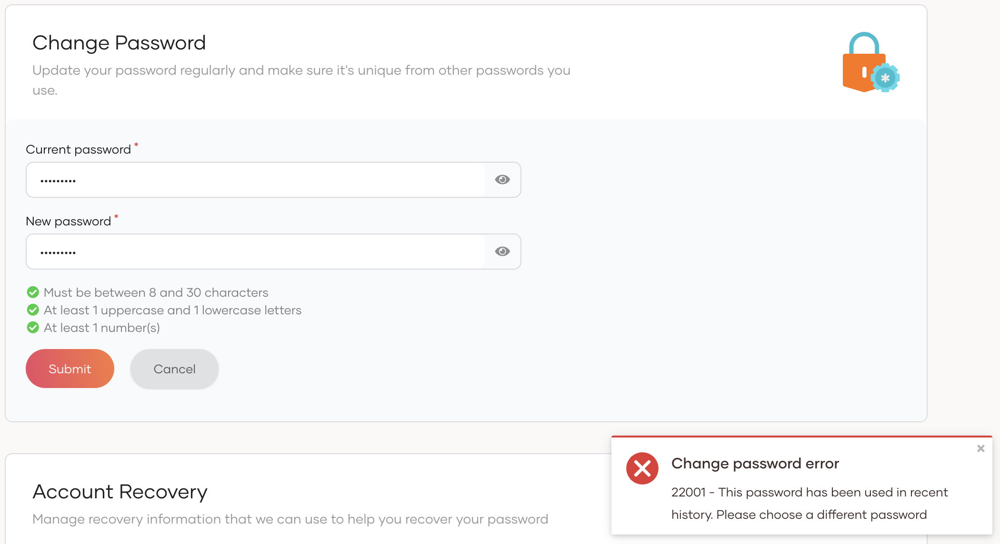
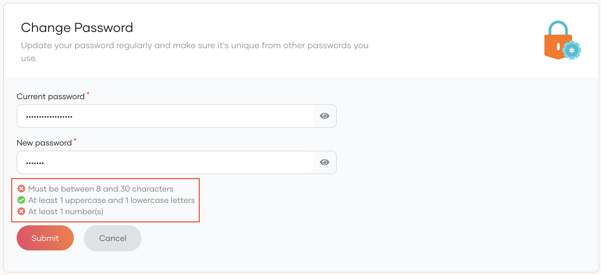

import Tabs from '@theme/Tabs';
import TabItem from '@theme/TabItem';

{edition.productName} provides several password validation mechanisms to ensure user passwords meet the required complexity standards and are regularly updated to maintain security. This guide walks you through enabling and configuring these options for your organization.

## Configure password validation

You can find the password configuration options by following the steps below.

1. On the {edition.productName} Console, navigate to **Login & Registration**.

2. Under **Login Security**, select **Password Validation**.

3. On the **Password Validation** page, you can configure the following [options](#password-validation-options):

    - [Rule-based password expiration](#rule-based-password-expiration): Passwords expire based on the rules you define for users' groups and roles. If users with expired passwords log in, they get redirected to the password reset screen.

        <Variants><Edition only="cloud"></Edition><Edition only="self-hosted"></Edition></Variants>

    - [Password history count](#password-history-count): Specify how often users can reuse old passwords. When resetting a password, if a user chooses a previously used password (within the stored history), the password reset fails with the following error:

        

    - [Password input validation](#password-input-validation): Set requirements for password complexity by defining its length constraints and required character types. When a user creates/resets a password, if it does not meet the complexity requirements, the validation checks fail as follows.

        

3. Click **Update** to save the changes.

## Password validation options

The following are the password validation options available for your organization.

### Rule-Based password expiration

Rule-based password expiration allows administrators to set custom password expiration rules based on the user's groups and roles. The higher a rule appears on the list, the greater its priority. Rules are evaluated based on their priorities and the first rule that matches the user's condition will take effect.

To configure rule-based password expiration,

1. Turn the **Password Expiration** toggle on to enable password expiration.

<Edition only="cloud">

2. Select the users that this policy should apply using the **Enforce password expiry for** field:

    - **All application login flows**: Applies to all users of an organization, regardless of the application they access. This is the default behavior.
    - **Selected application login flows**: Enforces for only the applications that have enabled this in the login flow. This overrides the default behavior.

        :::info
        To enforce password expiry for a specific application, add the Password Reset Enforcer as an authentication step in the application's login flow. See [Configure login flows](../../authentication/index.mdx) for instructions.

        
        :::

        :::tip
        By default, users are automatically logged in after successfully resetting their password. To require users to log in again from the beginning of the login flow, use the `passwordResetComplete` property in the authentication context of your adaptive script and call the `fail()` function as shown below.

        ```javascript
        var onLoginRequest = function(context) {
            executeStep(1, {
                onSuccess: function(context) {
                    // Step 2: Password reset enforcer authenticator.
                    executeStep(2, {
                        onSuccess: function(context) {
                            var isPasswordResetComplete = context.passwordResetComplete;
                            if (isPasswordResetComplete === true) {
                                var parameterMap = {'errorCode': 'password_reset_complete', 'errorMessage': 'Your password has been successfully reset due to expiry.', "errorURI":'https://localhost:9443/authenticationendpoint/retry.do'};
                                fail(parameterMap);
                            }
                        }
                    });
                }
            });
        };
        ```
        :::

</Edition>

<Variants>

<Edition only="cloud">

3. Set a default password expiry rule that applies to any user who does not meet the custom criteria.

</Edition>

<Edition only="self-hosted">

2. Set a default password expiry rule that applies to any user who does not meet the custom criteria.

</Edition>

</Variants>

<Variants>

<Edition only="cloud">

4. Click **Add Rule** and start defining custom rules. Each rule you add will be added to the top of the list. You may use the arrows on the left to change their priorities.

</Edition>

<Edition only="self-hosted">

3. Click **Add Rule** and start defining custom rules. Each rule you add will be added to the top of the list. You may use the arrows on the left to change their priorities.

</Edition>

</Variants>

    <Variants><Edition only="cloud"></Edition><Edition only="self-hosted"></Edition></Variants>

Refer to the following table for more information on rule parameters.

<table>
  <tbody>
    <tr>
      <th>Parameter</th>
      <th>Description</th>
    </tr>
    <tr>
      <td>Attribute</td>
      <td>User attribute against which you are enforcing password expiry. Select either `Groups` or `Roles`.</td>
    </tr>
    <tr>
      <td>Values</td>
      <td>Select the specific group/role. You may also select multiple values thus making the rule act as an AND operator, and is enforced only on users belonging to all selected groups/roles.</td>
    </tr>
    <tr>
      <td>Operator</td>
      <td>

        - **Apply:** Password expiry will be enforced for users who meet the rule criteria.
        - **Skip:** Password expiry will not be enforced for users who meet the rule criteria.

      </td>
    </tr>
    <tr>
      <td>Expiration (days)</td>
      <td>Passwords of users meeting the criteria expire after this number of days.</td>
    </tr>
  </tbody>
</table>

:::info[Retrieve password expiry time of users]
Using the SCIM 2.0 `/Users` endpoint, you can retrieve the password expiry times of users. To do so, you must explicitly request it in the `attributes` query parameter in the API request as shown below.

<Tabs groupId="tabs">
<TabItem value="request" label="Request">

```text
curl -v -k --user admin:admin \
--request GET 'https://localhost:9443/scim2/Users?attributes=userName,emails,urn:scim:wso2:schema.passwordExpiryTime' \
--header 'Content-Type: application/json'
```

</TabItem>
<TabItem value="sample-response" label="Sample Response">

```text
{
    "totalResults": 2,
    "startIndex": 1,
    "itemsPerPage": 2,
    "schemas": [
    "urn:ietf:params:scim:api:messages:2.0:ListResponse"
    ],
    "Resources": [
        {
            "emails": [
                "user1@example.com"
            ],
            "id": "3d64d675-5093-4b6e-9b5c-d00d2c89312e",
            "userName": "user1",
            "urn:scim:wso2:schema": {
                "passwordExpiryTime": "1734148289823"
            }
        },
        {
            "emails": [
                "user2@example.com"
            ],
            "id": "4453e6c3-a5a2-4158-955c-4d32366ba436",
            "userName": "user2",
            "urn:scim:wso2:schema": {
                "passwordExpiryTime": "1735244834546"
            }
        }
    ]
}
```

</TabItem>
</Tabs>
:::

### Password history count

The **Password History Count** feature allows you to specify the number of unique new passwords a user must use before an old password can be reused. This enhances account security by preventing the reuse of old passwords.


To enable this, select the corresponding checkbox and configure the following option.

| Parameter | Description |
| --- | --- |
| Password History Count | \[Optional\] The number of unique passwords that must be set before reusing an old password. <br /> **Example:** If set to `3`, the user cannot reuse the last three passwords they have set. |

### Password input validation

The **Password Input Validation** feature enables you to set password complexity requirements which include minimum password length and required character types.

<Variants><Edition only="cloud"></Edition><Edition only="self-hosted"></Edition></Variants>

Configure the following parameters to enforce input validation.

<table>
  <tbody>
    <tr>
      <th>Parameter</th>
      <th>Description</th>
    </tr>
    <tr>
      <td>Number of characters</td>
      <td>You can add the minimum and maximum length of the password users should use.</td>
    </tr>
    <tr>
      <td>Mandatory characters</td>
      <td>

        By default, a user password should contain at least one of the following characters.

        - Numbers
        - Upper-case characters
        - Lower-case characters
        - Special characters

      </td>
    </tr>
    <tr>
      <td>Number of unique characters</td>
      <td>\[Optional\] This field identifies the number of unique (non-repeated) characters the password should contain.</td>
    </tr>
    <tr>
      <td>Number of repeated characters</td>
      <td>\[Optional\] This field identifies the number of characters that can be repeated consecutively in a user password. <br /> **Example:** If you assign `1` as the number of repeated characters, the password cannot contain any repeated characters consecutively. <br /> The password `aa1@Znlq` is incorrect as it has the character `a` appearing consecutively.</td>
    </tr>
  </tbody>
</table>

:::note[Validation for whitespace in passwords]
{edition.productName} automatically trims leading and trailing whitespace from passwords when creating, updating, or entering passwords to login.
:::

<Edition only="self-hosted">

:::note[Password maximum allowed length]
In {edition.productName}, the maximum allowed password length is 64 by defualt and if you need to increase this value for your need you neeed to add below configuration.

```toml
[identity_mgt.password_policy]
max_password_allowed_length = 128
```
:::

</Edition>

