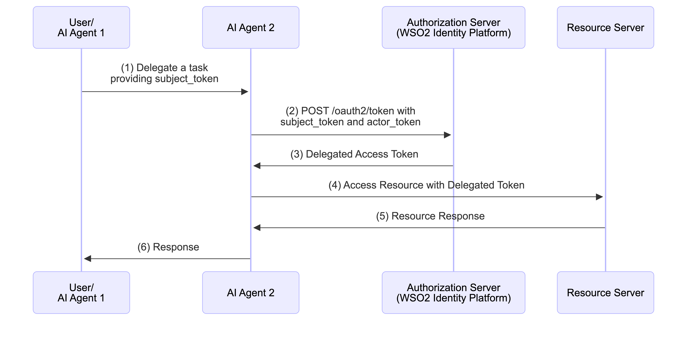
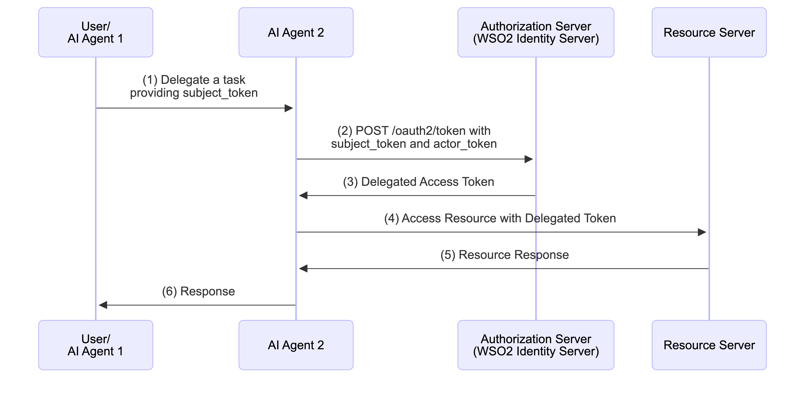

import Tabs from '@theme/Tabs';
import TabItem from '@theme/TabItem';

{/* vale off */}
{/* vale on */}

This guide walks you through how an AI agent can act on behalf of a user by exchanging a token that the user already holds. The flow uses the [token exchange grant](../../authentication/configure-oidc-flows/tokens-and-validation/configure-token-exchange.mdx), as defined in the [OAuth 2.0 Token Exchange specification (RFC 8693)](https://datatracker.ietf.org/doc/html/rfc8693).

The issued token identifies the user in the `sub` claim and records the agent as the acting party in the `act` claim. A resource server can then see both identities in a single token.

:::note[Agent friendly delegation mechanism]
- This flow does **not use redirects** and needs **no new user interaction**.
- It is suited to bringing an agent into work the user has already authorized.
- The agent reuses the token it already obtained through its own [authentication flow](./agent-authentication.mdx#ai-agent-acting-on-its-own).
:::

---

## How the flow works

<Variants><Edition only="cloud"></Edition><Edition only="self-hosted"></Edition></Variants>

As shown in the above sequence diagram, the flow proceeds as follows.

1. **Agent Authentication**
   The agent authenticates with its **Agent ID** and **Agent Secret** and obtains its own access token, as described in [AI agent acting on its own](./agent-authentication.mdx#ai-agent-acting-on-its-own). This token becomes the `actor_token`.

2. **Task Delegation**
   The user, or an agent earlier in the chain, delegates a task to the agent and provides the subject token. The subject token identifies the user on whose behalf the agent acts. {edition.productName} accepts a token issued by itself or by a trusted token issuer, as described in [Token exchange flows](../../authentication/configure-oidc-flows/tokens-and-validation/configure-token-exchange.mdx#token-exchange-flows).

3. **Token Exchange Request**
   The agent sends both tokens to the token endpoint using the token exchange grant.

4. **Validation**
   {edition.productName} validates both tokens, resolves the agent from the `sub` claim of the actor token, and verifies that the agent is a registered and active identity in the organization.

5. **Delegated Token Issuance**
   {edition.productName} issues an access token that carries the user in `sub` and the agent in `act.sub`.

6. **Authorized Request**
   The agent calls the protected resource with the delegated token. The resource server can authorize the request against the user's identity while attributing the action to the agent.

## Requesting a delegated token

:::note[Before you begin]
- Enable the token exchange grant for the application that requests the token, as described in [Enable token exchange in your app](../../authentication/configure-oidc-flows/tokens-and-validation/configure-token-exchange.mdx#enable-token-exchange-in-your-app).
- Configure the agent's application to issue `JWT` access tokens. {edition.productName} rejects opaque actor tokens.
:::

Send both tokens to the token endpoint.

<Variants>

<Edition only="cloud">

<Tabs groupId="tabs">
<TabItem value="request-format" label="Request Format">

```bash
curl --location 'https://api.asgardeo.io/t/{organization_name}/oauth2/token' \
--header 'Content-Type: application/x-www-form-urlencoded' \
--header 'Authorization: Basic <base64 Encoded (clientId:clientSecret)>' \
--data-urlencode 'grant_type=urn:ietf:params:oauth:grant-type:token-exchange' \
--data-urlencode 'subject_token={user_token}' \
--data-urlencode 'subject_token_type=urn:ietf:params:oauth:token-type:jwt' \
--data-urlencode 'actor_token={agent_token}' \
--data-urlencode 'actor_token_type=urn:ietf:params:oauth:token-type:jwt' \
--data-urlencode 'requested_token_type=urn:ietf:params:oauth:token-type:access_token' \
--data-urlencode 'scope={requested_scopes}'
```

</TabItem>
</Tabs>

</Edition>

<Edition only="self-hosted">

<Tabs groupId="tabs">
<TabItem value="request-format" label="Request Format">

```bash
curl --location 'https://localhost:9443/t/{root_organization_handle}/oauth2/token' \
--header 'Content-Type: application/x-www-form-urlencoded' \
--header 'Authorization: Basic <base64 Encoded (clientId:clientSecret)>' \
--data-urlencode 'grant_type=urn:ietf:params:oauth:grant-type:token-exchange' \
--data-urlencode 'subject_token={user_token}' \
--data-urlencode 'subject_token_type=urn:ietf:params:oauth:token-type:jwt' \
--data-urlencode 'actor_token={agent_token}' \
--data-urlencode 'actor_token_type=urn:ietf:params:oauth:token-type:jwt' \
--data-urlencode 'requested_token_type=urn:ietf:params:oauth:token-type:access_token' \
--data-urlencode 'scope={requested_scopes}'
```

</TabItem>
</Tabs>

</Edition>

</Variants>

The request contains the following delegation parameters:

| Parameter | Description |
| --- | --- |
| `subject_token` | A JWT token that identifies the user on whose behalf the agent acts. |
| `actor_token` | A JWT token issued by {edition.productName} for the agent. |
| `actor_token_type` | Should be `urn:ietf:params:oauth:token-type:access_token` or `urn:ietf:params:oauth:token-type:jwt`. |

:::note[Scopes of the delegated token]
When {edition.productName} issues the subject token, it limits the scopes of the delegated token to the scopes granted to the subject token. An agent can narrow the scopes it receives, but it can't widen them beyond what the user already approved.

To prevent {edition.productName} from issuing scopes when a trusted token issuer issues the subject token, see [Restrict scope issuance for federated tokens](../../authentication/configure-oidc-flows/tokens-and-validation/configure-token-exchange.mdx#restrict-scope-issuance-for-federated-tokens).
:::

## The delegated token

The decoded token identifies the user in `sub` and the agent in `act.sub`.

```json
{
  "sub": "<user_identifier>",
  "act": {
    "sub": "<agent_identifier>"
  },
  ...
}
```

A resource server can use the `act` claim to record which agent acted for the user, or to apply policies that depend on the acting agent. This gives you an audit trail that attributes the action to the agent independently of the user, as described in [Comprehensive auditing and explainability](./index.mdx#comprehensive-auditing-and-explainability).

## Chaining delegation across agents

When an agent hands a task to another agent, the second agent exchanges the delegated token again with its own actor token. The new agent becomes the current acting party and the existing `act` claim nests under it, so the token carries the full chain.

```json
{
  "sub": "<user_identifier>",
  "act": {
    "sub": "<second_agent_identifier>",
    "act": {
      "sub": "<first_agent_identifier>"
    }
  },
  ...
}
```

The most recent agent appears at the top level of the chain. When the request presents no actor token, {edition.productName} carries the existing chain forward unchanged. An agent that re-exchanges a token it received can't alter the chain behind it.

To learn more about the delegation model and the `act` claim, see [Delegation](../../authorization/delegation.mdx).
