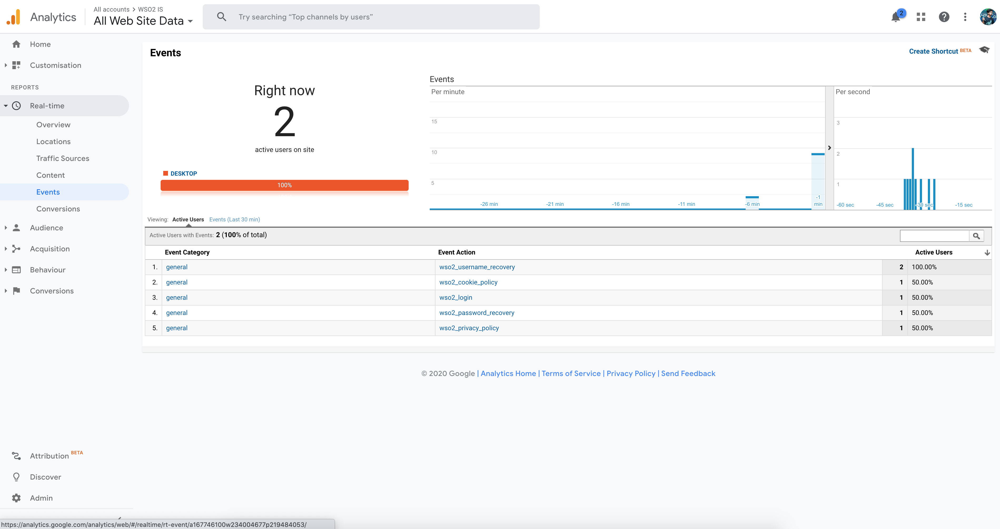
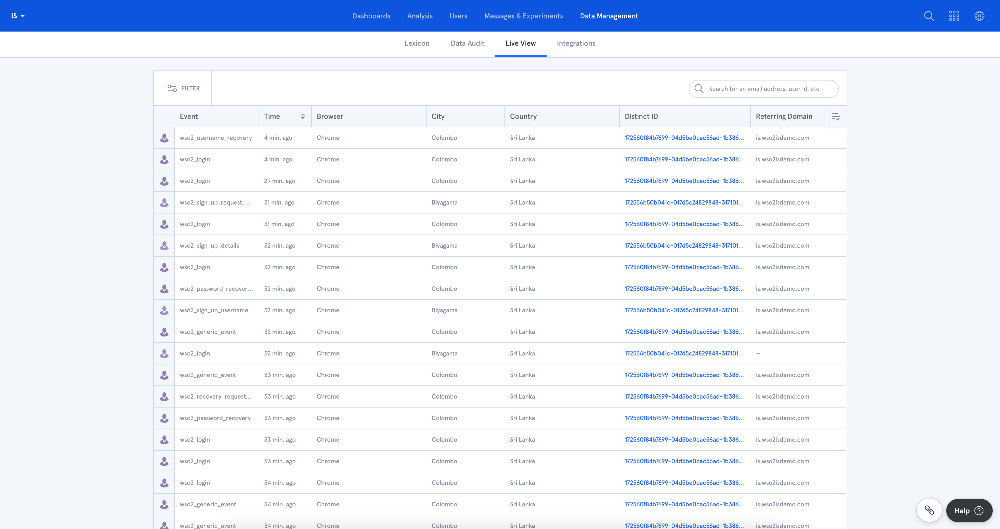

Web Analytics are used to analyze web traffic and user interactions on a website. {edition.productName} supports integrating [Google Analytics](https://marketingplatform.google.com/about/analytics/) and [Mixpanel](https://mixpanel.com/) as analytics solutions and allows you to enable either one or both of them.

## Set up web analytics

Follow the steps below to configure a web analytics solution for {edition.productName}.

1. Create an analytics project and obtain the relevant token.

    - For Google analytics:

        1. Follow the Google analytics [documentation](https://developers.google.com/analytics/devguides/collection/ga4) and create an analytics project.

        2. Navigate to **Admin** > **Tracking Info** > **Tracking Code**, and look for the token of your project in `gtag('config', '<TOKEN>');`.

    - For Mixpanel:

        1. Follow the Mixpanel [documentation](https://docs.mixpanel.com/docs/what-is-mixpanel) and create an analytics project.

        2. Navigate to **Settings** > **Set up Mixpanel**, and look for the token of your project in `mixpanel.init("<TOKEN>");`.

2.  Download the [samples-is](https://github.com/wso2/samples-is/archive/master.zip) repository and extract its content.

3. In the samples-is root directory, go to `analytics-extensions` and open the `config.jsp` file. Add the token/s obtained in step 1 above to the relevant line of the file.

    ```java
    // Insert your Google Analytics token here.
    private static final String GOOGLE_ANALYTICS_TOKEN = "<GOOGLE_ANALYTICS_TOKEN>";

    // Insert your Mixpanel token here.
    private static final String MIXPANEL_TOKEN = "<MIXPANEL_TOKEN>";
    ```

4. Copy the `analytics.jsp` and `config.jsp` files found in `analytics-extensions` and paste them in both `<IS_HOME>/authenticationendpoint/include` and `<IS_HOME>/accountrecoveryendpoint/include` directories.

5. Find the `header.jsp` file located in both `<IS_HOME>/authenticationendpoint/include` and `<IS_HOME>/accountrecoveryendpoint/include` directories and add the following line to the end of the files.

    ```java
    <%-- Include analytics --%>
    <jsp:directive.include file="/includes/analytics.jsp"/>
    ```

6. [Run {edition.productName}](../../deploy-and-operate/get-started/run-the-product.mdx) instance and the analytics events will be fired when users access the relevant web pages. 

## Types of analytic events

The following are the events that are captured when analytics are enabled in {edition.productName}.

| Event name | Description |
| --- | --- |
| `wso2_generic_event` | A generic event that will be fired unless the event belongs to one of the types below. |
| `wso2_error` | An error has occurred. |
| `wso2_login` | The login page has been visited. |
| `wso2_login_failure` | Login has failed. |
| `wso2_sign_up_username` | Self sign up username page has been visited. |
| `wso2_sign_up_details` | Self sign up user detail collection page has been visited. |
| `wso2_sign_up_request_complete` | A request for a self sign up has been completed. |
| `wso2_sign_up_process_complete` | A sign up flow has been completed including the confirmation. |
| `wso2_username_recovery` | Username recovery page has been visited. |
| `wso2_password_recovery` | Password recovery page has been visited. |
| `wso2_recovery_request_complete` | Request for a username/password recovery is complete. |
| `wso2_password_recovery_reset` | Password reset page has been visited. |
| `wso2_password_recovery_complete` | A password recovery flow has been successfully completed. |
| `wso2_privacy_policy` | Privacy policy page has been visited. |
| `wso2_cookie_policy` | Cookie policy page has been visited. |

## View analytics

You can view the analytics events from the dashboards of Google Analytics and Mixpanel. The following are sample views.

### Google Analytics


### Mixpanel

