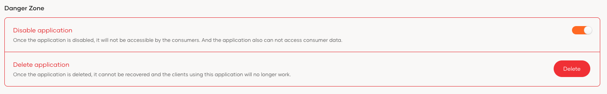

Registering your application is the first step towards unlocking the full spectrum of features offered by {edition.productName}.

## Register an application

<Variants>

<Edition only="cloud">

{edition.productName} supports integrating four application types. Once registered, {edition.productName} sets the default configurations for your application which can easily be customized according to your requirements.

</Edition>

<Edition only="self-hosted">

{edition.productName} supports integrating five application types. Once registered, {edition.productName} sets the default configurations for your application which can easily be customized according to your requirements.

</Edition>

</Variants>

### Single-page applications

Single-page applications (SPAs) run on the browser and dynamically update the content as the user interacts with it. As the user does not need to wait page reloads, users have a seamless experience with high responsiveness. JavaScript frameworks and libraries such as React, Angular and Vue.js are some popular technologies adopted to build SPAs. 

- [Register a single-page application](./register-single-page-app.mdx)

### Web applications

Web applications (web apps) are the most common type of applications in use. They are usually hosted on a web server and accessed by a browser. Web applications require authentication as they offer functionality specific to logged-in users. 

- [Register a web application with OIDC](./register-oidc-web-app.mdx)
- [Register a web application with SAML](./register-saml-web-app.mdx)

### Mobile applications

Mobile applications are apps that run on mobile devices. Android and iOS are some of the popular technologies adopted to build mobile applications.

- [Register a mobile application](./register-mobile-app.mdx)

### Standard-based applications

Standard-based applications allow you to configure the application protocol settings (OIDC or SAML) from scratch. 

- [Register a standard-based application](./register-standard-based-app.mdx)

<Edition only="self-hosted">

### Machine-to-Machine (M2M) applications

Machine-to-Machine (M2M) applications are designed for automated communication and interaction between devices or services without direct human intervention. Unlike user-centric applications, M2M applications cater to non-interactive scenarios, including command-line tools, daemons, IoT (Internet of Things) devices, or services running on the backend. 

- [Register a machine-to-machine application](./register-machine-to-machine-app.mdx)

</Edition>

## Make an application discoverable

Discoverable applications appear in the users' [My Account portal](../user-self-service/self-service-portal/configure-self-service-portal.mdx), making it easy for users to see and access the applications that they can use. When users click on an application, they get redirected to the application's access URL.

To enable application discovery:

1. On the {edition.productName} Console, navigate to **Applications**.
2. Select the application you want users in the organization to discover and go to the **General** tab. (This option is not available for M2M applications.)
3. Scroll down to the **Discoverable application** section.
4. Select the checkbox to enable and configure an access URL to make the application discoverable to everyone in the organization.

5. To limit discoverability to specific users, select **Only a selected group of users can discover this application** under **Discoverable Groups**.
6. Choose the user groups from each user store and click on **Update** button.
7. The application will then be discoverable only to users in the selected groups.

    

To learn how users can discover applications through the **My Account** portal, see [Discover applications](../user-self-service/self-service-portal/discover-applications.mdx).

## Enable/Disable an application

If your application is undergoing maintenance or should be made temporarily unavailable for any reason, you can disable it and re-enable it when ready.

:::warning[Important]
Disabling an application blocks new logins, revokes active access tokens and removes any user consents previously granted to the application. Upon re-enabling the application, users must login again and re-grant their consents.
:::

To enable/disable an application,

1. On the {edition.productName} Console, go to **Applications**.

2. Select the application you wish to disable and go to its **General** tab.

3. Scroll down to the **Danger Zone**. 

4. Under **Disable application**, switch the toggle on to disable the application or off to enable it.

    

## Delete an application

To delete an application,

1. On the {edition.productName} Console, go to **Applications**.

2. Select the application you wish to delete and go to its **General** tab.

3. Scroll down to the **Danger Zone**. 

4. Click Delete under **Delete application** and confirm your action.
