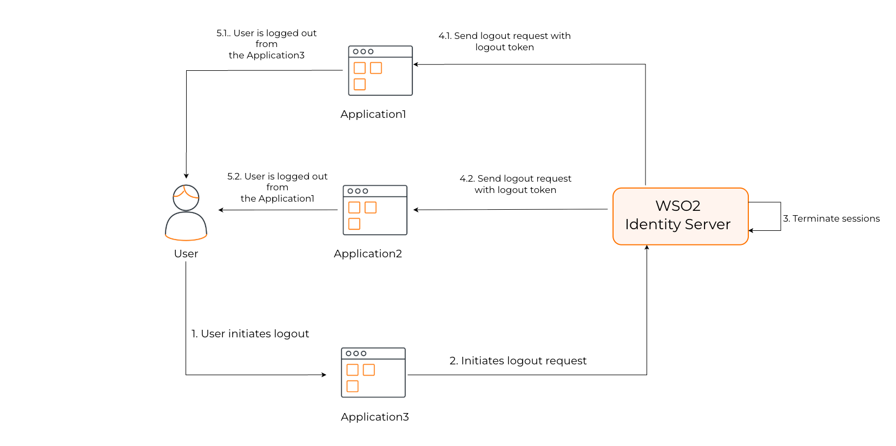

<Variants>

<Edition only="cloud">

Back-channel logout is a mechanism defined in the OpenID Connect (OIDC) specification that allows users to be securely logged out of client applications without any user interaction. Unlike front-channel logout, which relies on browser-based redirects and requires the user’s browser to visit each client application, back-channel logout happens entirely through server-to-server communication between the authorization server and the client applications.

</Edition>

<Edition only="self-hosted">

Back-channel logout, defined in the OpenID Connect (OIDC) specification, allows logging out of client applications without user interaction. Unlike front-channel logout that relies on the user's browser to notify each client application, back-channel logout happens entirely through server-to-server communication between the authorization server and the client applications.

For protocol details, see the OpenID specification: [OpenID Connect Back-Channel Logout 1.0](https://openid.net/specs/openid-connect-backchannel-1_0.html).

</Edition>

</Variants>

## How it works

<Variants>

<Edition only="cloud">

The underlying message flow of OpenID Connect (OIDC) back-channel logout happens as follows:

1. The authorization server or the client application initiates a user logout.
2. The authorization server identifies all the client applications associated with the user's session.
3. The authorization server generates a logout token, a special (JSON Web Token) JWT containing specific claims and sends it with a logout request to the logout endpoints of all the client applications.
4. Upon receiving the logout token, each client application validates the token and proceeds to invalidate the corresponding user session.

## Configure back-channel logout

</Edition>

<Edition only="self-hosted">



The underlying message flow of OIDC back-channel logout happens as follows:

1. The client application initiates a user logout.
2. {edition.productName} identifies all the client applications associated with the user's session.
3. {edition.productName} generates a logout token, a special  JWT (JSON Web Token) containing specific claims and sends it with a logout request to the logout endpoints of all the client applications.
4. Upon receiving the logout token, each client application validates the token and proceeds to invalidate the corresponding user session.

## Configure back-channel logout URL

</Edition>

</Variants>

Follow the steps below to register the back-channel endpoint of your application with {edition.productName}.

:::note[Before you begin]
[Register your OIDC application](../../../applications/index.mdx) in {edition.productName}.
:::

<Variants>

<Edition only="cloud">

1. On the WSO2 Identity Platform Console, go to **Applications** and select your OIDC application.

2. Go to the **Protocol** tab, and under **Logout URLs**, enter the **Back channel logout URL**.

    

</Edition>

<Edition only="self-hosted">

1. On the {edition.productName} Console, go to **Applications** and select your OIDC application.

2. Go to the **Protocol** tab, and under **Logout URLs**, enter the **Back channel logout URL**.

    

</Edition>

</Variants>

3. Click **Update** to save your configurations.

## Set up your client application

To complete the back-channel logout flow, you must set up the client application so that it can perform the following required actions.

<Variants>

<Edition only="cloud">

1. **Receive back-channel logout requests** - The client application must expose an endpoint that accepts POST requests from the authorization server to handle logout requests. You need to [register this endpoint with {edition.productName}](#configure-back-channel-logout).

2. **Validate the logout token** - The following is an example of the logout token sent by the authorization server to a client application:

    ```json
    {
    "iss": "https://api.asgardeo.io/t/<org_name>/oauth2/token",
    "sub": "aa21e449-****-****-****-****a6a3961f",
    "aud": "w_Hwp05dF****_****9SNwpflAa",
    "iat": 1609911868,
    "exp": 1609911988,
    "jti": "16159e3e-****-****-****-b0782ab33d58",
    "sid": "15043ffc-****-****-****-9b107f7da38c",
    "events": {
       "http://schemas.openid.net/event/backchannel-logout": {}
       }
    }
    ```

    Your client application must perform token validation as defined in the [OIDC back-channel logout specification](https://openid.net/specs/openid-connect-backchannel-1_0.html#Validation). A summary of the validations is below.

    - `iss`: Must match your trusted issuer.

    - `aud`: Must match your application's client ID.

    - `iat` and `exp`: Must be within a valid timeframe.

    - `events`: Must contain the http://schemas.openid.net/event/backchannel-logout claim.

    - `sid`: Must be present to identify the session.

</Edition>

<Edition only="self-hosted">

1. **Receive back-channel logout requests** - The client application must expose an endpoint that accepts POST requests from the authorization server to handle logout requests. You need to [register this endpoint with {edition.productName}](#configure-back-channel-logout-url).

2. **Validate the logout token** - The following is an example of the logout token sent by the {edition.productName} to a client application:

    ```json
    {
    "iss": "{edition.productUrlSample}/oauth2/token",
    "sub": "aa21e449-****-****-****-****a6a3961f",
    "aud": "w_Hwp05dF****_****9SNwpflAa",
    "iat": 1609911868,
    "exp": 1609911988,
    "jti": "16159e3e-****-****-****-b0782ab33d58",
    "sid": "15043ffc-****-****-****-9b107f7da38c",
    "events": {
       "http://schemas.openid.net/event/backchannel-logout": {}
       }
    }
    ```

    Your client application must perform JWT token validation as defined in the [OIDC back-channel logout specification](https://openid.net/specs/openid-connect-backchannel-1_0.html#Validation). A summary of the validations is below.

    - `iss`: Must match your trusted issuer.

    - `aud`: Must match your application's client ID.

    - `iat` and `exp`: Must be within a valid timeframe.

    - `events`: Must contain the http://schemas.openid.net/event/backchannel-logout claim.

    - `sid`: Must be present to identify the session.

</Edition>

</Variants>

3. **Terminate the user session** - Once the client validates the token and determines it to be valid, the client should use the `sid` claim to locate and terminate the user's session.
