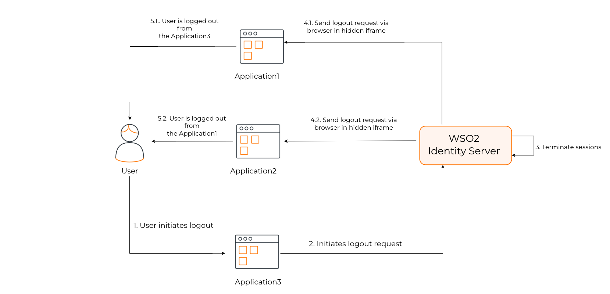
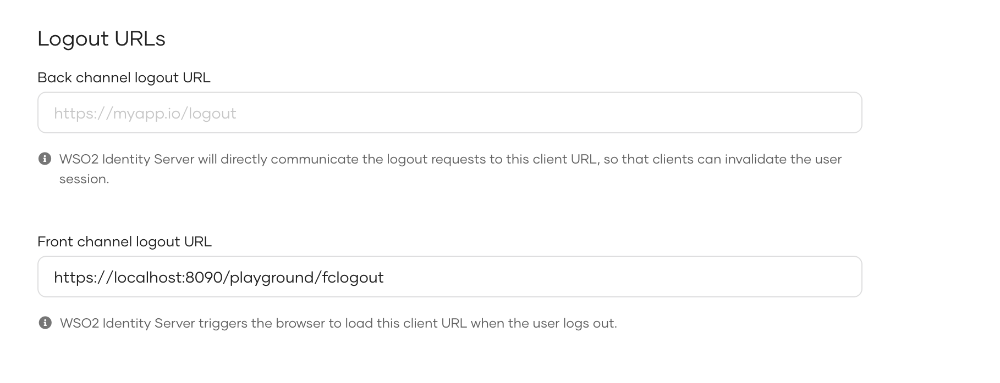

import Tabs from '@theme/Tabs';
import TabItem from '@theme/TabItem';

Front-channel logout lets the authorization server notify client applications to end a user's session through the user's browser via iframes.

Use front-channel logout when client applications cannot accept server-to-server (back-channel) requests but can receive browser-delivered logout notifications.

For protocol details see the OpenID specification: [OpenID Connect Front-Channel Logout 1.0](https://openid.net/specs/openid-connect-frontchannel-1_0.html).

## How it works



The front-channel logout flow works as follows:

1. The client application initiates a user logout.
2. {edition.productName} terminates the user's session.
3. {edition.productName} identifies all the client applications associated with the user's session.
4. {edition.productName} responds with an HTML page that embeds an iframe for each application that has a front-channel logout URI configured.
5. Upon receiving the logout request, each client application validates the requests and proceeds to invalidate the corresponding user session.

The logout request includes `iss` (issuer) and `sid` (session ID) query parameters.

<Tabs groupId="tabs">
<TabItem value="logout-request-format" label="Logout request format">

```text
http://myapp.com?iss={edition.productUrlFormat}/oauth2/token&sid={sid_value}
```

</TabItem>
<TabItem value="example-request" label="Example request">

```text
http://myapp.com?iss={edition.productUrlSample}/oauth2/token&sid=15043ffc-****-****-****-9b107f7da38c
```

</TabItem>
</Tabs>

## Configure front-channel logout URL

If your application supports OIDC front-channel logout, you can configure the logout URL of the application in the Console. That endpoint can listen to OIDC front-channel logout requests from {edition.productName}, and terminate the application's sessions.

To get started, you need to have an application registered in {edition.productName}. If you don't already have one, [register a web app with OIDC](../../../applications/register-oidc-web-app.mdx).

Follow the steps below to register the front-channel endpoint of your application with {edition.productName}.

:::note[Before you begin]
[Register your OIDC application](../../../applications/index.mdx) in {edition.productName}.
:::

1. On the {edition.productName} Console, go to **Applications** and select your OIDC application.

2. Go to the **Protocol** tab, and under **Logout URLs**, enter the **Front channel logout URL**.

       

3. Click **Update** to save your configurations.

:::note
**Cross-site cookie considerations**

Front-channel logout uses GET requests delivered via iframes to notify client domains. While GET requests in iframes have good browser support, modern browsers restrict third-party cookies and cross-site tracking, which can cause logout to fail.

*Recommendations:*

- Prefer [back-channel logout](./add-back-channel-logout.mdx) for reliable server-to-server session termination, as it does not depend on browser cookie policies.
- Consider hosting applications on subdomains of a shared parent domain (for example, `app1.example.com` and `app2.example.com`) so cookies can use `Domain=.example.com` and become first-party.
:::
