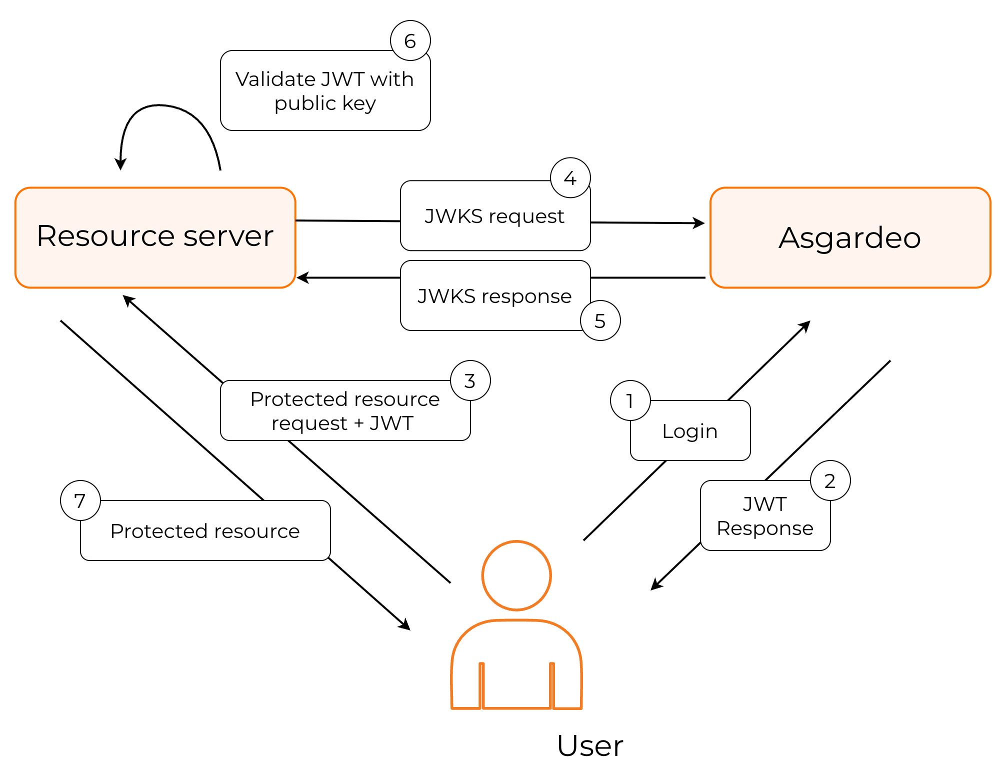
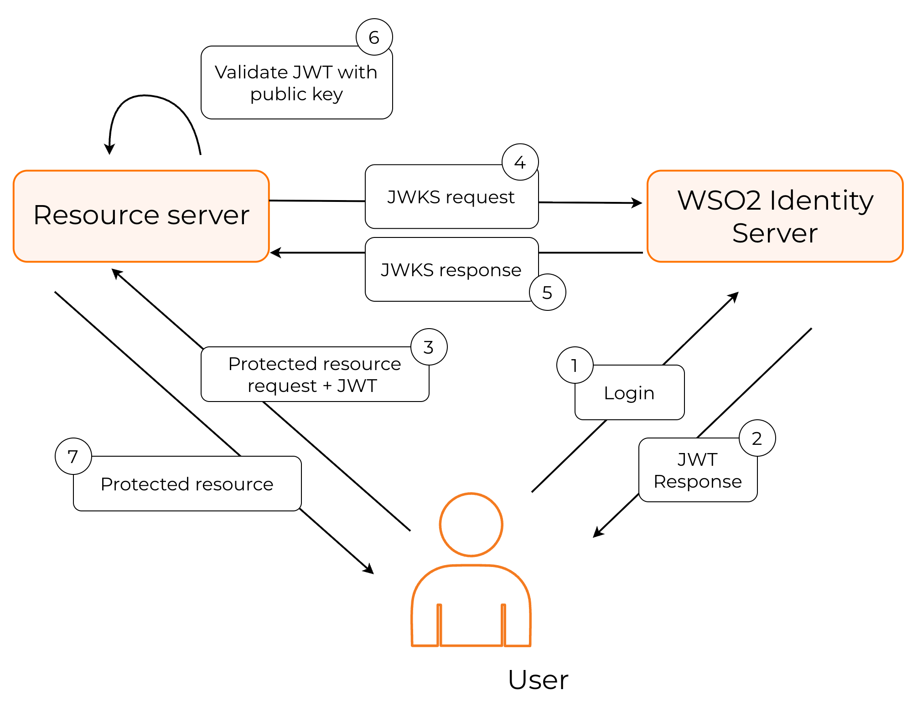
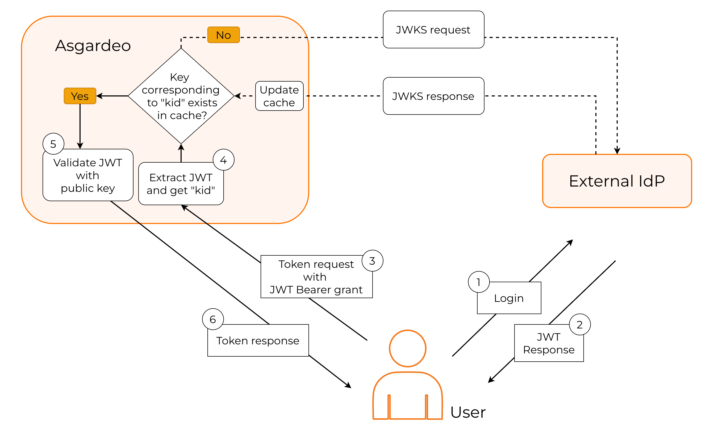

import Tabs from '@theme/Tabs';
import TabItem from '@theme/TabItem';

This guide explains JSON Web Key Set (JWKS) and how to use it to validate JSON Web Tokens (JWT) with {edition.productName}.

## Overview

A JWKS end-point exposes an authorization server’s public keys in the JWKS format. Clients can use these keys to verify the signatures of JWTs issued by the server. A JWKS endpoint comes with the following advantages.

- Programmatic key discovery by client applications - Clients can automatically fetch the Identity Provider (IdP)’s public keys without manual configuration.

- Simpler integration with multiple relying parties - Multiple apps can use the same IdP keys without individual updates.

- Seamless key rollover without service disruption - When the IdP changes keys, clients can verify tokens without breaking existing sessions.

{edition.productName} exposes its own JWKS endpoint when acting as an IdP. When acting as a service provider (SP), it can validate JWTs issued by external IdPs by calling the corresponding JWKS endpoints. The following sections explore how to configure and implement these two scenarios.

## {edition.productName} acting as the IdP

In this instance, {edition.productName} works as the JWT issuer. The following diagram explains this process.

<Variants><Edition only="cloud"></Edition><Edition only="self-hosted"></Edition></Variants>

- The user authenticates with {edition.productName} to access the protected resource.

- {edition.productName} authenticates the user, and returns a signed JWT.

- The application calls the JWKS endpoint of {edition.productName} to get the public keys.

- The application should then find the correct key based on the kid (key ID), validate the JWT response and grant access to the protected resource.

{edition.productName} exposes its public keys from the following URL:

<Variants>

<Edition only="cloud">

<Tabs groupId="tabs">
<TabItem value="format" label="Format">

```bash
https://api.asgardeo.io/t/<organization_name>/oauth2/jwks
```

</TabItem>
<TabItem value="example" label="Example">

```bash
https://api.asgardeo.io/t/bifrost/oauth2/jwks
```

</TabItem>
</Tabs>

</Edition>

<Edition only="self-hosted">

<Tabs groupId="tabs">
<TabItem value="format" label="Format">

```bash
https://<HOST_NAME>:<IS_HTTPS_PORT>/oauth2/jwks
```

</TabItem>
<TabItem value="example" label="Example">

```bash
https://localhost:9443/oauth2/jwks
```

</TabItem>
</Tabs>

</Edition>

</Variants>

The contents of the {edition.productName} JWKS endpoint take the following form:

```json
{
  "keys": [
    {
      "kty": "RSA",
      "x5t#S256": "m_eCU6DLMVTX9h5TomL64Swtp-AMsmA-6xvWCTr5gf4",
      "e": "AQAB",
      "use": "sig",
      "kid": "OWJmNzgyNTNhMGNiMzE1NGQ3ZjYxZTUzYTI2MmZhZTEyYzJkYTdlMDBjYjI2MDNlZWIxYmQ2MDkzYWY5ODFmZQ_RS256",
      "x5c": [
        "MIIDtTCCAp2gAwIBAgIUdYqOmjbFWs31cUW2cjkBlEUK3tQwDQYJKoZIhvcNAQELBQAwYjELMAkGA1UEBhMCVVMxCzAJBgNVBAgMAkNBMRQwEgYDVQQHDAtTYW50YSBDbGFyYTENMAsGA1UECgwEV1NPMjENMAsGA1UECwwEV1NPMjESMBAGA1UEAwwJbG9jYWxob3N0MB4XDTI1MDEwODA4MzIwN1oXDTI2MDEwODA4MzIwN1owYjELMAkGA1UEBhMCVVMxCzAJBgNVBAgMAkNBMRQwEgYDVQQHDAtTYW50YSBDbGFyYTENMAsGA1UECgwEV1NPMjENMAsGA1UECwwEV1NPMjESMBAGA1UEAwwJbG9jYWxob3N0MIIBIjANBgkqhkiG9w0BAQEFAAOCAQ8AMIIBCgKCAQEApKrcXnoAU82tf7lfrK7nXly0NXGuooK5976cApos9eKFd3I2ln7PEZEkeW5U+bsx/fSYBnSlf4rCD3xGI79H86dfJm6xewMeYkGW+gq/qyBJWR+qB4MSbh0LRci3swpVMfV4C+4jOJ0QmSjpr04toXz+yRO1YQIfZnO8ESlSby2gxnaimAkgjdv4pZJv4SK2YEQiOsUkYklRckMxVO3g/l4RIP83yBRLJaU5IiY/0YyKeR3XIM1QDv+0ZzI13MSPhb2TYzHevwgZ9cPnADMBT/RtRg9y5jscA+A/FdDcZ/QLsrWMYNqp9AlNBvKssrqZQ6PrfA+YngYu9rXIG3BuUw"
      ],
      "alg": "RS256",
      "n": "pKrcXnoAU82tf7lfrK7nXly0NXGuooK5976cApos9eKFd3I2ln7PEZEkeW5U-bsx_fSYBnSlf4rCD3xGI79H86dfJm6xewMeYkGW-gq_qyBJWR-qB4MSbh0LRci3swpVMfV4C-4jOJ0QmSjpr04toXz-yRO1YQIfZnO8ESlSby2gxnaimAkgjdv4pZJv4SK2YEQiOsUkYklRckMxVO3g_l4RIP83yBRLJaU5IiY_0YyKeR3XIM1QDv-0ZzI13MSPhb2TYzHevwgZ9cPnADMBT_RtRg9y5jscA-A_FdDcZ_QLsrWMYNqp9AlNBvKssrqZQ6PrfA-YngYu9rXIG3BuUw"
    },
    {
      "kty": "RSA",
      "x5t#S256": "m_eCU6DLMVTX9h5TomL64Swtp-AMsmA-6xvWCTr5gf4",
      "e": "AQAB",
      "use": "sig",
      "kid": "OWJmNzgyNTNhMGNiMzE1NGQ3ZjYxZTUzYTI2MmZhZTEyYzJkYTdlMDBjYjI2MDNlZWIxYmQ2MDkzYWY5ODFmZQ_PS256",
      "x5c": [
        "MIIDtTCCAp2gAwIBAgIUdYqOmjbFWs31cUW2cjkBlEUK3tQwDQYJKoZIhvcNAQELBQAwYjELMAkGA1UEBhMCVVMxCzAJBgNVBAgMAkNBMRQwEgYDVQQHDAtTYW50YSBDbGFyYTENMAsGA1UECgwEV1NPMjENMAsGA1UECwwEV1NPMjESMBAGA1UEAwwJbG9jYWxob3N0MB4XDTI1MDEwODA4MzIwN1oXDTI2MDEwODA4MzIwN1owYjELMAkGA1UEBhMCVVMxCzAJBgNVBAgMAkNBMRQwEgYDVQQHDAtTYW50YSBDbGFyYTENMAsGA1UECgwEV1NPMjENMAsGA1UECwwEV1NPMjESMBAGA1UEAwwJbG9jYWxob3N0MIIBIjANBgkqhkiG9w0BAQEFAAOCAQ8AMIIBCgKCAQEApKrcXnoAU82tf7lfrK7nXly0NXGuooK5976cApos9eKFd3I2ln7PEZEkeW5U+bsx/fSYBnSlf4rCD3xGI79H86dfJm6xewMeYkGW+gq/qyBJWR+qB4MSbh0LRci3swpVMfV4C+4jOJ0QmSjpr04toXz+yRO1YQIfZnO8ESlSby2gxnaimAkgjdv4pZJv4SK2YEQiOsUkYklRckMxVO3g/l4RIP83yBRLJaU5IiY/0YyKeR3XIM1QDv+0ZzI13MSPhb2TYzHevwgZ9cPnADMBT/RtRg9y5jscA+A/FdDcZ/QLsrWMYNqp9AlNBvKssrqZQ6PrfA+YngYu9rXIG3BuUw"
      ],
      "alg": "PS256",
      "n": "pKrcXnoAU82tf7lfrK7nXly0NXGuooK5976cApos9eKFd3I2ln7PEZEkeW5U-bsx_fSYBnSlf4rCD3xGI79H86dfJm6xewMeYkGW-gq_qyBJWR-qB4MSbh0LRci3swpVMfV4C-4jOJ0QmSjpr04toXz-yRO1YQIfZnO8ESlSby2gxnaimAkgjdv4pZJv4SK2YEQiOsUkYklRckMxVO3g_l4RIP83yBRLJaU5IiY_0YyKeR3XIM1QDv-0ZzI13MSPhb2TYzHevwgZ9cPnADMBT_RtRg9y5jscA-A_FdDcZ_QLsrWMYNqp9AlNBvKssrqZQ6PrfA-YngYu9rXIG3BuUw"
    }
  ]
}
```

<table>
  <tbody>
    <tr>
      <td>kty</td>
      <td>The public key type. e.g., RSA</td>
    </tr>
    <tr>
      <td>x5t#S256</td>
      <td>A SHA-256 hash of the X.509 certificate in the JWKS. Used to quickly identify which certificate was used to sign the JWT.</td>
    </tr>
    <tr>
      <td>e</td>
      <td>Exponent used in the RSA algorithm.</td>
    </tr>
    <tr>
      <td>use</td>
      <td>

        Indicates the intended use of the key.

        - `sig`: signature verification
        - `enc`: encryption

      </td>
    </tr>
    <tr>
      <td>kid</td>
      <td>The key ID. Helps to identify which key signed the JWT.</td>
    </tr>
    <tr>
      <td>x5c</td>
      <td>The X.509 certificate chain. The chain can include intermediate certificates up to a trusted root. Useful for clients that validate signatures against trusted Certificate Authorities (CA).</td>
    </tr>
    <tr>
      <td>n</td>
      <td>Modulus value used in the RSA algorithm.</td>
    </tr>
  </tbody>
</table>

## {edition.productName} acting as the SP

In this instance, {edition.productName} works as the JWT validator. The following diagram explains this process.

<Variants><Edition only="cloud"></Edition><Edition only="self-hosted"></Edition></Variants>

- The user first authenticates with the external IdP to access the protected resource.

- The external IdP issues a signed JWT and returns it to the user.

- Because the resource server trusts {edition.productName}, not the external IdP, the user must exchange this JWT for an access token in {edition.productName}.

- {edition.productName} reads the kid (key ID) from the JWT header to determine which key was used to sign it.

- If the corresponding key is already available in the cached JWKS content from the external IdP, {edition.productName} uses it to validate the JWT.

- If the key is not cached, {edition.productName} retrieves the JWKS from the external IdP and updates the cache.

- After successfully validating the JWT, {edition.productName} issues an access token to the user.

<Edition only="self-hosted">

Follow the steps below to implement this use case.

### Configure external JWKS endpoint properties

The following properties control how {edition.productName} retrieves and processes keys from an external JWKS endpoint. Configure them in the `<IS_HOME>/repository/conf/deployment.toml` file and restart {edition.productName}.

```toml
[oauth.jwks_endpoint]
enable= true
connection_timeout= 1000 # time in milliseconds
read_timeout= 1000 # time in milliseconds
size_limit_bytes= 51200
```

### Exchange signed JWT to a {edition.productName} token

</Edition>

You can see JWT validation in action by following the guide and implementing the [JWT Bearer Grant type](../grant-types/configure-jwt-bearer-grant.mdx) for your application.

<Edition only="self-hosted">

### Additional configurations

We recommend using `x5t#S256`. If your system requires the previous `x5t` support or hexifying the values, use the configuration combinations in the table below.

<table>
  <tbody>
    <tr>
      <th>JWT Header</th>
      <th>JWKS Response</th>
      <th>Configuration</th>
      <th>Notes</th>
    </tr>
    <tr>
      <td>`x5t#S256`</td>
      <td>`x5t#S256`</td>
      <td>This is the default configuration</td>
      <td>**Recommended.**</td>
    </tr>
    <tr>
      <td>`x5t`</td>
      <td>`x5t`</td>
      <td>`[oauth]`<br /> `jwt_x5t_s256_enabled=false`<br /> `jwt_x5t_enabled=true`<br /><br /> `[oauth.jwks_endpoint]`<br /> `is_x5t_required=true`</td>
      <td>Use this to support legacy systems that require `x5t`.</td>
    </tr>
    <tr>
      <td colSpan="2">Hexifying thumbprints</td>
      <td>`[oauth]`<br /> `jwt_x5t_hexify_required=true`<br /><br /> `[oauth.jwks_endpoint]`<br /> `is_thumbprint_hexify_required=true`</td>
      <td>When you need to hexify thumbprints, use this configuration.</td>
    </tr>
  </tbody>
</table>

</Edition>

