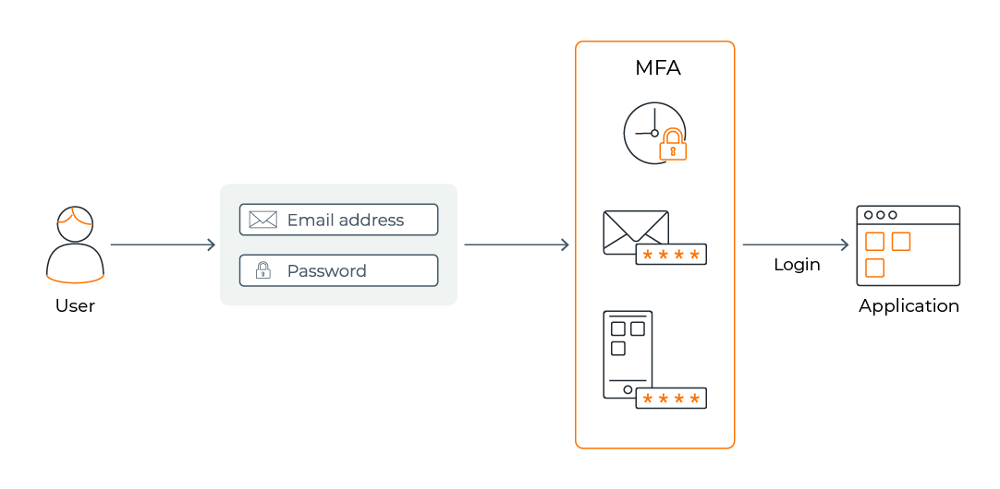
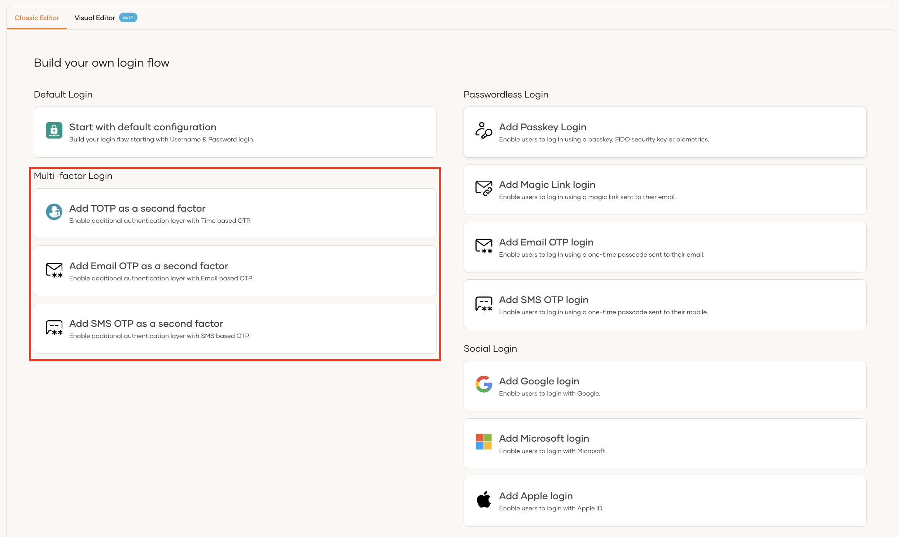
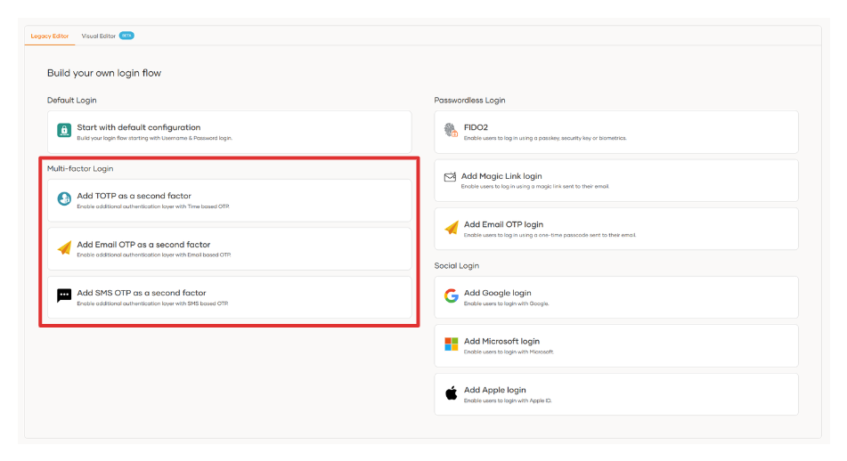
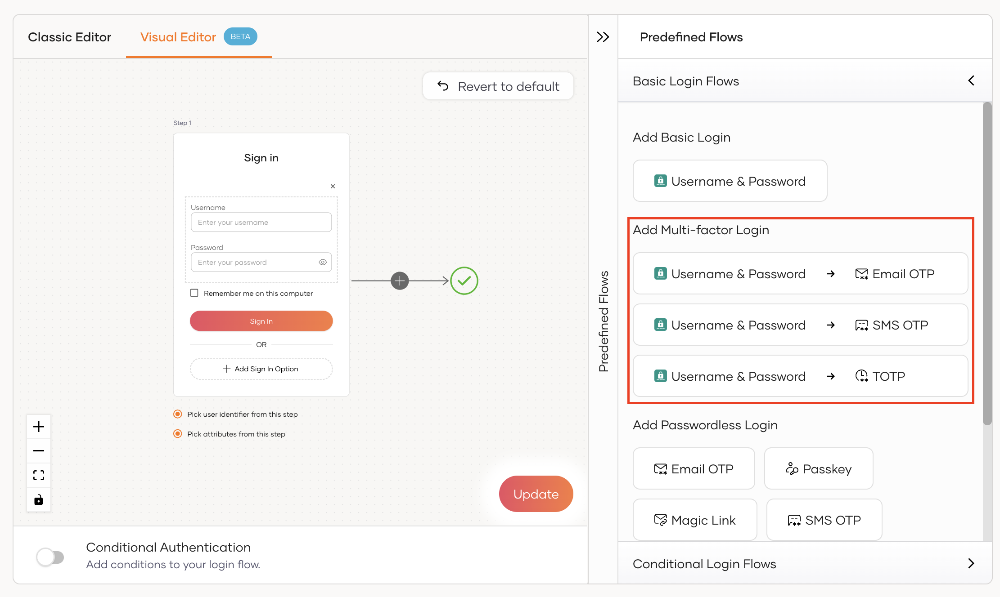
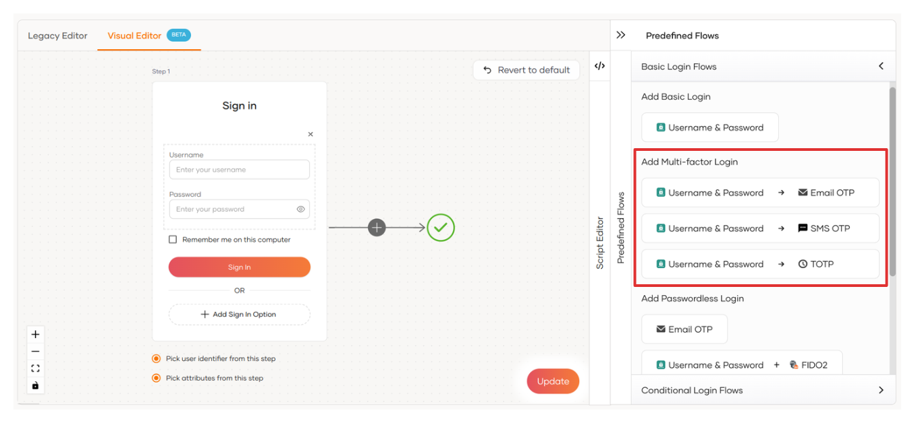

Multi-Factor Authentication (MFA) allows you to grant access to your resources by using two (2-Factor) or more (Multi-Factor) factors to authenticate users. If one factor is compromised or broken, an attacker still has at least one more barrier to breach before successfully breaking into the resource. MFA provides an additional layer of security to the resource.

Authentication factors in MFA rely on two or more independent credentials of the three categories given below.

- **Knowledge factor**  - Something you know, such as a password or a PIN.
- **Possession factor** - Something you have, such as a FIDO key or an ATM card.
- **Inherence factor**  - Something you are, such as your fingerprint or your iris pattern.

On {edition.productName}, the default authentication mechanism is **username and password**.

The {edition.productName} Console allows configuring multi-step authentication where you can define an authentication chain containing different authenticators in each step. By adding different authenticators, you can achieve a login flow secured by multiple factors.

You can choose to replace the **username and password** authentication with social or enterprise logins and add a few more authenticators to build your authentication chain.

## Configure multi-factor authentication

{edition.productName} provides two modes to configure multi-factor authentication, namely the **Classic Editor** and the **Visual Editor**.

Given below are the main steps you will follow when enabling MFA in your login flow.

1. On the {edition.productName} Console, go to **Applications** and select the application to which MFA needs to be added.

2. Go to the **Login Flow** tab where the application login flow is defined.

3. Add the required authenticators that should be enforced at each step. You can add authenticators using any one of the following editors:

    - Using the classic editor

        <Variants><Edition only="cloud"></Edition><Edition only="self-hosted"></Edition></Variants>

    - Using the classic editor

        <Variants><Edition only="cloud"></Edition><Edition only="self-hosted"></Edition></Variants>

## What's next?

Learn how to enable MFA using the following authenticators:

- [TOTP](./add-totp-login.mdx)
- [Email OTP](./add-emailotp-login.mdx)
- [SMS OTP](./add-smsotp-login.mdx)
- [Passkey](./add-passkey-login.mdx)
- [Push Notification](./add-push-auth-login.mdx)

<Edition only="cloud">

- [iProov](./add-iproov-login.mdx)
- [Duo](./add-duo-login.mdx)

</Edition>

