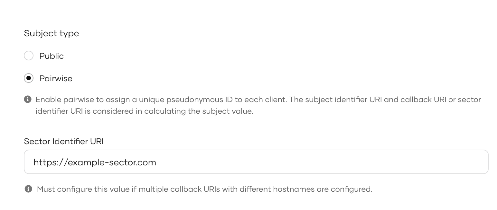

User attributes are pieces of information about the identity of a user such as an email address, birth date or the user's country etc.. Applications may request user attributes from the identity provider to personalize the experience of the logged in user.

The following guides explain how you can configure OpenID Connect applications to request attributes from {edition.productName}.

## Configure user attributes

Follow the steps given below to configure the user attributes from the {edition.productName} Console and share them with the application.

### Select user attributes

You can specify the necessary user attributes for an application. This ensures that when a user logs in, the application is only granted access to the user information associated with these attributes.

The user attributes are grouped by their specific scopes to ease the user attribute configuration process. You can add user attributes individually or all the attributes in the scope at once.

To add user attributes to the app:

1. On the {edition.productName} console, go to **Applications**.
2. Select your application and go to its **User Attributes** tab. The most common user attributes are listed according to the relevant scope.

    <Variants><Edition only="cloud"></Edition><Edition only="self-hosted"></Edition></Variants>

3. You can select user attributes using the following methods:

    - Add all user attributes for a given scope by selecting the checkbox in front of that scope.

        <Variants><Edition only="cloud"></Edition><Edition only="self-hosted"></Edition></Variants>

    - Add user attributes by expanding a scope and selecting only the necessary user attributes.

        <Variants><Edition only="cloud"></Edition><Edition only="self-hosted"></Edition></Variants>

4. Click **Update** once you are done.

### Select an alternate subject attribute

The **subject** attribute (`sub`) in the ID token uniquely identifies a user. By default, {edition.productName} sets `sub` to the User ID, but you can configure it to use any other user attribute as the subject.

To define a different attribute as the subject:

1. In the **Subject** section of the **User Attributes** tab, enable **Assign alternate subject identifier**.

    :::note
    According to the [OIDC specification](https://openid.net/specs/openid-connect-core-1_0.html#SubjectIDTypes), it is not recommended to change the default subject identifier. If you must change it, make sure to select an attribute that is immutable and unique across the organization.
    :::

    

2. Select an attribute as the subject from the **Subject attribute** list.

3. Click **Update**.

<Edition only="self-hosted" selfHostedFrom="next">

:::note[UserInfo `sub` and token reissue, for alternate subject identifiers]
When an alternate subject identifier is configured, the `sub` value returned by the [userinfo endpoint](#userinfo-response) is determined when the access token is issued and remains unchanged for the lifetime of that token.

If the underlying attribute changes later, for example, if the user updates their email address, and the same valid access token is reused, the newly issued ID token reflects the updated value. However, the userinfo response continues to return the sub value associated with the access token when it was originally issued.

To have the userinfo endpoint recompute `sub` from the attribute's current value on every request, enable the following `deployment.toml` configuration and restart the server:

```toml
[oauth.userinfo]
recompute_subject_claim_for_alternate_subject_identifier = true
```

This setting is disabled by default. When enabled, a client that requires matching sub values in the ID token and userinfo response must request a new access token after the attribute used as the subject changes.

Previously issued ID tokens are not updated retroactively because they are signed and immutable.

This setting applies only to applications configured with an alternate subject identifier. It has no effect on other applications.
:::

</Edition>

:::warning[Deprecated `sub` attribute behavior in application access tokens]
Application access tokens are tokens generated to represent the application rather than an individual user. Such tokens are generated during grant types such as [client_credential](../../../reference/iam-concepts/grant-types.mdx#client-credentials-grant).

Previously, the `sub` attribute of application access tokens contained the `userid` of the application owner. With the latest updates, the `sub` value will contain the `client_id` of the application. If your application's access tokens still return the `userid` in the `sub` attribute, it is likely that your application is out-of-date. If so, update your application through the {edition.productName} Console by navigating to the relevant application under the **Applications** section.

Once updated, the `sub` attribute will return the `client_id`. Therefore, before updating, ensure that your application does not rely on the `sub` attribute and remove any such dependencies.
:::

<Edition only="self-hosted">

### Include the user store and organization domains in the subject

The **Subject** section of the **User Attributes** tab has two options that add domain information to the subject identifier. Both options decorate whichever attribute is configured as the subject, including the default user ID.

Assuming the subject identifier is the user ID `e46ffa67-100d-4329-9460-b8251d446518`:

- **Include user domain** - prepends the user store domain of the user, for example, `SECONDARY/e46ffa67-100d-4329-9460-b8251d446518`.

    :::note
    The `PRIMARY` user store domain is never added to the subject identifier. This option has no visible effect for users in the primary user store.
    :::

- **Include organization name** - appends the organization name of the user, for example, `e46ffa67-100d-4329-9460-b8251d446518@carbon.super`.

For OpenID Connect applications, these two options appear only after you enable **Assign alternate subject identifier**. They also remain hidden until at least one user attribute is selected for the application.

:::warning[These options change the `sub` claim]
These options apply to the subject identifier itself, so an option that takes effect changes the `sub` claim of the ID token on every login to the application. As noted above, **Include user domain** has no effect for users in the primary user store. Make sure the application can handle the new `sub` value before you enable either option.
:::

These options also control the `username` field of the OAuth2 introspection response, but only when `build_subject_identifier_from_sp_config` is enabled at the server level. In the introspection response, the value is built from the user's username rather than from the subject attribute. For details, see [Validate tokens at a resource server](../configure-oidc-flows/tokens-and-validation/token-validation-resource-server.mdx#username-format).

</Edition>

### Define mandatory user attributes

{/* markdownlint-disable-next-line */}
If your application needs certain attributes for the successful function of the application, you can make them mandatory attributes. Users logging into the application should then have the mandatory attributes either pre-filled in their profiles or provide the required information when prompted during the login flow.

To make an attribute mandatory:

1. On the {edition.productName} console, go to **Applications**.

2. Select the application and go to its **User attributes** tab.

3. Expand the relevant scope and out of the selected attributes for the application, select the mandatory attributes by selecting the **Mandatory** checkbox next to them.

    <Variants><Edition only="cloud"></Edition><Edition only="self-hosted"></Edition></Variants>

<Edition only="self-hosted">

## Configure the subject identifier

WSO2 Identity Server uses a subject attribute to uniquely identify users logging into OIDC applications. This is set to be the **user ID** of the user which can be found in the user's profile in **User Management** > **Users**.

However, having a single subject identifier for multiple applications may enable external entities to track the activity of a user across applications based on a single attribute.

You can opt for a pairwise subject identifier to mitigate this issue. With a pairwise subject identifier, WSO2 Identity Server generates a unique pseudonymous ID for each user-application pair protecting the user's identity when accessing multiple applications.

Follow the steps below to configure the subject identifier type:

1. On the WSO2 Identity Server Console, go to **Applications**.

2. Select the application and go to its **User Attributes** tab.

3. Under **Subject type**, select **Pairwise**.

4. Enter a **Sector Identifier URI**.

    :::info
    The sector identifier URI is used to group clients belonging to the same security domain so that the same pairwise identifier is used for a given user accessing these clients.
    :::

    

4. Click **Update** to save the changes.

</Edition>

## How it works

The following diagram depicts the process {edition.productName} implements when a user tries to log in to an application.

<Variants><Edition only="cloud"></Edition><Edition only="self-hosted"></Edition></Variants>

### Application requests attributes

When the user logs in to the app, a request is sent to {edition.productName} with the relevant **scopes**.

Applications can use scopes to request access to a group of user attributes.

:::note
Learn more about [managing scopes](../../users/attributes/manage-scopes.mdx) in {edition.productName}.
:::

### {edition.productName} checks for mandatory attributes

{edition.productName} verifies whether the user's profile has values for all the [mandatory attributes](#define-mandatory-user-attributes) that are requested by the application. If there are missing values, {edition.productName} will prompt the user to enter the missing values.

### Requests user consent

By default, {edition.productName} requests the user's consent to share the user attributes with the application.

:::note
Learn more about [managing user consent](../manage-consent-for-attributes.mdx).
:::

### Shares attributes with the app

If the user consents to share attributes with the application, {edition.productName} returns the requested user attributes as well as the **subject** attribute to the application in the **ID token**.

#### Subject Attribute

The subject attribute is the unique identifier for a user. The application receives this value via the `sub` parameter in the [ID token](#id-token). In {edition.productName}, the user ID is used as the subject attribute.

#### ID token

Once the application calls the [token endpoint](../configure-oidc-flows/oidc/implement-auth-code.mdx#get-tokens), {edition.productName} sends the ID token in the response.

All the user attributes that are requested by scopes are returned as claims in the ID token. The application can decode the ID token to view the claims.

_A sample ID token is given below:_

```json
{
  "isk": "69b37037a2349763dc48e2a30a62c3feebf0b5823cf869e149352737ddc0ca63",
  "at_hash": "7qgloEmkz3kGBTtH7RI4qw",
  "sub": "e46ffa67-100d-4329-9460-b8251d446518",
  "amr": [
    "BasicAuthenticator"
  ],
  "iss": "{edition.productUrlSample}/oauth2/token",
  "given_name": "alice",
  "sid": "5580be2b-a12d-43a4-823a-9d1352b88269",
  "aud": "UEP40cZTZfxJfGdDWFmTrwqluxoa",
  "c_hash": "VlKxb3UhuYtFEG_VftAa0g",
  "nbf": 1625557031,
  "azp": "UEP40cZTZfxJfGdDWFmTrwqluxoa",
  "nickname": "nick",
  "exp": 1625560631,
  "iat": 1625557031,
  "family_name": "john"
}
```

#### Userinfo response

In addition to getting attributes from the ID token, the application can invoke the [userinfo endpoint](../configure-oidc-flows/tokens-and-validation/request-user-info.mdx) and get user attributes along with the subject attribute.

_A sample userinfo response is given below:_

```json
{
"sub": "e46ffa67-100d-4329-9460-b8251d446518",
"nickname": "nick",
"given_name": "alice",
"family_name": "john"
}
```

## Prioritize sharing local attributes

In a scenario where a user with a local account in {edition.productName}, logs in using [federated authentication](../add-federated-login/index.mdx), you may want to prioritize sharing local user attributes with the application over those provided by the external identity provider. Follow the steps below to set this priority for sharing user attributes.

1. On the {edition.productName} Console, go to **Applications**.
2. Select your application and go to its **User Attributes** tab.
{/* markdownlint-disable MD029 */}

3. Scroll down and under **Linked Accounts**, select **Prioritize local account attributes**.

{/* markdownlint-enable MD029 */}
    

4. Click **Update** to save the changes.

When enabled, {edition.productName} looks for a linked local user account based on the subject claim provided by the external identity provider. If a local user account is found, the local attributes will be shared with the application. If a local account is not found, user attributes obtained from the external identity provider will be shared with the application.

:::note
When [JIT provisioning](../jit-user-provisioning.mdx) is enabled for the external identity provider, {edition.productName} ensures that the attributes of the associated local account synchronize with the external identity provider upon each federated login.

If you want to preserve attribute values set in the local user account, you need to disable JIT provisioning
:::
