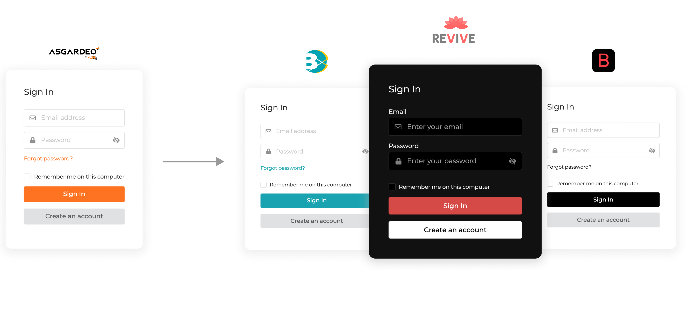
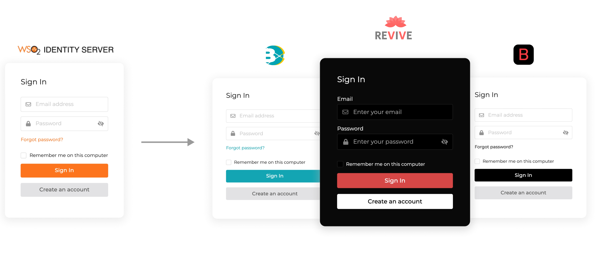

import Tabs from '@theme/Tabs';
import TabItem from '@theme/TabItem';

{edition.productName} allows you to customize the user interfaces (UIs) displayed to your users during login, sign-up, account recovery, and self-service.

Customizations take effect at two levels:

- **Organization-wide Branding**: This functions as the default branding and applies to all applications in an organization.
- **Application-specific Branding**: Each application can have its own branding. This overrides the organization-wide branding applied by default to the application.

By branding these interfaces, your users will experience a familiar and consistent look and feel that aligns with your organizational or application-specific themes.

:::note[UI Branding for B2B applications]
If you have implemented [B2B organizations](../../organization-management/index.mdx), refer [UI branding inheritance](../../organization-management/customize-organizations/inheritance-in-organizations/ui-branding-inheritance.mdx) to see how branding configurations are inherited.
:::

:::note
See the complete list of [UI branding options](#ui-branding-preferences) currently available in {edition.productName}.
:::

<Variants><Edition only="cloud"></Edition><Edition only="self-hosted"></Edition></Variants>

## Update branding

Follow the steps given below to configure branding preferences:

1. On the {edition.productName}, go to **Branding** > **Styles & Text**.

2. In the top right corner, select either **Organization** for organization-wide branding or **Application** and choose an application for application-specific branding.

    <Variants><Edition only="cloud"></Edition><Edition only="self-hosted"></Edition></Variants>

    :::note
    You may also navigate to application branding by going to the **General** tab of your application and under **Branding**, selecting **Go to Application Branding**.
    :::

2. Update the [UI branding options](#ui-branding-preferences) in the **General**, **Design**, **Advanced**, and **Text** tabs.

    :::note
    - Text branding is currently not available for application-specific branding. You can still configure text branding at the organization level, and it will apply to all applications unless overridden by application-specific branding in other areas.
    - If you leave any of the branding preferences empty, {edition.productName} defaults will be used.
    - The real-time preview will show you a sample view as you update the values.
    :::

3. Click **Save & Publish** to publish your branding configurations.

The email templates of the organization will be automatically updated according to your branding preferences if the preferences are in the published state. See [Customize email templates](./customize-email-templates.mdx) for more information.

<Edition only="cloud">

:::note
For free-tier subscriptions, the **Powered by WSO2 Identity Platform** label will display on the WSO2 Identity Platform-powered interfaces when branding is published.
:::

</Edition>

## Preview branding

You can preview how your branding preferences will look once they are saved and published.

To preview your branding configurations for different flows, on the **Preview** window, select the screen you wish to preview from the **Screen** list.

<Variants><Edition only="cloud"></Edition><Edition only="self-hosted"></Edition></Variants>

## Disable branding

You can temporarily disable your branding preferences by clicking **Unpublish** in the **Danger Zone**. Your progress will be preserved up to the point and you can choose to publish them again later by clicking on the **Save & Publish** button.

When disabled, {edition.productName}'s default branding will apply to the interfaces in your application's login, user registration, account recovery flows, and My Account portal.

## Revert branding

If you want to revert your branding preferences, scroll down to the **Danger Zone** and click **Revert to default**.

:::warning
Note that this permanently removes all the branding options that you have saved and the branding of the next available level (such as organization branding or {edition.productName} defaults) will be applied to your organization or application.
:::

<Edition only="cloud">

## Extend branding

When you go to **Branding > Styles & Text** on the WSO2 Identity Platform console, you will see the list of branding preferences that are supported for your user interfaces by default.

If you require any of the extended branding capabilities (explained below), you can contact the WSO2 Identity Platform team at **asgardeo-help@wso2.com** . Note that you need to send the request from an administrator account.

</Edition>

## UI branding preferences

Listed below are the branding preferences that you can use to customize the {edition.productName} interfaces (UIs) presented to your users.

### General preferences

Listed below are general branding preferences you can apply to the interfaces.

<table>
  <tbody>
    <tr>
      <td>**Organization Display Name**</td>
      <td>This name will appear as the organization name in the emails that send to your users. If not set, {edition.productName} defaults are used.</td>
    </tr>
    <tr>
      <td>**Contact Email**</td>
      <td>This email address will appear on emails, error pages and, other pages where users would require support from the organization admin.</td>
    </tr>
  </tbody>
</table>

<Edition only="self-hosted">

:::warning[Deprecated feature]
The branding **Organization Display Name** feature has been deprecated. Use the root organization name instead to ensure consistency and better customization.

See [Manage current organization](../../organization-management/manage-organizations.mdx#manage-current-organization) for more information.
:::

</Edition>

### Design preferences

Listed below are the design changes you can apply to the user registration interface, login interfaces and My Account portal.

:::note
My Account branding can only be configured at the organization level.
:::

#### Layout variations

Select one of the available layouts for your user registration and login interfaces. {edition.productName} uses the **Centered** layout by default.

<Edition only="cloud">

:::note[Custom layout]
If you want to use the **Custom** layout from the list (shown below), contact WSO2 Identity Platform support through the [WSO2 cloud support portal](https://cloud-support.wso2.com/) or send a request email to `asgardeo-help@wso2.com` and the team will get back to you with instructions.

Note that these requests should be sent from the account of an administrator in the organization.     
:::

</Edition>

#### Theme variations

Select from either **Dark** or **Light** theme variations to modify the styling of your user registration screen, login screen and My Account portal. {edition.productName} uses the **Light** theme by default.

#### Theme preferences

The following design preferences apply to the theme you select. You can configure and save separate design preferences for each of the themes.

Images

  You can configure the {edition.productName} logo, My Account logo, and favicon for the theme you selected.

  <table>
    <tbody>
      <tr>
        <td>**Logo**</td>
        <td>

          This is the logo that appears above the login box in login screens and in emails sent by the organization. Update the following values to set the logo:

          - **URL**: You can update the logo by specifying the URL of a hosted image.
          - **Alt Text**: The 'Alt text' or 'alternative text' is a short description of an image. This text is useful to make sense of the image when it can't be viewed for some reason. A descriptive alt text is always a good practice to improve accessibility.

          Use an image that's at least 600x600 pixels and less than 1MB in size for better performance.

        </td>
      </tr>
      <tr>
        <td>**Favicon**</td>
        <td>Browsers that provide favicon support typically display a page's favicon in the browser's address bar and next to the page's name in a list of bookmarks.   You can update the favicon by specifying the URL of a hosted image (of type **png**, **ico**, etc.).   Use an image with a square aspect ratio that's at least 16x16 pixels in size for better results.</td>
      </tr>
      <tr>
        <td>**My Account Logo**</td>
        <td>

          This is the logo that appears in the header of the My Account portal. Update the following values to set the logo:

          - **URL**: You can update the logo by specifying the URL of a hosted image.
          - **Alt Text**: The 'Alt text' or 'alternative text' is a short description of an image. This text is useful to make sense of the image when it can't be viewed for some reason. A descriptive alt text is always a good practice to improve accessibility.
          - **Logo Title**: The text shown beside the Logo.

          Use an image that's at least 250x50 pixels and less than 1MB in size for better performance.

        </td>
      </tr>
    </tbody>
  </table>

:::note[Important]
Be sure that the hosted image you use will properly return Content-Type headers. Without these headers, the image will not correctly render and you will experience a 403 error. You can use static image hosting services to ensure these headers are properly returned.
:::

Color Palette

This is the primary color palette for your interfaces. Click the color swatch and apply colors that match your organization's style guide.

<table>
  <tbody>
    <tr>
      <td>**Primary Color**</td>
      <td>The color that appears dominantly in primary actions, anchor tags, emails, etc.   By default, {edition.productName} uses an orange shade as the primary color for both **Light** and **Dark** themes</td>
    </tr>
    <tr>
      <td>**Secondary Color**</td>
      <td>The color that appears in secondary actions and other emphasized content.   By default, {edition.productName} uses a lighter gray shade as the secondary color.</td>
    </tr>
  </tbody>
</table>

#### Body background

<table>
  <tbody>
    <tr>
      <td>**Main Background Color**</td>
      <td>This is the main background color used in the UIs. This will be used as the background color for login, sign-up, and account recovery flows, and on the My Account portal.</td>
    </tr>
  </tbody>
</table>

#### Surface background

<table>
  <tbody>
    <tr>
      <td>**Main Surface Background Color**</td>
      <td>The main background color used in surface elements like cards, popups, panels, etc.</td>
    </tr>
    <tr>
      <td>**Light Surface Background Color**</td>
      <td>A lighter variation of the background color used in specific parts of the surface elements like cards, popups, panels, etc.</td>
    </tr>
    <tr>
      <td>**Dart Surface Background Color**</td>
      <td>A darker variation of the background color used in specific parts of the surface elements like cards, popups, panels, etc.</td>
    </tr>
    <tr>
      <td>**Inverted Surface Background Color**</td>
      <td>The inverted variation of the background color used in surface elements like the application header in the My Account portal.</td>
    </tr>
  </tbody>
</table>

#### Outlines

<table>
  <tbody>
    <tr>
      <td>**Default Outline Color**</td>
      <td>The default outline color used in elements like cards, tooltips, dropdowns, etc.</td>
    </tr>
  </tbody>
</table>

#### Text Colors

<table>
  <tbody>
    <tr>
      <td>**Primary Text Color**</td>
      <td>The primary text color used in the user interface. Select a color that provides good contrast against the background color and is easy to read.</td>
    </tr>
    <tr>
      <td>**Secondary Text Color**</td>
      <td>The secondary text color used in the user interface. Select a color that compliments the primary color and enhances the visual hierarchy of your design.</td>
    </tr>
  </tbody>
</table>

#### Alerts

<table>
  <tbody>
    <tr>
      <td>**Neutral Alert Background Color**</td>
      <td>The color of the message boxes that appears to convey non-critical information or feedback.</td>
    </tr>
    <tr>
      <td>**Info Alert Background Color**</td>
      <td>The color of the message boxes that appears to convey informative messages such as tips or additional information.</td>
    </tr>
    <tr>
      <td>**Warning Alert Background Color**</td>
      <td>The color of the message boxes that appears to convey warning messages such as potential risks or notifications that require your attention.</td>
    </tr>
    <tr>
      <td>**Error Alert Background Color**</td>
      <td>The color of the message boxes that appears to convey error messages such as system failures or critical errors.</td>
    </tr>
  </tbody>
</table>

#### Illustrations

<table>
  <tbody>
    <tr>
      <td>**Primary Color**</td>
      <td>This is the primary color used for the SVG illustrations in My Account portal.</td>
    </tr>
    <tr>
      <td>**Secondary Color**</td>
      <td>This is the secondary color used for the SVG illustrations in My Account portal.</td>
    </tr>
    <tr>
      <td>**Accent Color 1**</td>
      <td>This is the primary accent color used for the SVG illustrations. Choose a color that will draw attention to specific elements of your illustration and highlight key features of your user interface design.</td>
    </tr>
    <tr>
      <td>**Accent Color 2**</td>
      <td>This is the secondary accent color used for the SVG illustrations. Choose an alternate accent color that harmonizes with your design aesthetic and enhances the overall visual appeal of your SVG illustration.</td>
    </tr>
    <tr>
      <td>**Accent Color 3**</td>
      <td>This is the tertiary accent color used for the SVG illustrations. Choose an accent color that harmonizes with your design aesthetic and enhances the overall visual appeal of your SVG illustration.</td>
    </tr>
  </tbody>
</table>

Footer

Decide how you want the footer to look in the login screens by modifying the following attributes:

<table>
  <tbody>
    <tr>
      <td>**Border Color**</td>
      <td>The color of the top border of the footer that appears on the login screens.   By default, the **Default Outline Color** from the **Color Palette** will be used until a value for this is defined.</td>
    </tr>
    <tr>
      <td>**Font Color**</td>
      <td>The font color of the texts and links that appear on the footer.   By default, the **Primary Text Color** from the **Color Palette** will be used until a value for this is defined.</td>
    </tr>
  </tbody>
</table>

Font

Use one of the following options to override the default font for the theme you selected.

#### Use a web-safe font

<table>
  <tbody>
    <tr>
      <td>**Font Family**</td>
      <td>The list of available web-safe fonts to select from.   By default, {edition.productName} uses Montserrat as the font family.</td>
    </tr>
  </tbody>
</table>

#### Import a font

<table>
  <tbody>
    <tr>
      <td>**Font Import URL**</td>
      <td>Get the URL of a hosted font from the font service and add it here.   E.g., `https://fonts.googleapis.com/css2?family=Poppins&display=swap`</td>
    </tr>
    <tr>
      <td>**Font Family**</td>
      <td>This is the font family corresponding to the font imported using the URL (specified in the **Font Import URL** field).   E.g., `Poppins`, `Sans-serif`</td>
    </tr>
  </tbody>
</table>

Headings

These preferences decide the look and feel of  `h1`, `h2`, `h3`, `h4`, `h5`, and `h6` elements on     the login screens.

<table>
  <tbody>
    <tr>
      <td>**Font Color**</td>
      <td>This is the font color of the headings that appear on the login screens.   By default, the **Default Outline Color** from the **Color Palette** will be used until a value for this is defined.</td>
    </tr>
  </tbody>
</table>

Buttons

These preferences change the look and feel of buttons that appear on the login screens.

#### Primary Button

<table>
  <tbody>
    <tr>
      <td>**Font Color**</td>
      <td>This is the font color of the text inside the primary action buttons.   By default, {edition.productName} uses white as the font color for primary buttons.</td>
    </tr>
    <tr>
      <td>**Border Radius**</td>
      <td>This is the border radius of the primary action buttons.   By default, {edition.productName} uses **22** pixels as the border-radius for primary buttons.</td>
    </tr>
  </tbody>
</table>

#### Secondary Button

<table>
  <tbody>
    <tr>
      <td>**Font Color**</td>
      <td>This is the font color of the text inside the secondary action buttons.   By default, {edition.productName} uses black as the font color for secondary buttons.</td>
    </tr>
    <tr>
      <td>**Border Radius**</td>
      <td>This is the border radius of the secondary action buttons.   By default, {edition.productName} uses **22** pixels as the border-radius for secondary buttons.</td>
    </tr>
  </tbody>
</table>

#### External Connection Button

These preferences change the look and feel of buttons used for linking external identity providers     (Facebook, Google, etc.) from the login screens.

<table>
  <tbody>
    <tr>
      <td>**Background Color**</td>
      <td>This is the background color for external-connection buttons.   By default, {edition.productName} uses white as the font color for external-connection buttons.</td>
    </tr>
    <tr>
      <td>**Font Color**</td>
      <td>This is the font color of the text inside the external-connection buttons.   By default, {edition.productName} uses black as the font color for external-connection buttons.</td>
    </tr>
    <tr>
      <td>**Border Radius**</td>
      <td>This is the border radius of the external-connection buttons.   By default, {edition.productName} uses **22** pixels as the border-radius for external-connection buttons.</td>
    </tr>
  </tbody>
</table>

Inputs

These preferences change the look and feel of input fields, checkboxes, etc. on the login screens.

<table>
  <tbody>
    <tr>
      <td>**Background Color**</td>
      <td>This is the background color of the inputs on the login screens.   By default, {edition.productName} uses white as the background color for the inputs.</td>
    </tr>
    <tr>
      <td>**Font Color**</td>
      <td>This is the font color of the inputs on the login screens.   By default, the **Primary Text Color** from the **Color Palette** will be used until a value for this is defined.</td>
    </tr>
    <tr>
      <td>**Border Color**</td>
      <td>This is the border color of the inputs on the login screens.   By default, the **Default Outline Color** from the **Color Palette** will be used until a value for this is defined.</td>
    </tr>
    <tr>
      <td>**Border Radius**</td>
      <td>This is the border radius of the login box.   By default, {edition.productName} uses **8** pixels as the border-radius for the login box.</td>
    </tr>
  </tbody>
</table>

#### Input Labels

<table>
  <tbody>
    <tr>
      <td>**Font Color**</td>
      <td>This is the font color of the input labels on the login screens.   By default, the page font color will be used until a value for this is defined.</td>
    </tr>
  </tbody>
</table>

Login Page

These are the specific design preferences you can update specifically for login, sign-up, account     recovery flows. If these are not set,
the values will be inferred from the color palette.

<table>
  <tbody>
    <tr>
      <td>**Background Color**</td>
      <td>This is the background color that appears on the login, sign-up, account recovery screens.  By default, the **Main Background Color** from the **Color Palette** will be used until a value for this is defined.</td>
    </tr>
    <tr>
      <td>**Font Color**</td>
      <td>The font color of the text that appears on the login, sign-up, account recovery screens.  By default, the **Primary Text Color** from the **Color Palette** will be used until a value for this is defined.</td>
    </tr>
  </tbody>
</table>

Login Box

These preferences change how the login box appears on the screens.

<table>
  <tbody>
    <tr>
      <td>**Background Color**</td>
      <td>This is the background color of the login box.   By default, the **Main Surface Background Color** from the **Color Palette** will be used until a value for this is defined.</td>
    </tr>
    <tr>
      <td>**Font Color**</td>
      <td>This is the font color of the text inside the login box.   By default, the **Primary Text Color** from the **Color Palette** will be used until a value for this is defined.</td>
    </tr>
    <tr>
      <td>**Border Color**</td>
      <td>This is the border color of the login box.   By default, the **Default Outline Color** from the **Color Palette** will be used until a value for this is defined.</td>
    </tr>
    <tr>
      <td>**Border Width**</td>
      <td>This is the border width of the login box.   By default, {edition.productName} uses **one** pixel as the border width for the login box.</td>
    </tr>
    <tr>
      <td>**Border Radius**</td>
      <td>This is the border-radius of the login box.   By default, {edition.productName} uses `12` pixels as the border-radius for the login box.</td>
    </tr>
  </tbody>
</table>

### Advanced preferences

Listed below are some advanced branding preferences you can apply to the user registration and login interfaces.

<table>
  <tbody>
    <tr>
      <td>**Privacy Policy**</td>
      <td>This is a link to a statement or a legal document that states how your organization collects, handles, and processes the data of your users and visitors.   Once you configure a valid URL, {edition.productName} will show this on the footer of the login screens.</td>
    </tr>
    <tr>
      <td>**Terms of Service**</td>
      <td>This is a link to an agreement that your users must agree to and abide by in order to use your organization's applications or other services.   Once you configure a valid URL, {edition.productName} will show this on the footer of the login screens.</td>
    </tr>
    <tr>
      <td>**Cookie Policy**</td>
      <td>This is a link to a document or a webpage with detailed information on all cookies used by your applications and the purpose of each of them.</td>
    </tr>
    <tr>
      <td>**Self Signup**</td>
      <td>This is a link to your organization's self signup page.</td>
    </tr>
  </tbody>
</table>

#### Locale-aware URLs

By default, {edition.productName} automatically appends the `ui_locales` parameter with the selected locale to URLs. However, if you need to tailor your URL structure to meet specific requirements, you can use the following placeholders to create a more customized URL:

##### Supported placeholders:

- **`{{ locale }}`**: This placeholder represents the complete locale tag, including both the language and country, separated by a hyphen. For example, `ja-JP`.
- **`{{ country }}`**: Use this placeholder to insert the country code. For example, `JP`.
- **`{{ lang }}`**: This placeholder is for the language code. For example, `ja`.

These placeholders provide flexibility in constructing URLs that adapt to different regions, languages, and countries. Customize your URLs to deliver a personalized user experience.

##### Examples of customized URLs:

1. Constructing a URL with the complete locale tag:

    <Tabs groupId="tabs">
    <TabItem value="url-format" label="URL format">

    `https://example.com/{{ locale }}/page`

    </TabItem>
    <TabItem value="sample" label="Sample">

    Assume `ja-JP` is selected as the locale: `https://example.com/ja-JP/page`

    </TabItem>
    </Tabs>

2. Inserting the country code into the URL:

    <Tabs groupId="tabs">
    <TabItem value="url-format" label="URL format">

    `https://example.com/country/{{ country }}/page`

    </TabItem>
    <TabItem value="sample" label="Sample">

    If the selected country code is `JP`: `https://example.com/country/JP/page`

    </TabItem>
    </Tabs>

3. Using the language code in the URL:

    <Tabs groupId="tabs">
    <TabItem value="url-format" label="URL format">

    `https://example.com/lang/{{ lang }}/page`

    </TabItem>
    <TabItem value="sample" label="Sample">

    If the selected language code is `ja`: `https://example.com/lang/ja/page`

    </TabItem>
    </Tabs>

4. Combining language and country codes:

    <Tabs groupId="tabs">
    <TabItem value="url-format" label="URL format">

    `https://example.com/{{ lang }}_{{ country }}/page`

    </TabItem>
    <TabItem value="sample" label="Sample">

    If the selected language code is `ja`, the country code is `JP`, and the delimiter is underscore: `https://example.com/ja_JP/page`

    </TabItem>
    </Tabs>

### Text preferences

You can add text branding to screens of your organization in a language listed under the `Locale` list of **Text** branding.

Listed below are the text branding preferences you can apply to the screens in your organization.

<table>
  <tbody>
    <tr>
      <th>Screen</th>
      <th style={{width: "200px"}}>Field</th>
      <th>Description</th>
    </tr>
    <tr>
      <td rowSpan="2">**Common**</td>
      <td>`copyright`</td>
      <td>This text is displayed at the footer of all login screens within your organization and in emails from your organization, providing essential legal or branding information.</td>
    </tr>
    <tr>
      <td>`site.title`</td>
      <td>The site title may appear in browser tabs, search engine results, social shares, etc. You can use any meaningful text here.</td>
    </tr>
    <tr>
      <td rowSpan="2">**Login**</td>
      <td>`login.button`</td>
      <td>This is the text that appears on the main action button of the login box for your organization.</td>
    </tr>
    <tr>
      <td>`login.heading`</td>
      <td>This is the main heading of the login box, serving as a concise introduction to the login page.</td>
    </tr>
    <tr>
      <td>**SMS OTP**</td>
      <td>`sms.otp.heading`</td>
      <td>This is the heading of the SMS OTP box.</td>
    </tr>
    <tr>
      <td>**Email OTP**</td>
      <td>`email.otp.heading`</td>
      <td>The heading of the Email OTP box.</td>
    </tr>
    <tr>
      <td>**TOTP**</td>
      <td>`totp.heading`</td>
      <td>This is the heading of the TOTP box.</td>
    </tr>
    <tr>
      <td rowSpan="2">**Sign Up**</td>
      <td>`sign.up.button`</td>
      <td>The text on the primary action button within the sign-up box.</td>
    </tr>
    <tr>
      <td>`sign.up.heading`</td>
      <td>This is the main heading of the sign-up box, providing a brief introduction to the registration page within your organization.</td>
    </tr>
  </tbody>
</table>

:::note
- Adding custom fields to the text preferences is not supported.
- Text branding is currently not available for application-specific branding.
:::
