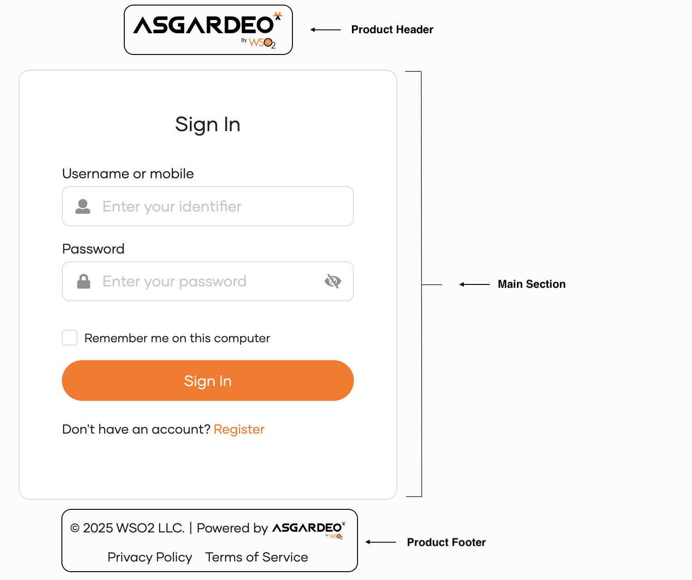

:::note[Premium feature]
Only customers on the enterprise tier can access this feature.
:::

{/*vale off */}

You can use the Console editor to customize the branding and layout of user interfaces, such as login, registration and recovery pages. This eliminates the need to contact WSO2 Identity Platform support for these changes. The following sections explain how to enable and use the Console editor.

{/*vale off */}
## Use the Console editor
{/*vale on */}

Before using the Console editor, you need to enable branding. To do so,

1. On the {edition.productName} Console, navigate to **Branding** > **Styles & Text**.

2. Click **Save & Publish** to enable branding.

{/*vale off */}
Once branding is enabled, follow these steps to customize a layout:
{/*vale on */}

1. On the same **Branding > Styles & Text** page, go to the top-right corner and select either:

    - **Organization** to apply changes globally across all applications.
    - **Application** to select a specific app for app-level customizations.

2. Switch to the **Design** tab and under **Login Layouts**, select the  **Custom** layout card.

3. In the **Preview** section, use the dropdown to choose the screen you want to customize.

4. Click the **Create** button to load the HTML, CSS, and JavaScript editor.

5. Start customizing the layout and once you finish, click **Save & Publish** to apply the changes.

Continue reading the guide to learn more about,

- [Syntax for custom layouts](#syntax-for-custom-layouts)
- [Best practices for creating custom layouts](#best-practices-for-creating-custom-layouts)

## Syntax for custom layouts

This section describes the special syntax you can use to define custom layouts.

### Component syntax

All pages in {edition.productName} share a common structure consisting of three primary layout components as shown below.



When creating a custom layout, you can reference these components using specific syntax. At runtime, {edition.productName} replaces these syntax elements with the appropriate content.

```markup
<div class="page-wrapper layout-file">
    <main class="center-segment">
        <div class="ui container medium center aligned middle">
            {{{ProductHeader}}}
            {{{MainSection}}}
        </div>
        {{{ProductFooter}}}
    </main>
</div>
```

:::note
To successfully publish a layout, make sure to include the `{{{MainSection}}}` component in the HTML code. The `{{{ProductHeader}}}` and `{{{ProductFooter}}}` components are optional.
:::

### Data syntax

When customizing layouts using the layout editor, you can use `data-*` attributes automatically injected into the `<body>` tag of each page. These attributes allow you to apply conditional logic based on the page's context.

#### Available `data-*` attributes {#available-data-attributes}

The following attributes are available for use in your custom layouts:

| Attribute                        | Description                                                                 | Example Value               |
|----------------------------------|-----------------------------------------------------------------------------|-----------------------------|
| `data-page`                      | Specifies the name of the current page.                                     | `sign-in`, `logout`         |
| `data-response-type`              | Indicates whether the page displays an error or success message.            | `error`, `success`          |
| `data-dynamic-prompt-template-id`| Available only for dynamic prompt pages generated by adaptive scripts.       | `genericForm`              |

<details>
<summary>Common `data-page` values</summary>

The following table shows common `data-page` values for conditional rendering. You can find all available attributes by inspecting the `<body>` tag of the rendered page.

| Page                            | `data-page` Value                      |
|---------------------------------|----------------------------------------|
| Login                           | `sign-in`                              |
| Logout                          | `logout`                               |
| Error Pages                     | `error`, `totp-error`, `oauth2-error`, `duo-error`, etc. |
| Self-Registration               | `self-registration`, `self-registration-complete`,  `self-registration-username-request` |
| Password Recovery               | `password-recovery`, `password-reset`, `password-reset-success` |
| Username Recovery               | `username-recovery`, `username-recovery-complete` |
| TOTP                            | `totp`, `totp-error`                   |
| SMS OTP                         | `sms-otp`, `sms-otp-error`             |
| Email OTP                       | `email-otp`, `email-otp-error`         |
| Push Authentication             | `push-auth`, `push-auth-error`         |
| Device Success Pages            | `device-success`                       |
| Policies                        | `privacy-policy`, `cookie-policy`      |
| Account Linking / Invite Flow   | `accept-invitation`                    |
| Other                           | `retry`, `consent`, `domain`, `oauth2-consent`, etc. |

</details>

#### Accessing `data-*` attributes {#accessing-data-attributes}

You can access these attributes in both CSS and JavaScript to dynamically customize behavior and appearance.

- **Using CSS**

    ```css
    body[data-page="sign-in"][data-response-type="error"] .message {
        color: red;
        font-weight: bold;
    }
    ```

- **Using JavaScript**

    ```javascript
    if (document.body.dataset.page === "sign-in") {
        // Perform sign-in page-specific logic
    }
    ```

## Best practices for creating custom layouts

Follow these best practices to create effective, maintainable, and compatible custom layouts:

### When managing resources

When referencing assets such as images, fonts, or icons, always use publicly accessible hosted resources. This ensures reliability and prevents performance issues.

- **Correct Example**:

    ```markup
    
    ```

- **Incorrect Example**:

    ```markup
    <svg xmlns="http://www.w3.org/2000/svg" width="100" height="100" viewBox="0 0 100 100">
        <circle cx="50" cy="50" r="40" stroke="black" stroke-width="3" fill="blue" />
        <text x="50" y="55" font-size="12" text-anchor="middle" fill="white">Sample</text>
    </svg>
    ```

### When defining class names

To avoid conflicts with existing styles, always add a unique prefix to your custom CSS classes. This helps maintain a clean and organized stylesheet.

- **Example**:

    ```css
    .unique-prefix-button {
        background-color: #007bff;
        color: #fff;
    }
    ```
