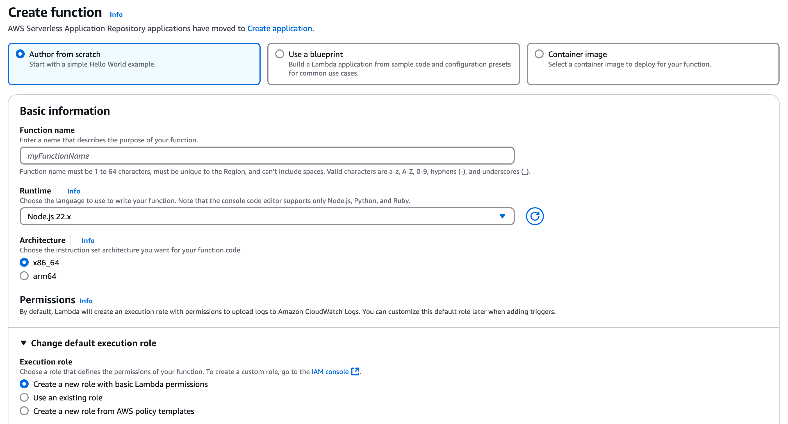
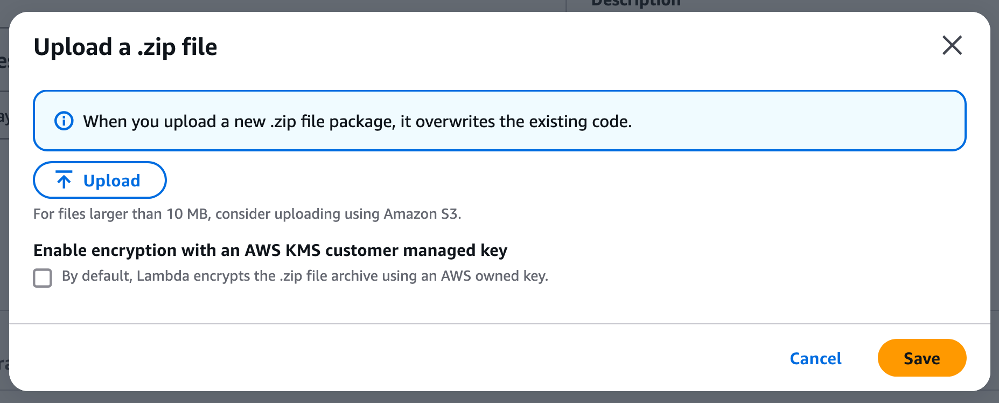
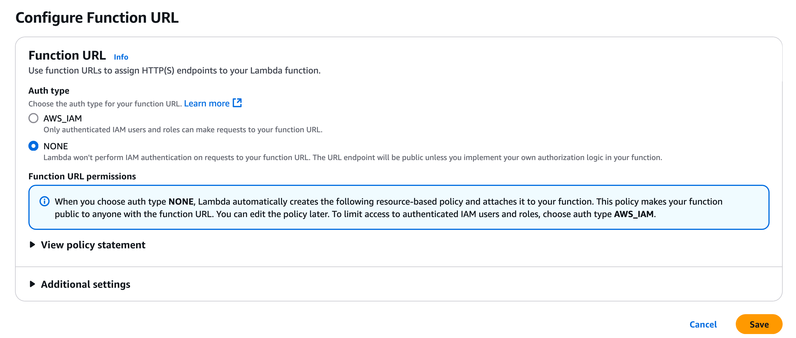
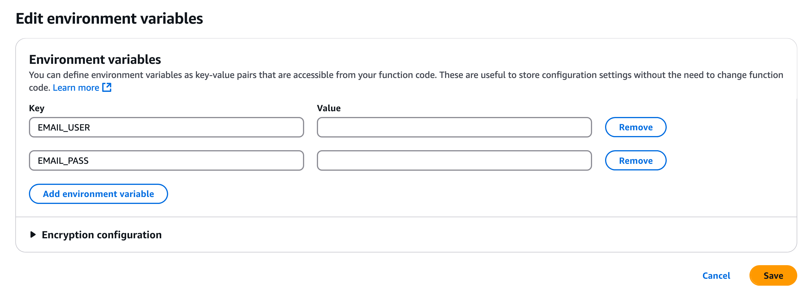
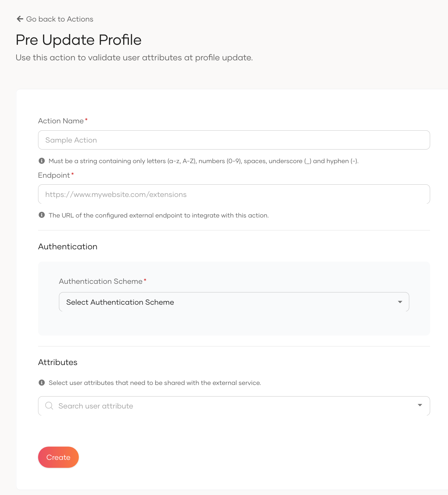
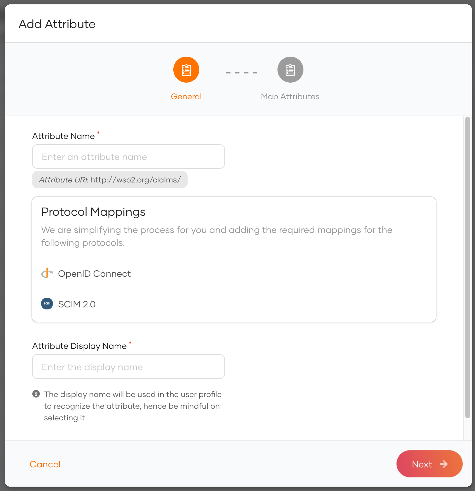
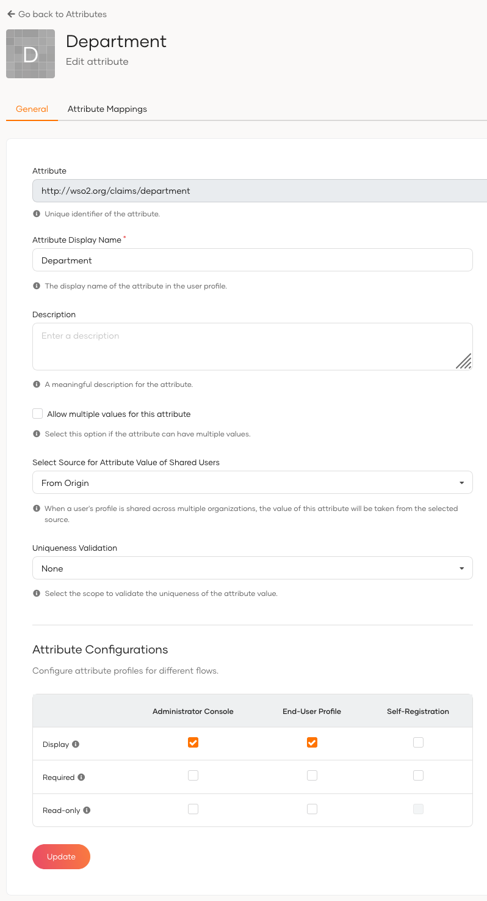

## Using AWS Lambda

This section describes how to implement the same Pre-Update Profile Action scenario discussed above using AWS Lambda
with Node.js. In this approach, the validation logic is implemented in a Lambda function for department validation, and
a notification email is sent to the security team when sensitive user profile data (like email address, phone number, or
department) is being updated.

The Lambda function uses the SMTP service to simulate email sending. Deployment is done using a ZIP package because
external Node.js modules are used.

### Set Up Your Node.js Project

Create a folder to hold your Lambda source code and its dependencies, so it can be packaged as a ZIP file to be uploaded
as a Lambda function.

```bash
mkdir profile-update-validator
cd profile-update-validator
```

Run the following command to generate a `package.json` file which helps manage your project dependencies:

```bash
npm init -y
```

This creates a basic `package.json` with default values. The `-y` flag automatically accepts all default settings, so 
you don't have to manually answer prompts.

Install required dependencies for the use case. The Lambda function requires the following packages:

* nodemailer – Enables the function to send emails.
* dotenv – Enables the function to send emails.Enables the function to send emails.

```bash
npm install nodemailer dotenv
```

In the root directory, create a .env file and add your SMTP credentials. The file is primarily used for local testing,
but these are included separately in the AWS Lambda deployment.

```bash
touch .env
```

Add the following content:

```bash
EMAIL_USER=your-smtp-username
EMAIL_PASS=your-smtp-password
```

### Create the Lambda Source Files for Deployment

Create a new file named `index.js`, which will contain the implementation of the Lambda function.

```bash
touch index.js
```

Define the initial structure in the `index.js` file as shown below; this will lay the groundwork for building the
profile update validation logic.

```javascript
const nodemailer = require('nodemailer');
require("dotenv").config();
```

Add a helper function that looks through the incoming user data (claims) and picks out specific information like
department, email, or phone number based on the provided field name.

```javascript
// Helper to extract claim values
const getClaimValue = (claims, uri) => {
  const claim = claims.find(c => c.uri === uri);
  return claim ? claim.value : null;
};
```

Create a list of departments that are considered valid for your organization. Also, set up an email service (using
Nodemailer) to send notifications when sensitive user profile updates happen. We will use a service like Mailtrap for
development testing.

```javascript
// Mock: valid department list (simulating a directory check)
const validDepartments = ["Engineering", "HR", "Sales", "Finance"];

// Email transporter config using environment variables
const transporter = nodemailer.createTransport({
  host: "sandbox.smtp.mailtrap.io", // The hostname should be smtp.gmail.com if Gmail is used.
  port: 2525, // The port should be 465 smtp.gmail.com if Gmail is used.
  auth: {
    user: process.env.EMAIL_USER,
    pass: process.env.EMAIL_PASS
  }
});
```

Implement the Lambda function that listens for user profile update requests from {edition.productName}.

```javascript
module.exports = async (req, res) => {
    if (req.method !== 'POST') {
        return res.status(405).send('Method Not Allowed');
    }

    // Validate API key from headers
    const apiKey = req.headers['api-key'];
    if (!apiKey || apiKey !== VALID_API_KEY) {
        return res.status(401).json({
            actionStatus: 'FAILED',
            failureReason: 'unauthorized',
            failureDescription: 'Invalid or missing API key.',
        });
    }

    const payload = req.body;

    if (payload.actionType !== "PRE_UPDATE_PROFILE") {
        return res.status(200).json({
            actionStatus: "FAILED",
            failureReason: "invalid_input",
            failureDescription: "Invalid actionType provided."
        });
    }

    const claims = payload?.event?.request?.claims || [];
    const userId = payload?.event?.user?.id || "Unknown User";

    const department = getClaimValue(claims, "http://wso2.org/claims/department");
    const email = getClaimValue(claims, "http://wso2.org/claims/emailaddress");
    const phone = getClaimValue(claims, "http://wso2.org/claims/mobile");

    // Department validation
    if (department && !validDepartments.includes(department)) {
        return res.status(200).json({
            actionStatus: "FAILED",
            failureReason: "invalid_department_input",
            failureDescription: "Provided user department value is invalid."
        });
    }

    // Send security alert email if sensitive attributes are being updated
    const changes = [];
    if (department) changes.push(`Department: ${department}`);
    if (email) changes.push(`Email: ${email}`);
    if (phone) changes.push(`Phone: ${phone}`);

    if (changes.length > 0) {
        try {
            await transporter.sendMail({
                from: '"Security Alert" <security-notifications@wso2.com>',
                to: "security-team@wso2.com", // Replace with actual security email
                subject: "Sensitive Attribute Update Request",
                text: `User ${userId} is attempting to update:\n\n${changes.join("\n")}`
            });
        } catch (error) {
            console.error("Failed to send security email:", error);
            return res.status(200).json({
                actionStatus: "FAILED",
                failureReason: "email_error",
                failureDescription: "Failed to notify security team about sensitive data update."
            });
        }
    }

    return res.status(200).json({ actionStatus: "SUCCESS" });
};
```

The above source code performs the following key tasks to help fulfill the use case defined earlier in this document:

* It validates that the action type is `PRE_UPDATE_PROFILE`.
* It extracts claims from the event payload and checks whether the department is among a predefined list of valid
  values,
  returning an error response if it is not.
* If the email, phone number, or department is being updated, it triggers an email alert to the security team.

The final source code should look similar to the following.

```javascript
const nodemailer = require('nodemailer');
require("dotenv").config();

// Mock: valid department list (simulating a directory check)
const validDepartments = ["Engineering", "HR", "Sales", "Finance"];
const VALID_API_KEY = process.env.API_KEY; // Replace with your actual key

// Email transporter config using environment variables
const transporter = nodemailer.createTransport({
  host: "sandbox.smtp.mailtrap.io",
  port: 2525,
  auth: {
    user: process.env.EMAIL_USER,
    pass: process.env.EMAIL_PASS
  }
});

// Helper to extract claim values
const getClaimValue = (claims, uri) => {
  const claim = claims.find(c => c.uri === uri);
  return claim ? claim.value : null;
};

module.exports = async (req, res) => {
  if (req.method !== 'POST') {
    return res.status(405).send('Method Not Allowed');
  }

  // Validate API key from headers
  const apiKey = req.headers['api-key'];
  if (!apiKey || apiKey !== VALID_API_KEY) {
    return res.status(401).json({
      actionStatus: 'FAILED',
      failureReason: 'unauthorized',
      failureDescription: 'Invalid or missing API key.',
    });
  }

  const payload = req.body;

  if (payload.actionType !== "PRE_UPDATE_PROFILE") {
    return res.status(200).json({
      actionStatus: "FAILED",
      failureReason: "invalid_input",
      failureDescription: "Invalid actionType provided."
    });
  }

  const claims = payload?.event?.request?.claims || [];
  const userId = payload?.event?.user?.id || "Unknown User";

  const department = getClaimValue(claims, "http://wso2.org/claims/department");
  const email = getClaimValue(claims, "http://wso2.org/claims/emailaddress");
  const phone = getClaimValue(claims, "http://wso2.org/claims/mobile");

  // Department validation
  if (department && !validDepartments.includes(department)) {
    return res.status(200).json({
      actionStatus: "FAILED",
      failureReason: "invalid_department_input",
      failureDescription: "Provided user department value is invalid."
    });
  }

  // Send security alert email if sensitive attributes are being updated
  const changes = [];
  if (department) changes.push(`Department: ${department}`);
  if (email) changes.push(`Email: ${email}`);
  if (phone) changes.push(`Phone: ${phone}`);

  if (changes.length > 0) {
    try {
      await transporter.sendMail({
        from: '"Security Alert" <security-notifications@wso2.com>',
        to: "security-team@wso2.com", // Replace with actual security email
        subject: "Sensitive Attribute Update Request",
        text: `User ${userId} is attempting to update:\n\n${changes.join("\n")}`
      });
    } catch (error) {
      console.error("Failed to send security email:", error);
      return res.status(200).json({
        actionStatus: "FAILED",
        failureReason: "email_error",
        failureDescription: "Failed to notify security team about sensitive data update."
      });
    }
  }

  return res.status(200).json({actionStatus: "SUCCESS"});
};
```

### Create the Deployment Package

Since this project includes external libraries, the Lambda function needs to be packaged as a ZIP archive before
uploading:

```bash
zip -r validate-user-profile-update.zip .
```

This command includes all necessary files (`index.js`, `.env`, `node_modules`) required by AWS Lambda.

### Deploy the Function on AWS Lambda

Log in to the AWS Dashboard and navigate to the AWS Lambda Console. Once there, click Create function and choose Author
from scratch.



Then, fill in the following details and create the function:

* Function name: validate-user-profile-update
* Runtime: Node.js 22.x
* Architecture: x86
* Permissions: Choose an existing role or create a new one with basic Lambda permissions.

Once the function is created, go to the Code tab, upload the ZIP file (validate-user-profile-update.zip) that was
created earlier, and click Save to upload the source code.



Next, configure the Function URL:

* Navigate to the Configuration tab, then to the Function URL section.
* Click Create function URL and set the Auth type to None.



The generated function URL will be displayed in the Function overview section of the dashboard. Make sure to note this
URL, as it will be used to expose the function to external services.

Since the source code uses environment variables to manage sensitive information, you must configure the corresponding
environment variables in AWS. To do this:

* Go to the Configuration tab, then Environment variables.
* Add the values for the SMTP username and password, and save the changes.



### Test Deployed Service

To test the deployed service, you will need the function URL. A sample request for a successful scenario is shown below.

```bash
curl --location '<function_url>' \
--header 'Content-Type: application/json' \
--data-raw '{
    "actionType": "PRE_UPDATE_PROFILE",
    "event": {
        "request": {
            "claims": [
                {
                    "uri": "http://wso2.org/claims/department",
                    "value": "HR"
                },
                {
                    "uri": "http://wso2.org/claims/mobile",
                    "value": "+94771223448"
                },
                {
                    "uri": "http://wso2.org/claims/emailaddress",
                    "value": "testuser@wso2.com"
                }
            ]
        },
        "tenant": {
            "id": "2210",
            "name": "testwso2"
        },
        "user": {
            "id": "57b22cbf-4688-476c-a607-c0c9d089d25d",
            "claims": [
                {
                    "uri": "http://wso2.org/claims/username",
                    "value": "testuser@wso2.com"
                },
                {
                    "uri": "http://wso2.org/claims/identity/userSource",
                    "value": "DEFAULT"
                },
                {
                    "uri": "http://wso2.org/claims/identity/idpType",
                    "value": "Local"
                }
            ]
        },
        "userStore": {
            "id": "REVGQVVMVA==",
            "name": "DEFAULT"
        },
        "initiatorType": "ADMIN",
        "action": "UPDATE"
    }
}'
```

### Configure {edition.productName} for Pre-Update Profile Action Workflow

First, sign in to your {edition.productName} account using your admin credentials, click on "Actions" and then select the
action type Pre Update Profile.

Add an action name, the endpoint extracted from the deployment, and the appropriate authentication mechanism. For AWS
Lambda, use the generated function URL directly, and set the authentication mechanism to None, as no authentication is
required.



Once the action is configured, ensure that the action is marked as active. Additionally, navigate to the **User
Management > Users** section and add a user with a predefined password for testing purposes.


Since "department" is a custom attribute, you will also need to add an attribute for it. You can navigate to **User
Attributes & Stores > Attributes > Manage Attributes > Attributes > New Attribute**, and then add an attribute named
department.



Once it is added, mark it to be displayed in both the Administrator Console and End User Profile.



### Validate Pre-Update Profile Action Workflow

To test the scenario, update the user's profile with sensitive claim values such as department, email, and phone number.
You can perform this update either through the Console (administrator update) or the My Account application (
self-update) to verify that the department validation is working and that an email is sent via the SMTP server.
Additionally, test with invalid department values to ensure the implementation handles errors as expected.

#### Console (administrator update)

Log in to the Console application using the administrator account, navigate to **User Management > Users**, select a
specific user, and update the profile with sensitive attributes such as department, email address, and phone number.

#### My Account (self-update)

Log in to the My Account application using a specific user, navigate to **Personal Info > Change Password**, and update
the profile with sensitive attributes such as department, email address, and phone number.
