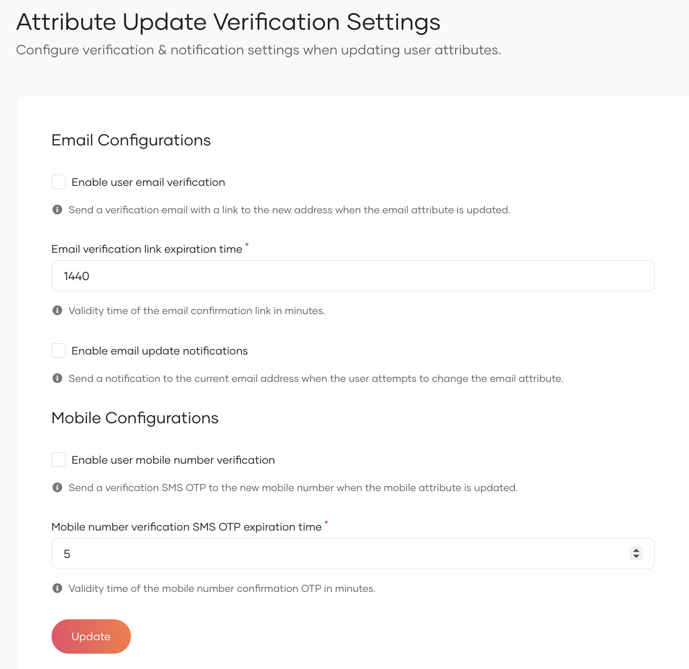

This guide explains how to configure notification and verification settings when a user changes specific attributes like their email address or mobile number. These settings ensure users are properly notified when attributes are updated or are requested to verify critical attribute updates.

Follow the steps below to configure attribute change verification settings:

1. On the {edition.productName} Console, go to **User Attributes & Stores** > **Attributes**.

<Variants>

<Edition only="cloud">

2. Under **Manage Attributes**, click on  **Attribute Update Verification Settings** .

</Edition>

<Edition only="self-hosted">

2. Under **Manage Attributes**, click on  **Attribute Update Settings** .

</Edition>

</Variants>

3. Configure the following properties:

    <Variants><Edition only="cloud"></Edition><Edition only="self-hosted"></Edition></Variants>

    <Variants>

    <Edition only="self-hosted">

    <table>
      <tbody>
        <tr>
          <td>Enable User Email Verification on Update</td>
          <td>When enabled, triggers an email verification process whenever a user updates their email address.</td>
        </tr>
        <tr>
          <td>Email verification on update link expiry time</td>
          <td>Defines the validity period (in minutes) of the email verification link. Default is set to 1440 minutes.</td>
        </tr>
        <tr>
          <td>Enable user email notification on update</td>
          <td>When enabled, triggers a notification email to the existing email address whenever the user attempts to update their email address.</td>
        </tr>
        <tr>
          <td>Enable user mobile number verification on update</td>
          <td>When enabled, triggers an SMS One-Time Password (OTP) verification process when the user updates their mobile number.</td>
        </tr>
        <tr>
          <td>Enable mobile number verification by Privileged Users</td>
          <td>When enabled, allows privileged users (such as administrators) to initiate mobile number verification on behalf of other users.</td>
        </tr>
      </tbody>
    </table>

    </Edition>

    <Edition only="cloud">

    <table>
      <tbody>
        <tr>
          <td>Enable User Email Verification on Update</td>
          <td>When enabled, triggers an email verification process whenever a user updates their email address.</td>
        </tr>
        <tr>
          <td>Email verification on update link expiry time</td>
          <td>Defines the validity period (in minutes) of the email verification link. Default is set to 1440 minutes.</td>
        </tr>
        <tr>
          <td>Enable user email notification on update</td>
          <td>When enabled, triggers a notification email to the existing email address whenever the user attempts to update their email address.</td>
        </tr>
        <tr>
          <td>Enable user mobile number verification on update</td>
          <td>When enabled, triggers an SMS One-Time Password (OTP) verification process when the user updates their mobile number.</td>
        </tr>
      </tbody>
    </table>

    </Edition>

    </Variants>

4. Click **Update** to save the changes.
