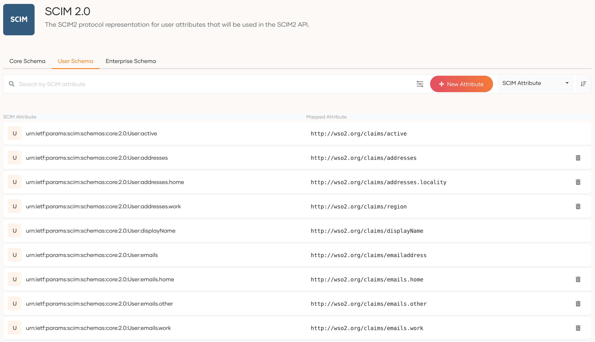

When a user or a group is created with SCIM 2.0, there are set of mandatory attributes that need to be saved along with the user or group. Some of these values are as follows.

-   urn:ietf:params:scim:schemas:core:2.0:meta.location 
-   urn:ietf:params:scim:schemas:core:2.0:meta.resourceType 
-   urn:ietf:params:scim:schemas:core:2.0:meta.version 
-   urn:ietf:params:scim:schemas:core:2.0:meta.created 
-   urn:ietf:params:scim:schemas:core:2.0:id 
-   urn:ietf:params:scim:schemas:core:2.0:meta.lastModified 
-   urn:ietf:params:scim:schemas:core:2.0:User:userName

Unless your user store is a JDBC user store, you need to map how these values are stored in your user store. This mapping can be done using the attribute mapping setup in WSO2 Identity Server. You can find Active directory specific attribute configurations when you [configure Active Directory user stores for SCIM 2.0](./configure-active-directory-user-stores-for-scim2.mdx).

Now let's assume you have an AD userstore as the primary userstore and you have done the attribute mappings for the SCIM attributes. 

Now suppose you need to add a secondary userstore, OpenLDAP. In this scenario, attribute mappings done for AD may not be the same for OpenLDAP attributes. Therefore, it should be possible to map the attributes to the secondary userstore as well. Follow the instructions given below to do this.

---

## Configure attribute mappings to use SCIM 2.0 for inbound provisioning

1.  Log in to the WSO2 Identity Server and access the WSO2 Identity Server Console (`https://<IS_HOST>:<PORT>/console`).

2.  Navigate to **User Attributes & Stores** >  **Attributes**. For more information on managing attributes, see [Manage attributes and mappings](../attributes/index.mdx). Click on **SCIM 2.0** under **Manage Attribute Mappings**.  Navigate to either **Core Schema** or **User Schema** tabs (depending on which SCIM attribute you need to update) and find the mapped local attribute of the SCIM attribute that you need to edit. 

    

3.  Once you find the Mapped Local Attribute, go back and click on **Attributes**. Then select that attribute.
4.  Navigate to **Mapped Attribute** tab. Modify the attributes and click **Update**.

    :::note
    Here we need to add attribute mappings for both primary and secondary user stores.
    
    :::

:::info[Related topics]
-    You can see the sample cURL commands for SCIM 2.0 user operations [here](../../../reference/apis/scim2-users-rest-apis/index.mdx) and SCIM 2.0 group operations [here](../../../reference/apis/scim2-groups-rest-apis/index.mdx). 
:::
