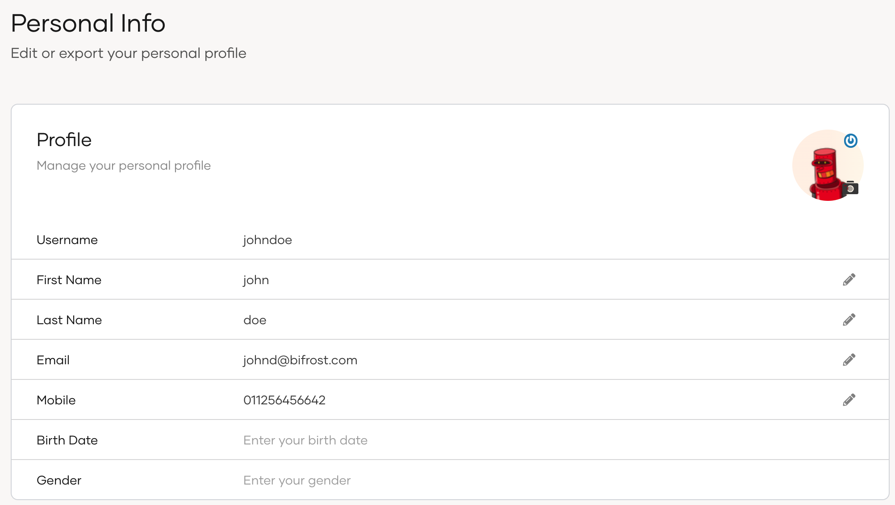

If you are an owner or an administrator in an {edition.productName} organization, go to the [My Account portal](#access-my-account-portal) to manage your information from anywhere.

You can perform the following activities on this portal:
- Update profile information
- Change password
- View linked social accounts
- View and revoke active sessions

## Access My Account portal

You can access the My Account portal using the following URL:

[https://myaccount.asgardeo.io](https://myaccount.asgardeo.io)

You can also switch to My Account from the {edition.productName}. Click your profile icon as shown below and select **My Account**.


You are now automatically signed in to the portal.

## Update profile information

The user details displayed in your profile corresponds to the default attributes that are enabled for the organization.

To update your profile information via My Account:

1. Sign in to the My Account portal.
2. Click **Personal Info** to see the profile information.

   

3. If required, update the editable information.

## Change password

{/* markdownlint-disable-next-line */}

Users can use the My Account portal to change the password by following the steps below.

1. Sign in to the My Account portal.

2. Click **Security** and go to **Change Password**.

3. Click **Change your password**.

      

4. Enter the **Current password** and the **New password**.

5. Click **Submit**.

:::note
- Alternatively, users can [reset a forgotten password from the login page of an application](../user-self-service/self-service-portal/user-password-recovery.mdx). <br /><br />
- Users onboarded from a read-only remote user store do not have the capability of changing their password through the My Account portal.
:::

## Manage linked social accounts

{/* markdownlint-disable-next-line */}

Users can use the My Account portal to change the password by following the steps below.

Given below are the steps to follow.

1. Sign in to the My Account portal.

2. Click **Personal Info** > **External Logins**.

3. To remove any of the linked accounts, click **Remove**.

    

## Export profile information

{/* markdownlint-disable-next-line */}
Users can export profile information via the My Account portal as a `JSON` file by following the steps below.

1. Sign in to the My Account portal.

2. Click **Personal Info** and go to **Export Profile**.

3. Click **Download the profile** to export the user profile information.

    

    <details>
    <summary>Sample JSON file</summary>

    This is a sample of the exported `json` file with an admin user's profile information.

    ```json
    {
        "user_profile": {
            "accountState": "UNLOCKED",
            "emailVerified": "true",
            "country": "SriLanka",
            "givenname": "firstname",
            "created": "2021-04-07T15:07:58.001440Z",
            "modified": "2023-04-25T04:31:05.838894Z",
            "emailaddress": "tom@wso2.com",
            "userid": "36d2dd61-6e58-4b54-bfbe-f8621236c88b",
            "username": "tom@wso2.com",
            "lastname": "Jerry"
        },
        "linked_accounts": [
            {
                "connection": "Google",
                "connectionId": "xxxx",
                "linkedAccountId": "xxxx",
                "isExternalConnection": true
            }
        ]
    }
    ```

    </details>

## Manage login sessions

{/* markdownlint-disable-next-line */}

Users can manage their own sessions via My Account by following the steps below:

1. Sign in to the My Account portal.

2. Go to **Security** and go to **Active Sessions**. This section lists all the active login sessions of the user.

3. Click **Show more** on an individual session to get more details on it.

    

4. To terminate sessions, users can do one of the following:

    - Click **Terminate** on a selected session to terminate only that session.

    - Click **Terminate all** on the upper-right corner to terminate all active sessions.

## Enroll TOTP for {edition.productName} users

If you, as an administrator or an organization owner, want to register an authenticator app for generating OTP values, you can configure it via the My Account portal.

### Initial setup

Follow the steps given below to set up an authenticator app using My Account.

1. In your My Account portal, go to **Security > Additional Authentication**.

    

2. Click the **+** icon and scan the prompted QR code using an authenticator application.

    

3. Enter the TOTP code obtained after scanning the QR code and click **Verify**.

    

### Regenerate the QR code

If you deleted the scanned QR from the authenticator app, follow the steps below to reconfigure it.

1. In your My Account portal, go to **Security > Additional Authentication**.

2. Click the eye icon (view) next to the authenticator app.

    

3. Click **Regenerate** to generate a new QR code.

    

3. Enter the TOTP code obtained after scanning the QR code and click **Verify**.

    

## Configure backup codes

When you have enabled at least one additional authentication method in the **Additional Authentication** section, authentication using backup codes will be available as a recovery option for MFA. Users can use these backup codes to log in when they cannot obtain the required MFA codes.

### Enable backup codes

:::note[Before you begin]
You need to configure at least one additional authenticator from the My Account portal. See more information on [configuring the authenticator app](#initial-setup).
:::

To enable backup codes:

1. On the My Account portal, go to **Security** > **Additional Authentication** > **Recovery Options**.
2. Click `+` to add backup codes.
    You will see a popup window with ten backup codes. Each backup code can be used only once.

    

3. Click **Download Codes** or **Copy Codes** and save the copied or downloaded backup codes securely, as the codes will only be shown once.
4. After saving the backup codes, click **Close**.

:::note
The backup code configurations will not be applied to your active sessions by default, therefore it is recommended to terminate your active sessions.
:::

### Regenerate backup codes

In case you have lost these backup codes or have used them all, follow the steps below to generate a new set of backup codes.

1. On the My Account portal, go to **Security** > **Additional Authentication** > **Recovery Options**.
2. Click on the refresh icon to regenerate the backup codes.

    

3. On the confirmation window, click **Regenerate** to confirm your action.
    You will see a popup window with ten backup codes. Each backup code can be used only once.

    

4. Click **Download Codes** or **Copy Codes** and save the copied or downloaded backup codes securely, as the codes will only be shown once.
5. After saving the backup codes, click **Close**.

:::note
The backup code configurations will not be applied to your active sessions by default, therefore it is recommended to terminate your active sessions.
:::

### Remove backup codes
To remove the backup codes:

1. On the My Account portal, go to **Security** > **Additional Authentication** > **Recovery Options**.
2. Click on the trash icon to remove the existing backup codes.

    

3. On the confirmation window, click **Remove** to confirm your action.

:::note
The backup code configurations will not be applied to your active sessions by default, therefore it is recommended to terminate your active sessions.
:::
