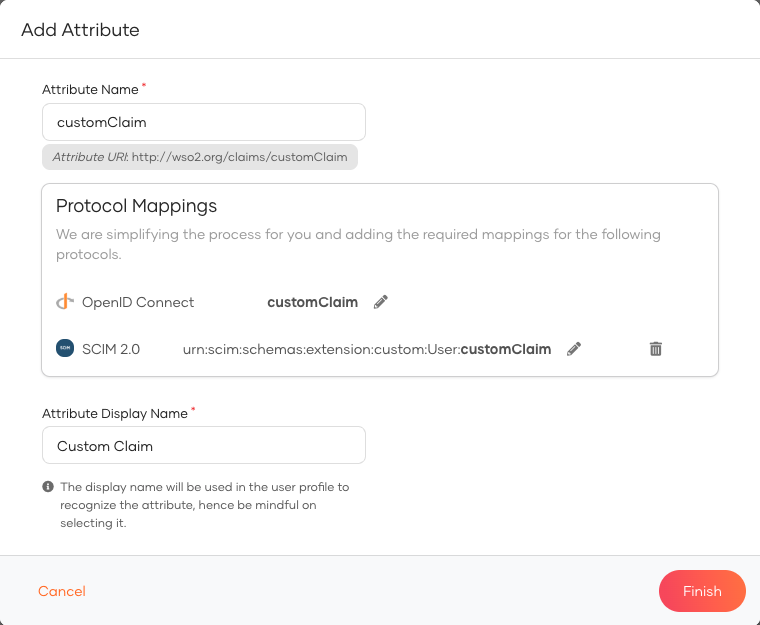
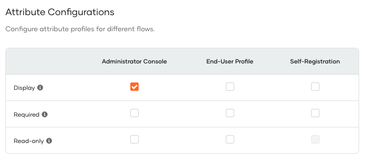
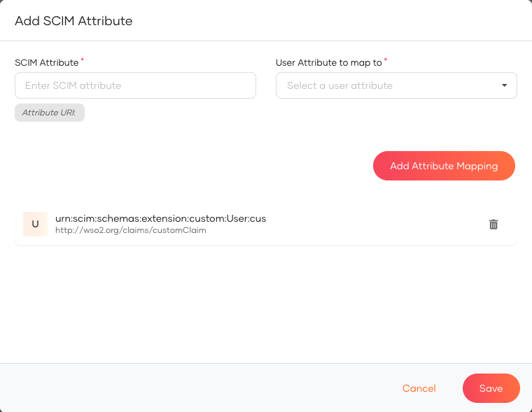
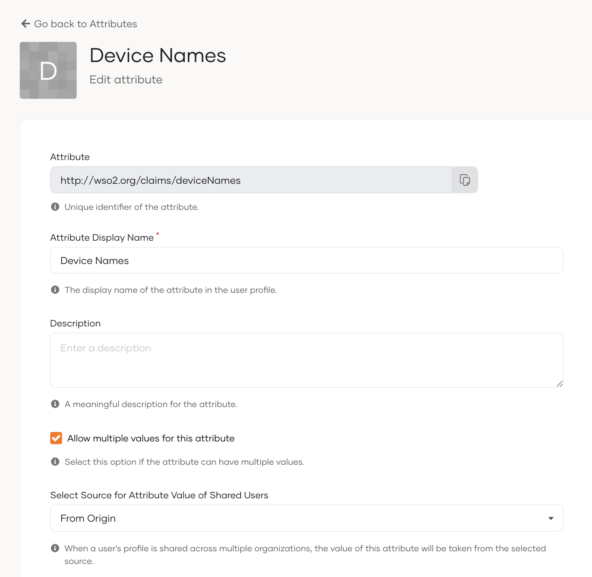
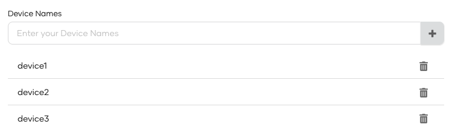
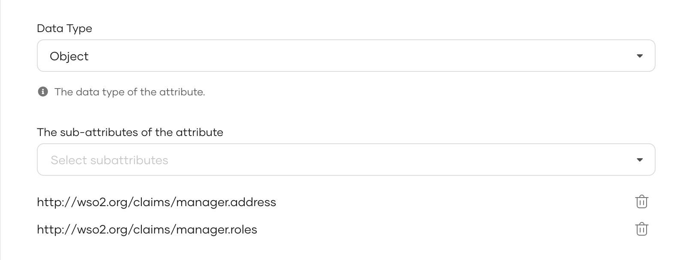
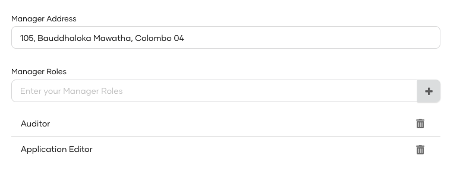

{edition.productName} allows adding custom attributes into user objects through Custom schema.

## How to add claims to support simple attributes

To add claims for simple attributes, follow these steps:

### Add custom local claim

1. Navigate to **User Attributes & Stores** > **Attributes** in console.
2. Click **Attributes** under **Manage Attributes**.
3. Click **New Attribute** and enter the following values.
    - **Attribute Name**: `http://wso2.org/claims/customClaim`
    - **Attribute Display Name**: `Custom Claim`

    

4. Go to the **Edit Attribute** of the custom attribute you just created.
5. Select necessary options in **Attribute Configurations** to make the field visible in user profiles and click **Update**.
   

### Map the custom claim

:::note
SCIM 2.0 protocol mapping in Custom schema, will be created automatically with the Custom local claim creation as mentioned in the **Protocol Mapping** section in the wizard.
:::

If it is not added, you can add it manually by,

1. Navigate to **User Attributes & Stores** > **Attributes** in console.
2. Click **SCIM 2.0** under **Manage Attribute Mappings**.
3. Click **New Attribute** in **Custom Schema** tab and enter the following values.
    - **SCIM Attribute**: `customClaim`
    - **User Attribute to map to**: Select local claim from the dropdown
4. Click **Add Attribute Mapping** and click **Finish**.
    

### Try it out

1. Create a user from **User Management** > **Users** in console.
2. Go to the **User Profile** of the user you just created.
3. Add a value for the **Custom Claim** field and click **Update**.

## How to add claims to support multi-valued simple attributes

Let's see when we've a **deviceNames** simple multi-valued attribute.

### Add local claim for deviceNames

1. Navigate to **User Attributes & Stores** > **Attributes** in console.
2. Click **Attributes** under **Manage Attributes**.
3. Click **New Attribute** and enter the following values.
    - **Attribute Name**: `http://wso2.org/claims/deviceNames`
    - **Attribute Display Name**: `Device Names`
4. Click Finish.
5. Go to the **Edit Attribute** of the custom attribute you just created.
6. Select necessary options in **Attribute Configurations** to make the field visible in user profiles and click **Update**.

7. Check the **Allow multiple values for this attribute**.

    

### Map the custom claim {#map-the-custom-claim_1}

:::note
SCIM 2.0 protocol mapping in Custom schema, will be created automatically with the Custom local claim creation as mentioned in the **Protocol Mapping** section in the wizard.
:::

If it is not added, refer [Map the custom claim](#map-the-custom-claim) to add it manually.

### Try it out {#try-it-out_1}

1. Create a user from **User Management** > **Users** in console.
2. Go to the **User Profile** of the user you just created.
3. Add values for the **Device Names** field and click **Update**.
   

## How to add claims to support Complex attributes

Let's see if we have a **manager** complex attribute that has **address** simple attribute and **roles** multi-valued attribute as the sub attributes.

### Create claim mappings for Manager-Address claim

1. Navigate to **User Attributes & Stores** > **Attributes** in console.
2. Click **Attributes** under **Manage Attributes**.
3. Click **New Attribute** and enter the following values.
    - **Attribute Name**: `http://wso2.org/claims/manager.address`
    - **Attribute Display Name**: `Manager Address`
4. Go to the **Edit Attribute** of the custom attribute you just created.
5. Select necessary options in **Attribute Configurations** to make the field visible in user profiles and click **Update**.

:::note
SCIM 2.0 protocol mapping in Custom schema, will be created automatically with the Custom local claim creation as mentioned in the **Protocol Mapping** section in the wizard.
:::

### Create claim mappings for Manager-Roles claim

1. Navigate to **User Attributes & Stores** > **Attributes** in console.
2. Click **Attributes** under **Manage Attributes**.
3. Click **New Attribute** and enter the following values.
    - **Attribute Name**: `http://wso2.org/claims/manager.roles`
    - **Attribute Display Name**: `Manager Roles`
4. Click Finish.
5. Go to the **Edit Attribute** of the custom attribute you just created.
6. Select necessary options in **Attribute Configurations** to make the field visible in user profiles and click **Update**.

7. Check the **Allow multiple values for this attribute**.

:::note
SCIM 2.0 protocol mapping in Custom schema, will be created automatically with the Custom local claim creation as mentioned in the **Protocol Mapping** section in the wizard.
:::

### Create claim mappings for the Manager claim

1. Navigate to **User Attributes & Stores** > **Attributes** in console.
2. Click **Attributes** under **Manage Attributes**.
3. Click **New Attribute** and enter the following values.
    - **Attribute Name**: `http://wso2.org/claims/manager`
    - **Attribute Display Name**: `Manager`
4. Click Finish.
5. Go to the **Edit Attribute** of the custom attribute you just created.

6. Select the **Object** data type as the attribute data type.
7. Add the `http://wso2.org/claims/manager.address` and `http://wso2.org/claims/manager.roles` as sub-attributes.

    

### Try it out {#try-it-out_2}

1. Create a user from **User Management** > **Users** in console.
2. Go to the **User Profile** of the user you just created.
3. Add values for the **Manager Address** field, **Manager Roles** field and click **Update**.
   
